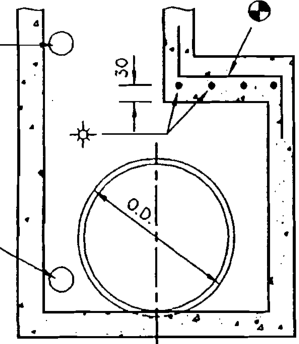

### 1 /1 Ir~ )' ~r>: t::; ::::J--!­

### I

### L 750

01,::0:;

#### DRAIN OUTLET WHERE REQUIRED. 450 !

### I

### . .I

### il-----::-::!,-_.&.-

### SECTION A-A

### FOR PIPE DIAMETER UP TO 750mm

#### FLOW

#### I t'- .

### '1..._,,,..._)

#### NOTES:

### A-­

### / "

### PLAN WITH

### COVER AND GRILLE REMOVED

#### PITS DEEPER THAN I~O ARE

#### TO BE REINFORCED A.,<;' Pe«­ £1> 35".

### o

### I I e I

### GALVANISED STEP IRONS .""s "f"e:"Yl-. <;.b~,. .

### I.

### .. I

#### PLAN OF PIT COVER

### ~~'hA-~h ~\')LL'1 Pcr ~o~ ""''1~t ~F \(~

### DRAWING No. :s.b~~ <;.~ 1Cl~ 3

A 120 4\OY REINFORCEMENT BARS AT 100 CENTRES

#### 1" (WHEN HAUNCHED IN 2 DIRECTIONS.)

### *

PIPE DIAMETER RANGE

1200 825mm TO 900mm INCL 0·250 fOR PIPES > 900mm NO·IIN-1)x250\.250 FOR MUL T1PLE PIPES

L-. F1218 MESH

IWHERE N=NUH6ER OF lINESI

PAVEMENT o

-.:7 RETURNED MINIMUM .300

4/140 COUN TERSUNK HOLE S

w

n:5 ::::;;

6 HOLES 85x50 EQUALLY SPACED

o :::l

w ::::;;

GRIND ALL EDGES

### ~ I. 900 .1 15°1. 550 ·1

#### n: Z

### I

MAXIMUM

> [Picture on page 38: a picture, saved as a picture (images/part-03-drawings-page-38-24.gif, 150 dpi).]
> Words printed on the picture (title and legend, copied from the PDF):
> .,

~

~ o

o

'I'

w

#### I H

### CJ CJ CJ CJ CJ

J: 0

I- I")

a.. ~

1000 HOLE FOR SUBSURFACE DRAIN CLEANOUT WHERE

o

REQUIRED. TO BE CAPPED.

o

#### ~O

### I.

### • ~I !-i-O

750

o

N

1250

### .

### .

o

### MILD STEEL GRILLE

o
