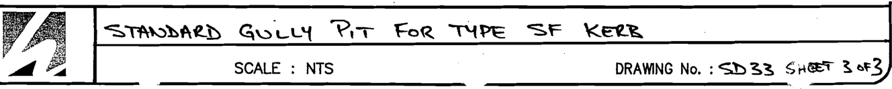
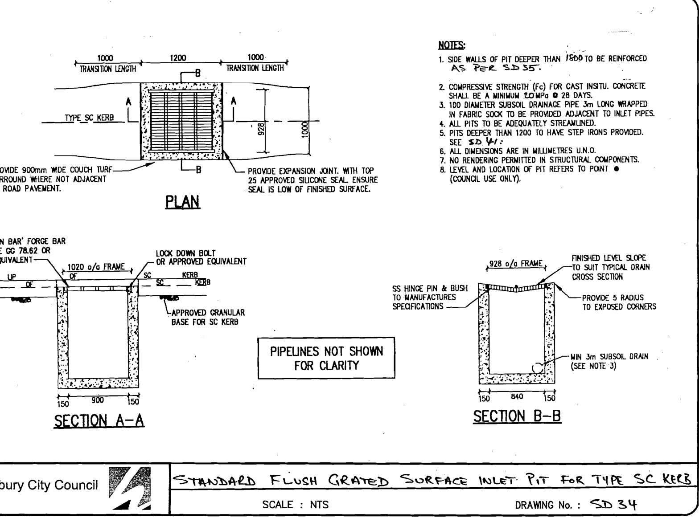
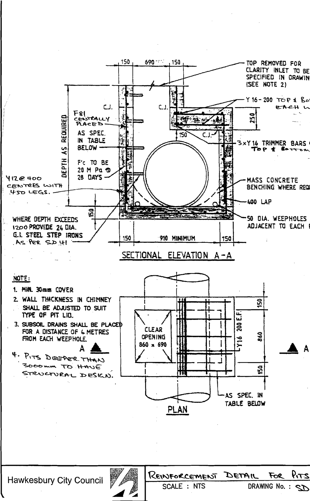

#### 25 BEVEL -I r

### ~

o

100e HOLE FOR SUBSURFACE DRAIN OUTLET WHERE

### GRILLE SECTION ~

REOUIRED.

### L

### TAP 12 WHITWORTH[l-l':; '50.50'

### 1f

### ,. 45 I

### ~

'<t

### I. laDf~T i

### l~~~LO

I

### ~~ i :I ~

#### f---i0

### *

### ~I

### ~~RTH THREAD

### SECTION A-A

### BEARING PLATE

### COUNTERSUNK SCREWS

### FOR PIPE DIAMETER OVER 750mm

2 REQUIRED

4 REQUIRED

### AND MULTIPLE PIPES

#### NOTE: ALL MILD STEEL MATERIAL TO BE GALVANism ON COMPLETION

> [Picture on page 38: a picture, saved as a picture (images/part-03-drawings-page-38-81.gif, 150 dpi).]

### '"S.11\\..:)'hf\-e..h ~~ LL'1 ~,T 'Fo« \"t"'= CSoF 'Krt"t..

### DRAWING No. : <;b s~ 5~~ ~ t:>f3

#### "-­

> [Picture on page 39: a map, saved as a picture (images/part-03-drawings-page-39-1.gif, 150 dpi); the street names and other small labels are on the picture.]
> Words printed on the picture (title and legend, copied from the PDF):
> • 1000 ... 1200 ... 1000 •
> 1\. SIDE WALLS OF PIT DEEPER lHAN'~~ TO BE REINFORCED
> ft TRANSITIG'I lEHCnl'
> 2\.  (''OMPRESSI~ STRENGTH (Fe) FOR CAST INSITU. CONCRETE
> SHAlL BE A MINIMUM teMPo a 26 DAYS.
> 3\.  100 DIMlEl£R SUBSCXL DRAINAGE PIPE .3m LOOG ~APPED
> IN FABRIC 500< TO BE PROVlDED ADJAC£NT TO INLET PIPES.
> 4\.  ALL PITS TO BE ADEQUATELY STROOIUNED.
> 5\.  PHS DEEPER THAN 1200 TO HA'w'E STEP IRONS PROVlDED•
> 6\.  All. DIMENSIONS ARE IN MIWMrnES U.N.O.
> 7\. NO RENDERING PERM/nED IN STRUCTURAL ca.lPONENTS.
> 8\.  LI~L AND LOCATION OF PIT REI1RS TO paNT •
> (COUNCIL USE ONLY).
> PROVlDE 9DCrnm Yl\
> SURROUND Y1HERE NOT ADJACENT
> TO ROAD PA'w£WENT.
> PROVlDE EXPANSION JOINT. Vt1lt1 T~
> 25 APPRO~O SIUCOOE SEAL ENSURE
> . SEAl IS LOW OF FINISHED SURFACE.
> FlNI~ED LE..u ~(X>[
> TO  SUIT MeAL DRAIN
> SS HINGE PIN & BUSH
> PROVlDE 5 RADIUS
> TO EXPOSED COONERS
> BASE FOR SC KERB
> WIN 3m SUBSCXL DRAIN
> (SEE NOTE· 3)
> 1 1" ....
> 150 ...... 50
> 150 900 50

### -

#### ~

#### HOlES:

### . ~

#### , 1RAHSlTI~ lIHGlH

#### A..~ :Pe-~ 'S,,l:) 3S-. .

### ..'" ,•. :.~::

#### .- ... :~

,

#### A

#### A

#### -;.

### ..1 I

### ---I!PE2C KERB L ;.

### .

#### '..

#### ...

### .:

#### ....: ••;... 0. i" ." o· : 4: •.~., \.

### --

#### SEE S1)""','

### fJ.Ali

WEl..Dl.OK '1WN BAR' FCRGE BAR

#### GRATING rtPE GC 78.62 ~

APPRO~D EQUIVALENT­

#### HR l' ur rtr i 'c: ur

### n ..n. ~

### ...

#### ~ .

### I..­.;;"..

I.!" .,.,

#### PIPEUNES NOT SHOWN

#### FOR CLARITY

### .

### ...

.,

### .

#### ·~i.·J;~I."~--Z;~:-.."':..-.•:·:;.;;:::-·z

#### ~~ au\ ~ t

### SECTION B-B

#### • +

#### t5<t

### .sEC.IlQtLA=A

### S~":hA-€.h 'F'-\J~" G~A"le» <s.oft~Ac.~ '~L~'· t" ;:CfC:.. ''t~ ~c.. \{lU

### ORAWING No.: "S.:D ~ 't

> [Picture on page 40: a map, saved as a picture (images/part-03-drawings-page-40-1.gif, 150 dpi); the street names and other small labels are on the picture.]
> Words printed on the picture (title and legend, copied from the PDF):
> " ~. ",..:
> e::-A--e·H lAJ A.'1.
> 0: 'PLA-<:.E"h - .........;:0"
> BENCHING  WHERE RmU·IREO
> 3\. SUBSOIL. DRAINS SHAlL BE PLACE~

#### 150 6-90 -,"" 150

### TOP REfI10V£O FO R

#### (WHY INLET 10 BE AS

#### SPECIFIED IN ORAWINGS.

#### (SEE HOTE 2)

### Y 16- 200  TO" a ~o~~

#### U.

#### Q. Fg-I

#### ~ AS SPEC.

#### ~ IN iABU:

### "-oo-+":f~3xY 10 TRH'1HE.q BARS @ ·~s c(G.

#### <.It BiLOW --r.tI~::::t

### . Tep 't ... ~_

#### <.

....

### "'t 1"2.. <2 Q-oo

#### KASS CONCRETE

### ; ~'"'n2.E5. ~ IT1\­

l .4-:s-o U;;~~. .J------.....bL,.....

#### 4CO LAP

#### WHERf DEPTH EXCEEDS

### so OlA. WEE?HOLES

#### ''200 PROViDE 24 [l1A.

#### 150 .910 MlNtHUM 150

#### ADJACENT TO EACH PtPE

### GJ. S,riEl STEP IImHS

#### . ~'S. . YEfl.. S,.b.':tl "_-J

### SECTIONAL ELEVATlO N A- A

### l!Qlli
