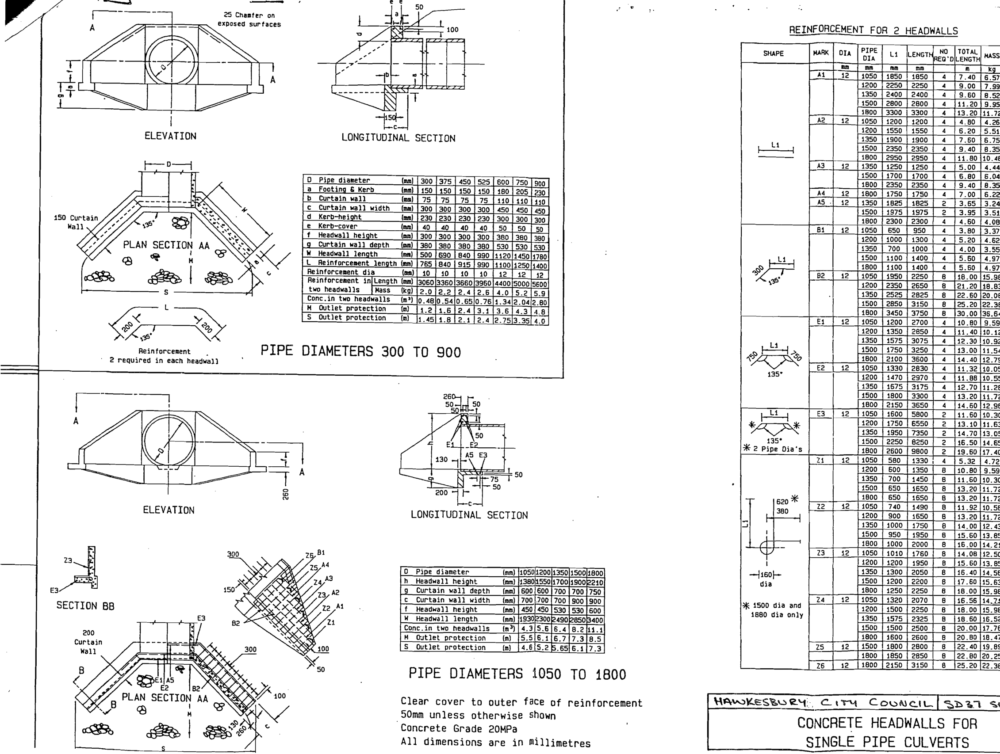
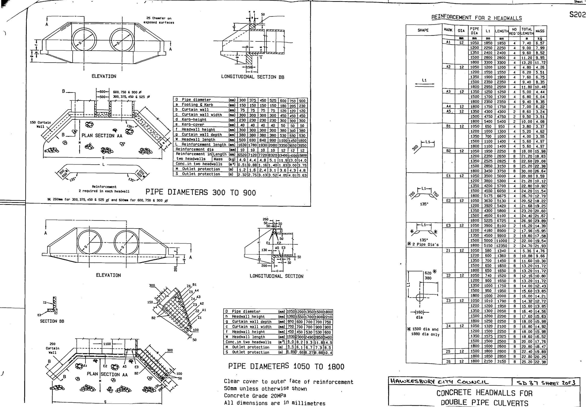
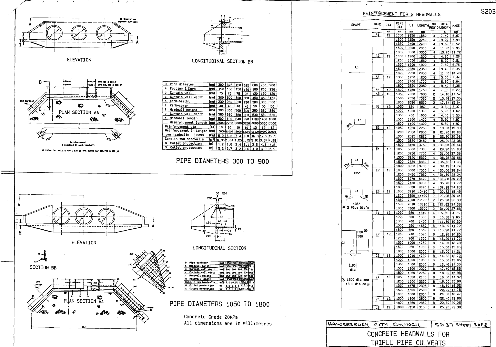
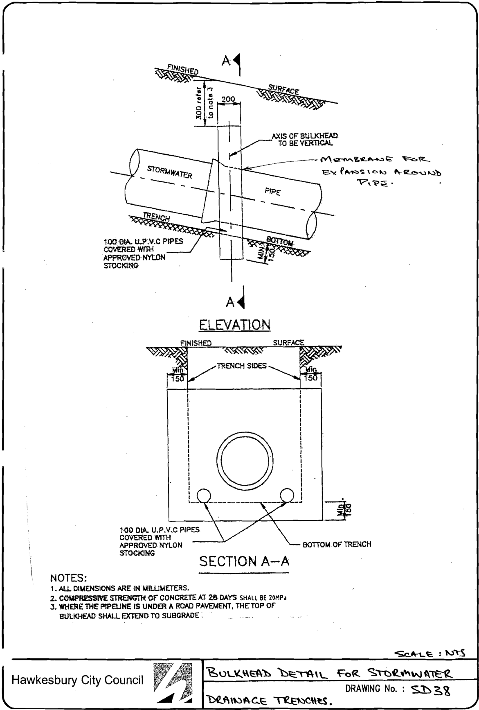
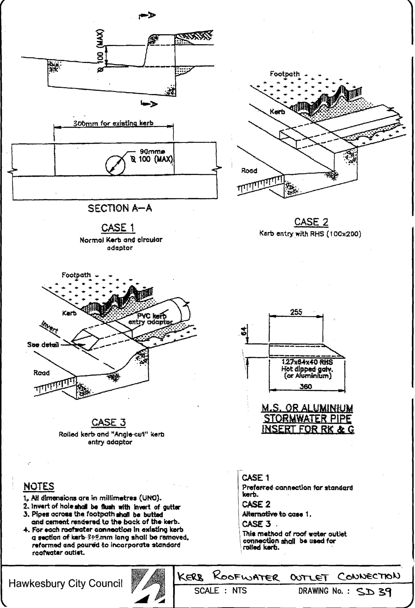
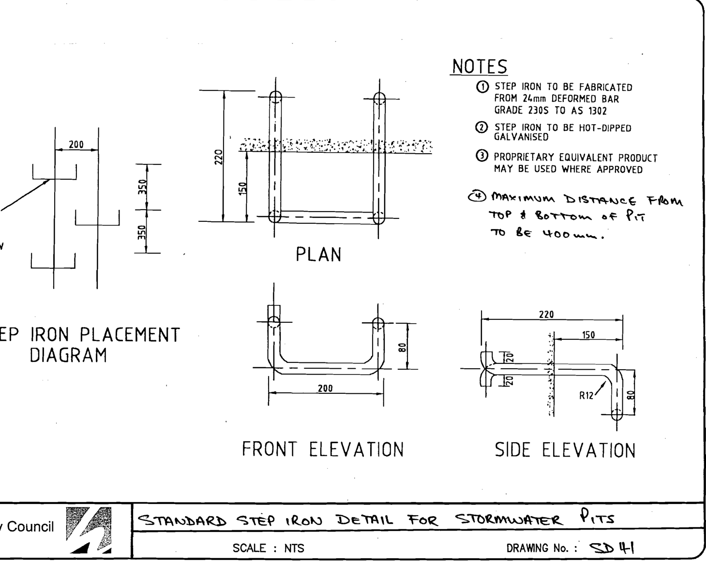
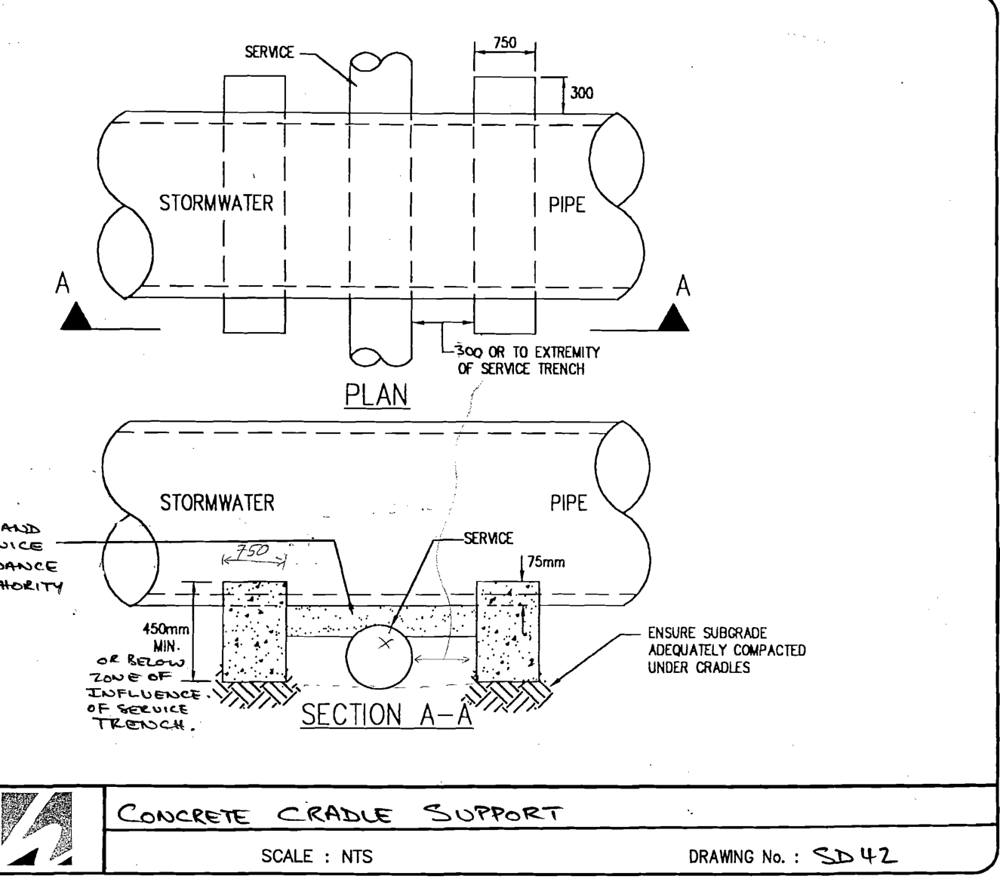
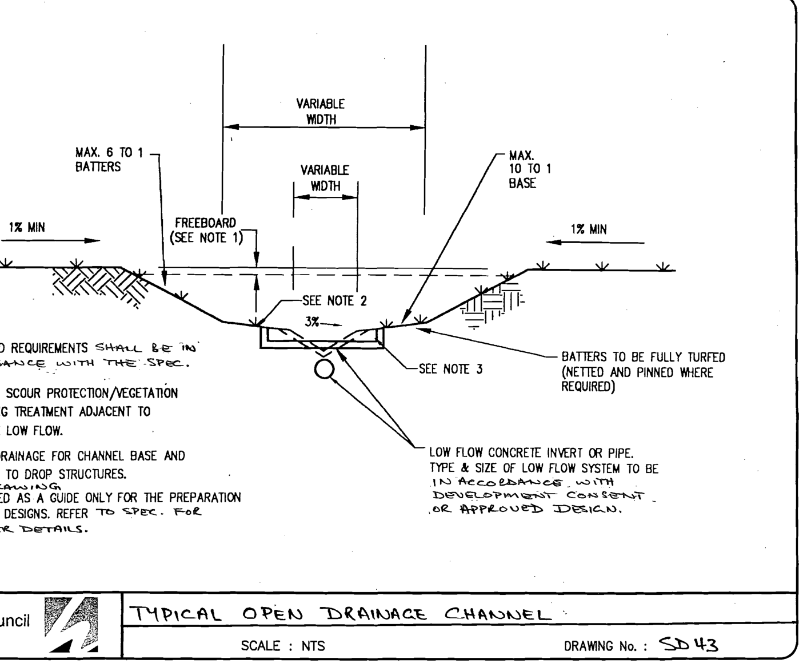

### 0 lin-

### ·

### ........ ~ ../ '-AS SPEC. 1N

### l"­

#### TABLE a£l.OW

### PLAN

### DRAWING No. : ~ 3 S

!"

### ~/

~-~

> [Picture on page 41: a map, saved as a picture (images/part-03-drawings-page-41-4.gif, 150 dpi); the street names and other small labels are on the picture.]
> Words printed on the picture (title and legend, copied from the PDF):
> 25 Ch811lfer on
> 0 Pipe diameter
> c Curtain wall width
> f Headwall heioht
> (m') 0.48 0.54 0.65 0.76 1.34 2.04 2:.~
> H OUtlet protection (m)
> S Outlet protection (m)
> 1.45 1.8 2.1 2.4 2.753.35 1&.
> 75 I 50
> _ • E3
> I » I » l'
> 0 Pipe diameter
> h Headwall heioht
> g Curtain wall depth
> c Curtain wall width
> W Headwall length
> Conc.in two headwalls
> H frJtlet protection
> S Outlet protection (m)
> 4.6 5.2 Is. 65 6.1 7.3

.~.

### ----_.

### r-----

#### A />= ± K' exposed surfaces

### S201

### REINFORCEMENT FOR 2 HEADWALLS

> Words printed on the picture (title and legend, copied from the PDF):
> SHAPE MARl< OIA
> iRED '0 LENGTH
> IlIII mm mm mm 1\ leg
> 1<2 12 1050 1200 1200 4 4.80 4.26
> Zl 12 11050 580 1330 I 4 5.32 4.72
> la80 dia only

### I

#### ELEVATION

Al 12 1050 1850 1650 4 7.40 6.57

1200 . 2250 2250 4 9.00 7.99

1350 2400 2400 4 9.60 8.52

1500 2800 2800 4 11.20 9.95

1800 3300 3300 4 13.20 11.72 1200 1550 1550 4 6.20 5.51

1350 1900 1900 4 7.60 6.75

#### I

#### I

1500 2350 2350 4 9.40 8.35

1600 2950 2950 4 11.80 10.48

A3 12 1350 1250 1250 4 5.00 4.44

1500 1700 1700 4 6.80 6.04

1800 2350 2350 4 9.40 8.35

A4 12 1800 1750 1750 4 7.00 6.22

A5 . 12 1350 1825 1825 2 3.65 3.24

1500 1975 1975 2 3.95 3.51

1800 2300 2300 4 4.60 4.08

81 12 1050 650 950 4 3.80 3.37

1200 1000 1300 4 5.20 4.62

1350 700 1000 4 4.00 3.55

### ~

#### s

(M) 300 375 450 525 600 750 900

#### a Footina &Kerb (1l\lIl)

150 150 150 150 180 205 230

b Curtain wall !l1I1I) 75 75 75 75 110 110 110

(1Ml) 300 300 300 300 450 450 450

d Kerb-heiaht (I11III)

230 230 230 230 300 300 300

(1Ml) 40 40 40 40 50 50 50

!111mI 300 300 300 300 380 380 3BO

Q Curtain wall deoth !111m)

380 380 380 380 530 530 530

W Headwall lenoth

(I11III) 500 690 840 990 1120 1450 1780

L Re inforcelllent lenoth !111m)

765 840 915 990 1100 1250 1400

Reinforcement dia (I11III) 10 10 10 10 12 12 12

Reinforcement In/Length (DInt) 3060 3360 3660 3960 4400 5000 5600

#### two headwalls I Mass

(kg) 2.0 2.2 2.4 2.6 4.0 5.2 5.9

Conc.in two headwalls

1.2 1.6 2.4 3.1 3.6 4.3 -t. 8

### ~/~>

1500 1100 1400 4 5.60 4.97

1800 1100 1400 4 5.60 4.97

### V­

82 12 1050 1950 2250 a 18.00 15.98

1200 2350 2650 8 21.20 18.83

1350 2525 2825 8 22.60 20.08

1500 2850 3150 a 25.20 22.38

1800 3450 3750 a 30.00 35.64

El 12 1050 1200 2700 4 10.80 9.59

1200 1350 2850 4 11.40 10.12

### I

### PIPE DIAMETERS 300 TO 900

2 required in each headwall

### r----­

### i

#### ./.71--,­

#### A

1350 1575 3075 4 12.30 10.92

1500 1750 3250 4 13.00 11.54

### '\~

1800 2100 3600 4 14.40 12.79

E2 12 1050 1330 2830 4 11.32 10.05

1200 1470 2970 4 11.88 10.55

1350 1675 3175 4 12.70 11.28

1500 1800 3300 4 13.20 11.72

1800 2150 3650 4 14.60 12.96

### ~

E3 12 1050 1600 5800 2 11.60 10.30

### ~

### t 1

#### Fh:M~

### ~

### r.fA

#### 200 Lc

### '"

#### ELEVATION

### 1

#### LONGITUDINAL SECTION

1200 1750 6550 2 13.10 11.63

1350 1950 7350 2 14.70 13.05

1500 2250 8250 2 16.50 14.65

### * 2 Pipe Oia's

1800 2600 9800 2 19.60 17.40 1200 600 1350 8 10.80 9.59

1350 700 1450 8 11.60 10.30

1500 650 1650 8 13.20111.72

#### ... 620*

1800 650 1650 8 13.20 11.72

Z2 12 1050 740 1490 8 11.92 10.58

1200 900 1650 8 13.20 11.72

1350 1000 1750 8 14.00 12.43

1500 950 1950 8 15.60 13.85

#### r

1800 1000 2000 8 16.00 14.21

### 't

### !oJ

### E3A

## SECTION 88

f Headwa 11 he ight

1050 1200 1350 1500 1800

1380 1550 1700 1900 ;)210

600 600 700 700 750

700 }OO 700 900 900

450 450 530 530 600

1930~300 1;>490 1:>850 3400

4.3 5.6 6.4 8.2 11.1

5.5 6.1 6.7 7.3 8.5

Z3 12 1050 1010 1760 8 14.0B 12.50

1200 1200 1950 8 15.60 13.85

1350 1300 2050 8 16.40 14.56

1500 1200 2200 8 17.60 15.63

1800 1250 2250 a 18.00 15.98

24 12 1050 1320 2070 8 16.56 14~U

### * 1500 dia and I 1200 1500 2250 a 18.00 15.98

1350 1575 2325 8 18.60 16.52

1500 1500 2500 8 20.00 17.76

1800 1600 2600 8 20.80 18.47

25 12 1500 1800 2800 8 22.40 19.89

1800 1850 2850 8 22.80 20.25

Z6 12 1800 2150 3150 8 25.20 22.38

### PIPE DIAMETERS 1050 TO 1800

### "~""'-.)~tS~~~'1:, c.., ~ CO\,) iIJ c..1~ ~1Y~_'

<;.\\~,-

\ o~ 3.

### CONCRETE HEADWALLS FOR

### Clear cover to outer face of reinforcement

### 50mm unless otherwise shown

### Concrete Grade 20MPa

### All dimensions are in millimetres

### SINGLE PIPE CULVERTS

### /~

> [Picture on page 42: a map, saved as a picture (images/part-03-drawings-page-42-2.gif, 150 dpi); the street names and other small labels are on the picture.]
> Words printed on the picture (title and legend, copied from the PDF):
> SH4PE KARl< OIA
> 600\. 750 & 900 J6
> I ,.. I
> (1IIIl) 1 40 I 40 I 40 1 40 I 50 I 50 I 50
> Reinforcelllent inlLength (1IlIIl) 6520712077208320113-40014500158001
> IDIlI mm m kg
> two headwalls I Hass (kg) 4.0 4.4 4.8 5.1 11.913.014.0
> Cone.in two headwalls (m a) 0.510.881.161.401.833.003.75
> D Pipe diameter (Jnm)
> h Headwall heiQht (mm)
> f Headwall height (mm)
> W Headwall length (mm)
> H OUtlet protection (m)
> S OUtlet protection lin)
> 1880 dia only

### ~CEMENT FOR 2 HEADWALLS

### .. -

#### ELEVATION

300\. 375. -450 & 525 J6

### r' .~:~a ..

#### I ,'Ii

#### o Pi e diameter (1IllII)

- FootinQ & Kerb (11m)

#### Curtain wall (1IIIl) I 75 I 75 1 75 1 75 112011201120

Curtain wall Width (111m) 1300 1300 1300 1300 1450 1450 1450

Kerb-heioht (111m) 1230 1230 1230 1230 13001300 1300

Headwall heiQht (mm) 1300 1300 13001300 1380 13iJO 1380

Curtain wall deoth ham) 1380 1380 1380 1380 I 530 1530 1530

1500 1100 1400 4 5.60 4.97

W Headwa 11 1enQth (lIIal! 500 690 840 990 1100 1450 1800

l Reinforcement 1enoth hm) 1630 1780 1930 2080 33503650 3950

Reinforcement dia lIam) 10 10 10 10 12 12 12

Al 12 1050 1850 1850 4 7.40 6.57

1200 2250 2250 4 9.00 7.99

1350 2400 2400 4 9.60 8.52

1500 2800 2800 4 11.20 9.95

1800 3300 3300 4 13.20 11.72

42 12 1050 1200 1200 4 4.80 4.26

1200 1550 1550 <I 6.20 5.51

1350 1900 1900 <I 7.60 6.75

#### II

1500 2350 2350 <I 9.40 8.35

### -

1800 2950 4

A3 12 1350 1250 1250 4 5.00 4.44

1500 1700 1700 4 6.80 6.04

1800 2350 2350 4 9.40 8.35

A4 12 1800 1750 1750 4 7.00 6.22

AS. 12 1350 4300 4300 2 8.60 3.24

1500 4750 4750 2 9.50 3.51

1800 5400 5400 2 10.00 4.08

81 12 1050 650 950 4 3.80 3.37

1200 1000 1300 4 5.20 4.62

1350 700 1000 4 4.00 3.55

### P

H OUtlet protection lin) 1.2 1.6 2.4 3.1 3.6 4.3 4.8

S Outlet protection (m) 2.322.753.-133.524.05 4.Bl 5.63

### ~

#### /d

### <k.'

### ,~

### PIPE DIAMETERS 300 TO 900

f Dr 600. 750 & 900 !d

2 requ1red In each headwall

### '* 200- for 300. 375. 450 & 525 fI5 and 600IIlI

### I~~-­

1800 1100 1400 4 5.60 4.97

82 12 1050 1950 2250 8 18.00 15.98

1200 2350 2650 8 21.20 18.83

1350 2525 2825 8 22.60 20.08

1500 2850 3150 8 25.20 22.38

1800 3450 3750 8 30.00 26.64

El 12 1050 3500 5000 4 20.00 9.59

1200 3800 5300 4 21.20 10.12

1350 4200 5700 4 22.80 10.92

### lUI

1500 4550 6050 4 24.20 11.54

### '\~

1800 5175 6675 4 26.70 12.79

E2 12 1050 3630 5130 4 20.52 18.22

1200 3920 5420 4 21.68 19.25

1350 4300 5800 4 23.20 20.60

1500 4600 6100 4 24.40 21.67

1800 5225 6725 4 26.90 23.89

### lUI

E3 12 1050 3900 8100 2 16.20 14.39

1200 4180 8900 2 17.96 15.95

### ~

1350 4500 9900 2 19.80 17.58

#### I

1500 5000 11000 2 22.00 19.54

### *2 Pipe Dia's

1800 5150 12350 2 24.70 21.93

21 12 1050 580 1340 4 5.36 4.76

1200 600 1360 8 10.88 9.66

1350 700 1450 8 11.60 10.30

1500 650 1650 8 13.20 11.72

#### ~620*

1800 650 1650 8 13.20 11.72

22 12 1050 740 1520 8 12.16 10.80

1200 900 1650 8 13.20 11.72

#### :i I

### l

1350 1000 1750 8 14.00 12.43

### L-4>-­

#### ELEVATION

### :J

g Curtain wall depth (1IllI\)

c Curtain wall width (mill)

Conc.in two headwalls (m 3)

1050 1200 1350 1500 1800

1380 1550 1700 190012210

600 600 700 700 750

700 700 700 900 900

<150 <150 530 530 600

1930 12300 12490 285013<100

6.0 8.2 9.3 11.8 14.9

5.5 6.1 6.7 7.3 8.5

i§...89 t7.66 8.27 18.88 10.4

1500 950 1950 8 15.60 13.85

-,

1800 1000 2000 8 16.00 14.21

23 12 1050 1010 1790 8 14.32 12.72

1200 1200 1950 8 15.60 13.85

#### -l1601­

1350 1300 2050 8 16.40 14.56

1500 1200 2200 8 17.60 15.63

1800 1250 2250 8 18.00 15.98

24 12 1050 1320 2100 8 16.80 14.92

\* 1500 dia and

1200 1500 2250 8 18.00 15.98

1350 1575 2325 8 18.60 16.52

1500 1500 2500 8 20.00 17.76

1800 1600 2600 8 20.80 18.47

25 12 1500 1800 2800 8 22.40 19.89

1800 1850 2850 8 22.80 20.25

26 12 1800 2150 3150 8 25.20 22.38

### PIPE DIAMETERS 1050 TO 1800

#### J

#### "~~esl!.\)~'( C\'r\-fC-o\.)L\)UL

### T~b~" S~T '2.o~.3

### -

### Clear cover to outer face of reinforcement

### 50mm unless otherwise ~hown

### Concrete Grade 20Mpa

### DOUBLE PIPE CULVERTS

> [Picture on page 43: a map, saved as a picture (images/part-03-drawings-page-43-1.gif, 150 dpi); the street names and other small labels are on the picture.]
> Words printed on the picture (title and legend, copied from the PDF):
> L Reinforcellent lenath (1IIIIl)
> Reinforcement inlLength (mm)
> SHAPE 14AA!( ilIA
> M II1II mill IIlIIl III ka
> A3 12 1350 1250 1250 4 5.00 4.44
> A5 • 12 1350 7080 7080 2 14.16 .17.57
> Cone.in two headwalls (Ill')
> S OUtlet protection (m)
> 2.2 2.7 3.2 3.6 4.0 4.9 5.9
> ~~I L1 I~~
> 1800 650 I 1650 8 13.20 11.72
> o Pille dl••ter
> II ....ad...ll heiaht
> CUrta1n ",,11 c1apth
> CUrte1n ""11 "1dtll
> I( ...._11 lenGth
> C<>nC .1n two Ileacl".na
> " cutlet IM'OtecUon
> S CUtlet IlrDtecUoa
> 1880 dia only

### S203

#### ~CEMENT FOR 2 HEADWALLS

### r-------

#### A ...dV1+

#### ELEVATION

#### LONGITUDINAL SECTION BB

### o

### o ...

0 Piol! diameter

(1IIIIl) 300 375 450 5::!5 600 750 900

#### a Footina &Kerb (1IlIlI)

b Curtain wall (mm)

c Curtain wall width (1IIlII)

d Kerb-heiaht (mill)

e Kerb-cover

f Headwall height !lnm)

~ Curtain wall deoth (1IlIIl)

1500 1100 1400 4 5.60 4.97

150 150 150 150 180 205 230

75 75 75 ~i5 120 120 120

300 300 300 300 450 450 450

230 230 230 230 300 300 300

40 40 40 40 50 50 50

300 300 300 300 380 380 380

380 380 380 380 530 530 530

II Headwall lenath (1IlDl)

500 690 840 990 1100 1450 1800

2500 2750 3000 3250 4600 5050 5500

Reinforcement dia (M) 10 10 10 10 12 12 12

Al 12 1050 1850 1850 4 7.40 6.57

1200 2250 2250 4 9.00 7.99

1350 2400 2400 4 9.60 8.52

1500 2800 2800 4 11.20 9.95

1800 3300 3300 4 13.20 11.72

.1.2 12 1050 1200 1200 4 4.80 4.26

1200 1550 1550 4 6.20 5.51

1350 1900 1900 4 7.60 6.75

1500 2350 2350 4 9.40 8.35

1800 2950 2950 4 11.80 10.48 1500 1700 1700 4 6.80 6.04

1800 2350 2350 4 9.40 8.35

A4 12 1800 1750 1750 4 7.00 6.22 1500 7530 7530 2 15.86 13.35

1800 8520 8520 2 17.84 15.04

81 12 1050 650 950 4 3.80 3.37

1200 1000 1300 4 5.20 4.62

1350 700 1000 4 4.00 3.55

### ~

two headwalls .1 Mass (kg)

#### V 'ta it PLAN SECTION AA qJ

### ~ l6

### •

### f--------1

### 1#/

### \~

#### 2"-li'elIlII __ll

#### 10000 111000 12000 1:>,000 11W)() ~200 ~

#### 6.2 6.8 7.4 e.o 16.3 17.9 19.5

0.95 1.04 1.25 1.45 2.61 3.64 4.88

M Outlet protection (Ill)

1.2 1.6 2.4 3.1 3.6 4.3 4.8

### • - I.. 300.375. eo, S!!l pi __ 1... ICQ, 7:lIl '1lOO 111

1800 1100 1400 4 5.60 4.97

92 12 1050 1950 2250 8 18.00 15.98

1200 2350 2650 8 21.20 18.83

1350 2525 2825 8 22.60 20.0B

1500 2850 3150 B 25.20 22.38

1800 3450 3750 8 30.00 26.64

E1 12 1050 5800 7300 4 29.20 25.93

1200 6250 7750 4 31.00 27.53

1350 6820 8320 4 33.28 29.55

### PIPE DIAMETERS 300 TO 900

### f-

#### A

### L -T

#### ELEVATION

#### LONGITUDINAL SECTION

1500 7330 8830 4 35.32 31.36

### '\~

1800 8280 97BO 4 39.12 34.74

E2 12 1050 6000 7500 4 30.00 26.64

1200 6450 7950 4 31.80 28.24

1350 6970 8470 4 33.88 30.09

1500 7430 18930 4 35.72 31.72

IBOO 8320 9820 4 39.28 34.88

### I L1 I

E3 12 1050 6210 10410 2 20.82 IB.49

1200 6690 11490 2 22.98 20.41

### ~

1350 7200 12600 2 25.20 22.38

1500 7810 113810 2 27.62 24.53

### * 2 Pipe Dia's

1800 8300 15500 2 31.00 27.53

21 12 1050 580 1340 4 5.36 4.76

1200 600 1360 8 10.8B 9.66

1350 700 1450 8 11.60 10.30

1500 650 1650 8 13.20 11.72

22 12 1050 740 1520 8 12.16 10.80

1200 900 1650 B 13.20 11.72

### - I

### I

1800 1000 2000 8 16.00 14.21

23 12 1050 1010 1790 8 14.32 12.72

1350 1000 1750 8 14.00 12.43

### :

1500 950 1950 8 15.60 13.85

### --Et'--

1200 1200 1950 8 15.60 13.85

#### SECTION BS

### a:;J

#### >\0

#### P4AN SDECTION YA

### PIPE DIAMETERS 1050 TO 1800

1350 1300 2050 B 16.40 14.56

1500 1200 2200 8 17.60 15.63

IBOO 1250 2250 .B 18.00 15.98

24 12 1050 1320 2100 8 16.80 14.92

\* 1500 dia and

1200 1500 2250 8 18.00 15.98

1350 1575 2325 8 18.60 16.52

1500 1500 2500 8 20.00 17.76

1800 1600 2600 8 20.80 18.47

25 12 1500 1800 2800 8 22.40 19.89

1800 1850 2850 B 22.80 20.25

26 12 1800 2150 3150 8 25.20 22.3B

### ~:o

### 8~

### Concrete Grade 20MPa

### \-\A-\A..:) ~Q \:) t..."{

### C tT'1 . c.ou N c...\ L I ~:b '!»., <:'\+e'eT!. 0 ~.s

### -

### TRIPLE PIPE CULVERTS

> [Picture on page 44: a map, saved as a picture (images/part-03-drawings-page-44-1.gif, 150 dpi); the street names and other small labels are on the picture.]
> Words printed on the picture (title and legend, copied from the PDF):
> AXIS OF' BUU<HEAD
> TO BE VERTICAL
> l00·OlA. u.P.V.C P\PES
> lOa DIA. U.P.V~C PIPES
> BOTTOM OF TRENCH
> 1\. AU.. DIUENSIONS ARE IN MIWUETERS.
> 2\. C.ot.1P.RESSM STRENGTH OF' CONCRETE AT 2;6 DAYS SHALL BE 20MP a
> BULKHEAD SHALL EXrEND TO SU8GRAOE ~

i ,.,

### ~ gn

#### E'ol: f~~\o'-:l ~~~

#### 'Y\ '\'~ .

### A~

### ELEVATlON

### I

### ~

### --

### ~ly-------,~-.-l2F

### SECTION A-A

#### NOTES:

#### J. WHOlE n-!£PlPruNE IS UNDER A ROAD PAVEMENT. THETOP Of

> [Picture on page 45: a map, saved as a picture (images/part-03-drawings-page-45-1.gif, 150 dpi); the street names and other small labels are on the picture.]
> Words printed on the picture (title and legend, copied from the PDF):
> 3~mm {Of' existing kerb
> Kerb entry"ith RHS (1 OC~2DO)
> Normol Kerb an4 clrculor
> Rolled kerb and H Angle-eut" k-erb
> Preferred, connecUon fer stand~
> reformed and poured 'to Incorporate stGndotd •

### . ..

.....

### ... ..

### r

### SEcnONA-A

#### CASE 2

### CASE 1

### . ...

### Lil

### [---

#### ---~

#### 1..2.1,<8.04"1(40 'RHS

### \1 ------------­

#### , Hotdlppe:d·JaW.

#### (~ AfuminlUm) 360

#### CASE 3

### NOTES

### '+ "If dfmenaiol18 are in· millimetre. (UNO).

#### 2-ln¥ert of hol.1hoI be ftu8h with Inwrt of gutter

#### J. Pipe, across the. footpc:rth IhaII be butted

#### Qnd' cemeftt ron~red to the back of the', qn,.

#### ..... For e-aeh roofwater ~onnect:1Oft In. eDlfatli'l9 kerb

### CASE 1

### kerb..

### CASE 2

#### AItern.ative tG~ 1.

#### CASE3 '

### Th'- method of roof water outlet

#### Q S'tCtiQn of k.erb..~!>~,mm ton9 sholl be removed

connection, shaD ~ uled for

#### roo1Wcrtar outl.t.

### DRAWING No.: '5>)::) 59

r

> [Picture on page 46: a map, saved as a picture (images/part-03-drawings-page-46-2.gif, 150 dpi); the street names and other small labels are on the picture.]
> Words printed on the picture (title and legend, copied from the PDF):
> FROM 24mm DEFORMED BAR
> GRADE 2305 TO AS 1302
> MA Y BE USED WHERE APPROVED

### NOTES

### <D STEP IRON TO BE FABRICATED

### <D  STEP IRON TO BE HOT -DIPPED

#### I

### ~k:~ ~:. ;.~>;:!;.: :<;::.;;;:·~W 'J '~'.:~ :;'-j:':.

### <D  PROPRIETARY EQUIVALENT PRODUCT

#### <3) ~A~u\I\~WV\ b ,~~~~~

#### ~p ~ ~f>~~ 6~ ~"

#### ~ f.~ ~OO """,,-.'

FOR STEP IRON

FABRICATlON

DETAILS SEE

DRAWING BELOW

### PLAN

#### 220

### STEP IRON

#### .;L 150

### PLACEMENT

### DIAGRAM

### --

#### -

### I

### ~~ ~I

### II.

### ~ I

#### R12/

" ,

### FRONT ELEV ATION

### SIDE ELEVATION

### <:::."TA~~A«l> c::;~~ \'tot.-) l:)e."'rA,\. "f=oR S \1)ftM~f\~ {> \'TS

DRAWING No.: ~ '\-,

#### r

> [Picture on page 47: a map, saved as a picture (images/part-03-drawings-page-47-2.gif, 150 dpi); the street names and other small labels are on the picture.]
> Words printed on the picture (title and legend, copied from the PDF):
> ~oo OR TO EXTREt.lITY
> Of SERVICE TRENCH
> (<f ~ r

I 750 .,

### --T-T--'

### -/--1-1­

### I \ I II I I

### STORMWATER I I I I I PIPE

### I I I I I I

### L-_' __

### I

### A \

### I __I __ _,_ I

#### ~,--'

### _.A

### PLAN

#### PIPE

#### STORMWATER

#### Co\JlE'K­ ~ f\-~, AL ,~

### r)

I ,

b~'"n\ O"lC'«....-'$~':l\c:..e

#### \0 ~G'" It-.) ~O~~c..~

#### \A) \1\0\- ~'l:'\ \..\ 'r"1 ~"'A'-ot!.I1'1

### _\

"',,.,

### --

### .. " ........ ; ':'1~ '~~l;"

... ', . 1....

### OL ~E'l..o-w I~,'

### :."..

#### X /

### ..: •. ' t.

#### <,' '~~', i /

### -z.o...,e- of -L ':,.':-.'"

### ('-~-"';;.'.,.~: 'i

### "J:"':>F'-\)~~ .,>>;: . ~,~

~ ,..:.', ",

### oF- ~\),c..~ / ...)7/, y

### '7>;:

### TlL~~.

### SECTION A-~///7//·Y

#### Lc~c.~~~ C-~A'h\...£ ~~~~oRT

### DRAWING No. : ~ 4-L.

> [Picture on page 48: a map, saved as a picture (images/part-03-drawings-page-48-1.gif, 150 dpi); the street names and other small labels are on the picture.]
> Words printed on the picture (title and legend, copied from the PDF):
> (SEE NOTE 1~
> S;~L ~-{;!" -I~'
> ~c.cotL~~ 'A:>IT\-t ~'-'S.'f'EC.-.
> .3.  SUBSOIL DRAINAGE FOR CHANNEL BASE AND
> TYPE &: SIZE OF LOW FLOW SYSTEM TO BE
> :D~~1"\f.Y'\ ~'\­ C-o~ s.~\
> ,eR.. ~?iLc>~e:D :o~,c...10,
> "Tb ~"PI!"C.. F-ot.
> OF DETAIL DESIGNS. REFER

#### MAX. 6 TO 1

#### BAffiRS
