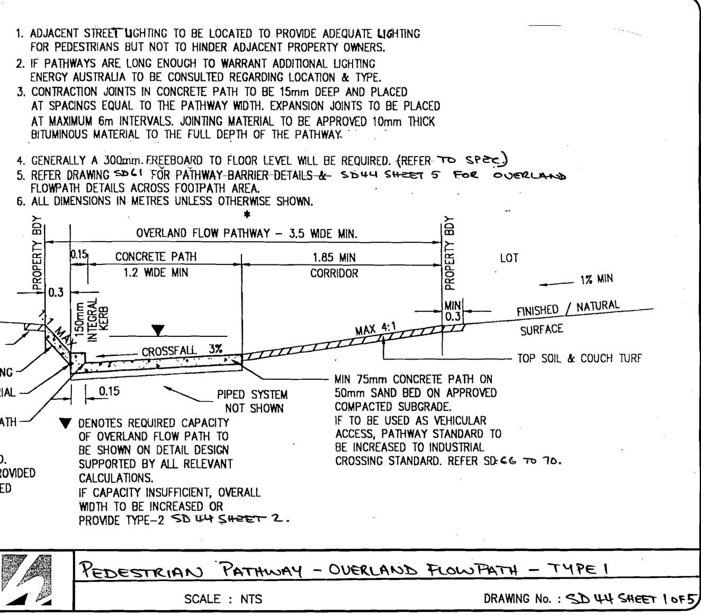

#### 4.  !l+tS "D~~,~~

#### TO BE USED AS A GUIDE ONLY FOO THE PREPARATION

#### ~tL~ be-rA'LS.

### T'1. ~,~A'­ 0 l>E.~ ~~.J\'~AC~ C-\-\A.t0~~ L

### DRAWING No.: Sb "'-3

> [Picture on page 49: a map, saved as a picture (images/part-03-drawings-page-49-1.gif, 150 dpi); the street names and other small labels are on the picture.]
> Words printed on the picture (title and legend, copied from the PDF):
> FOR PEDESTRIANS BUT NOT TO HINDER ADJACENT PROPERTY O\\NERS.
> AT SPACINGS EQUAL TO THE PATHWAY WIDTH. EXPANSION JOINTS TO 8E PLACED
> FLOWPATH DETAILS ACROSS FOOTPATH AREA.
> .'---­ ,.~." .. ,."
> NOT SHOWN COMPACTED SUBGRADE.
> IF TO BE USED AS VEHICULAR
> OF OVERLAND FLOW PATH TO
> ACCESS, PATHWAY STANDARD TO
> BE SHOWN ON DETAIL DESIGN
> BE INCREASED TO INDUSTRIAL
> IF CAPACITY INSUFFlCIENT, OVERALL
> WIDTH TO BE INCREASED OR
