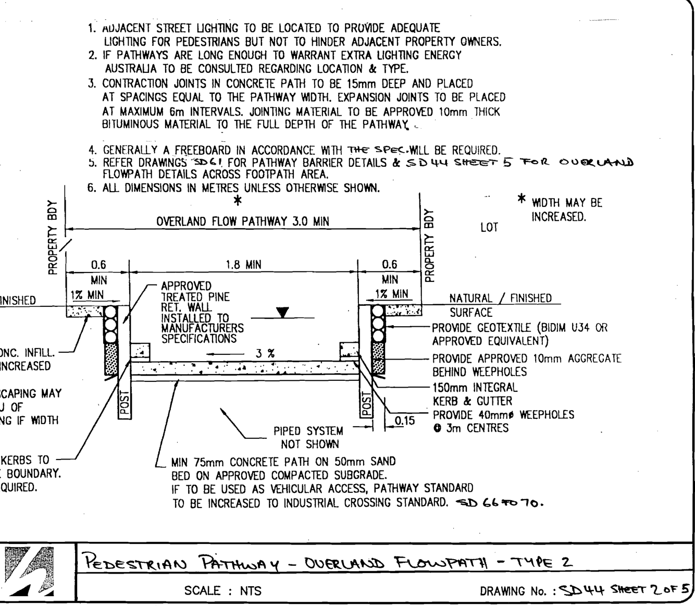

#### 6. ALL DIMENSIONS IN METRES UNLESS OTHERWISE SHOWN.

### •

#### OVERLAND FLOW PAnlWAY - 3.5 WIDE MIN.

### 1.85 MIN

LOT

### 1.2 WIDE MIN

#### ·I~

#### lX MIN

### ___ '70 MIN

#### NATURAL / FINISHED

### MIN 1---=

#### 0.3

#### f\NISHEO / NA1\JRAl

SURFACE

#### CROSSFAll 31.

### ..

#### TOP SOIL & COUCH TURF

TOPSOIL &: COUCH TURF MIN

### 0.3 WIDE 75mm 20mpe CONCRETE PAVlNG 10mm BI11JMINOUS MATERIAL

~e-lL Tt::> sJ:> 4,",,­

#### , "SttEE-1 S FOR KERB & FLOWPATH

#### TRD\lMENT ACROSS FOOTPATH

#### MIN 75mm CONCRETE PATH ON

### ~ PIPED SYSTEM 50mm SAND BED ON APPROVED

### .. DENOltS REQUIRED CAPACITY

#### SUPPORTED BY All RELEVANT

### CROSSING STANDARD. REFER SI} ,€"

### II:> -'0.

### * YnDTH MAY BE INCHEASED.

LANDSCAPING MAY BE PROVlDED

OUTSIDE OF THE PROPOSED

FLOW AREA.

### PRO~DE TYPE-2 <;bw-t $~ L..

V~e~\~1"0 '\>A~A'-{ - a\)t1lL"~b ~O\A)~"" - \'1,;>e:. ,

### DRAWING No. : <;.b ~ <;.~~ 'bf5':

#### ... DENOTES REQUIRED CAPACI1Y

> [Picture on page 50: a map, saved as a picture (images/part-03-drawings-page-50-2.gif, 150 dpi); the street names and other small labels are on the picture.]
> Words printed on the picture (title and legend, copied from the PDF):
> 1\.  ~LJJACENT· STREET UGHTING TO BE LOCATED TO PROVIDE ADEQUATE
> LlGHTJNG FOR PEDESTRIANS BUT NOT TO HINDER ADJACENT PROPER1Y OVfNERS.
> 2\.  IF PATHWAYS ARE LONG ENOUGH TO WARRANT EXTRA LIGHTING ENERGY
> $1:)4-4 Stte::t=-;- b
> . "'j' ":"~.
> KERB c!c GUTTER
> BED ON APPROVED COMPACTED SUBGRADE.
> IF TO BE USED AS VEHICULAR ACCESS, PATHWAY STANDARD

AUSTRAUA TO BE CONSULTED REGARDING LOCATJON & TYPE,
