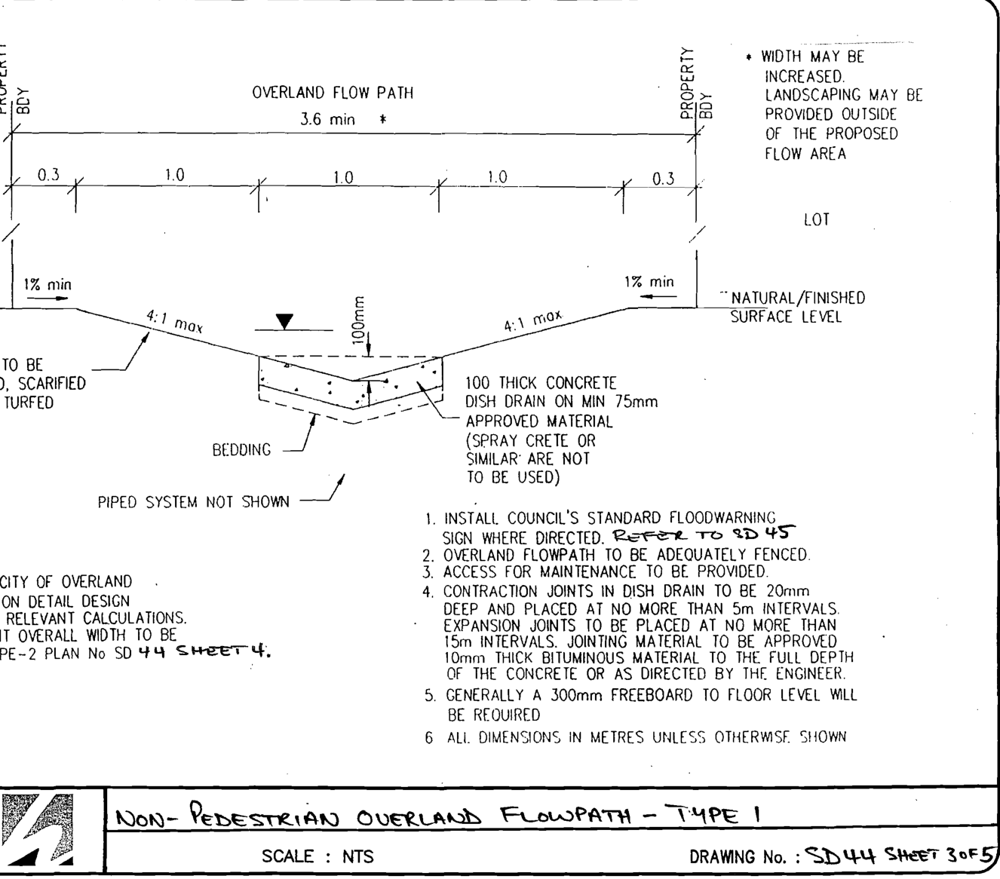

#### 4.  GENERALLY A FREEBOARD IN ACCORDANCE WITH -rn-e- S.P~·¥f1LL BE REQUIRED.

#### ~.  REFER DRAWlNGS·'Sbc:.,. FOR PAlHWAY BARRIER DETAILS c!c

#### FLOWPATH DETAILS ACROSS FOOT?ATH AREA.

#### 6.  All DIMENSIONS IN METRES UNLESS OlHERWlSE SHOWN.

#### -.=oa..

### * 'MDlH MAY BE

### *

#### OVERLAND FLOW PATHWAY 3.0 MIN

#### 0.6

### 1.8 MIN

\>­a

LOT

### 0:::/

#### ~I

#### ~ 0.6

#### >­

#### @

#### ~

#### ffi

#### ~

#### 1% MIN NATURAL / FlNISHED

### r lREATED PINE

#### ,.-.-'" ,... "

### y

NATURAL FlNISHED

SURFACE

#### PROVIDE GEOTEXTlLE (BIDIM U.34 00

### ..:

#### PROVIDE APPROVED lOmm AGGREGAIE

#### 75mrn lHlCK CONC. INFlLL.

W1DlH MAY BE INCREASED

; ! ' •• -.; .': .: 4 '...

#### LA •

### 71f

#### ...~

### r.

#### WAll MANUFACTURERS

### ·..·. ..3. ~

#### PROVIDE 40mmtl WEEPHOLES

### . o 3m CENTRES

c!c WAU. TJERED.

#### lURFOR LANDSCAPING MAY

BE USED IN LIEU OF

CONCR[TE PAVING IF W1DlH

#### EXCEEDS 1.0m.

### ~ PIPED SYSTEM ~

RETAINING WALLS AND KERBS TO

END AT ROAD RESERVE BOUNDARY.

BULLNOSE KERB AS REQUIRED.

#### MIN 75mm CONCRETE PAlH ON 50mm SAND

#### TO BE INCREASED TO INDUSffilAL CROSSING STANDARD. -sob bl:. =t'b ,().

### Yebc~\1t'At\) -vA-~'A '# - ~\)~\J\~ ~~'T'\\ - \'-\.~~ 2..

#### DRAWING No. :~~'-'" <;~ LOt=' 5

> [Picture on page 51: a map, saved as a picture (images/part-03-drawings-page-51-1.gif, 150 dpi); the street names and other small labels are on the picture.]
> Words printed on the picture (title and legend, copied from the PDF):
> OVERLAND FLOW PATH
> 0- co PROVIDED OUTSIDE
> OF THE PROPOSED
> (SPRAY CRETE OR
> SIMILAR' ARE NOT
> TO BE USED)
> DEEP AND PLACED AT NO MORE THAN 5m INTERVALS.
> EXPANSION JOINTS TO BE PLACED AT NO MORE THAN
> OF THE CONCRETE OR AS DIRECTED BY THE ENGINEER.

#### • WIDTH MAY BE

0::

W

0­

#### 0>-

#### 0>- LANDSCAPING MAYBE

#### 0:::1°

#### [,§5

### 3.6 min *

#### 1.0

1/,

#### 1.0

### /I,----lSL-.

### TO.} .'­

#### lOT •

#### /

#### 1% min

#### 11% min

NATURAL/FINISHED

#### -

#### - I -. NATURAL/FINISHED

SURF ACE LEVEL

### ---------!.: 1 nJo\

### Y ~

#### -

### ____ 31 _

OATTERS TO BE

### ~--'

TOPSOILED. SCARIFIED

#### . • 100 THICK CONCRETE

& FULLY TURFED

### l- __~~ DISH DRAIN ON MIN 7Smm

### J -- ~ --- ---

### - APPROVED MATERIAL

### PIPED SYSTEM NOT SHOWN --.I

#### ...
