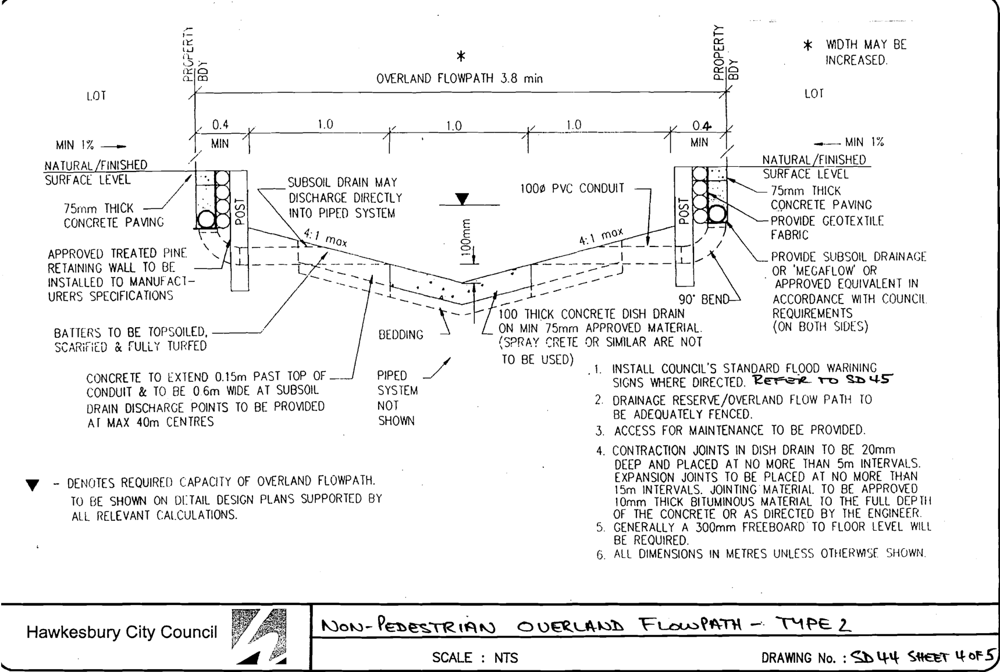

#### 6 All. DIMENSIONS IN METRES UNLESS OTHERWlSF. SHOWN

~ot\)- Q~h~~'At() C\)ttLA~ 'f=Lo\.J0{>A"" - "''1~t ,

#### DRAWING No. : ~b\\--"\ C;~ ~a~

> [Picture on page 52: a map, saved as a picture (images/part-03-drawings-page-52-1.gif, 150 dpi); the street names and other small labels are on the picture.]
> Words printed on the picture (title and legend, copied from the PDF):
> NA TURAL IFINISHED
> SUBSOIL DRAIN MAY
> INTO PIPED SYSTEM
> PROVIDE GEOTEX TIL.E
> APPROVED TREATED PINE
> PROVIDE SUBSOIL DR AIN AGE
> INST ALLED TO MANUFAC1­
> APPROVED EOUIVALENT IN
> (ON BOTH SIDES)
> (SPRA.Y CRETE OR SIMILAR ARE NOT
> TO BE USED)
> 2\.  DRAINAGE RESERVE/OVERLAND FLOW PATH TO
> DRAIN DISCHARGE POINTS TO BE PROVIDED
> 3\.  ACCESS FOR MAINTENANCE TO BE PROVIDED.
> EXPANSION JOINTS TO BE PLACED AT NO MORE THAN
> ALL RELEVANT CAl.CULATIONS.
> OF THE CONCRETE OR AS DIRECTED BY THE ENGINEEr<.
> 6\.  ALL DIMENSIONS IN METRES UI'-lLESS OTHERWlS[ SHOWN.

### * WIDTH MAY BE

### *

#### OVERLAND FLOWPATH 3.8 min

#### /  0.4

#### 1.0

### _----+

#### 1.0

#### / 1. 0

### I

#### y v~

### /1----·-·------­

#### _.-- MIN

### MIN 1% --­

### 1

#### .//

SURF ACE LEVEL / I",

#### 100¢ PVC CONDUI T

#### 75rnm THICK

### /

### ...

#### 75rnrn THICK ---/

### fr.\ ~-'--tr I

#### RETAINING WALL TO BE

### -__~ -~~~J- ---D/\ OR 'MEGAFLOW' OR

#### 90' BENr0 ACCORDANCE WI TH COUNCIL

#### 100 THICK CONCRETE DISH DRAIN

#### ON MIN 75mrn APPROVED MATERIAL.

### BATTms TO BE TOPSOILED, --­

#### SC,\RiFim & fULL '( TUPFED

#### .1. INSTALL COUNCIL'S STANDARD FLOOD WARINING

### CONCRETE TO [X1END O.15m PAST TOP OF -­ PIPED J

### SIGNS WHERE DIRECTED. ~~ 'n:) ~ 4-5"'

#### CONDUIT & TO BE 06m WIDE AT SUBSOIL

BE  ADEQUA TEL Y FENCED,

#### Ar  MAX 40m CENTRES
