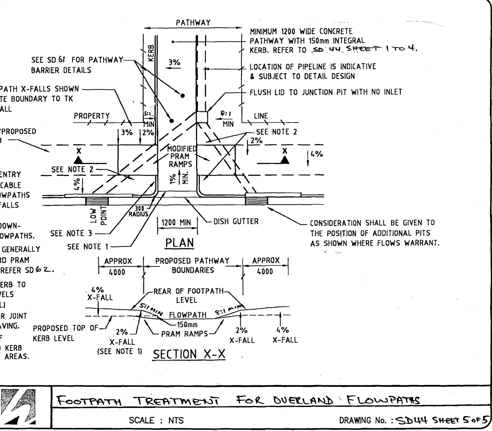

#### 4.  CONTRACTION JOINTS IN DISH DRAIN TO BE 20mm

#### DEEP AND PLACED AT NO MORE THAN Sm INTERVALS.

#### ... - DENOTES REQUIRED CAPACITY OF OVERLAND FLOWPATH.

#### 15m INTERVALS. JOINTING MA TERIAl. TO BE APPROV£D

#### TO BE SHOWN ON oUAIL DESIGN PLANS SUPPORTED BY

IOmm THICK BITUMINOUS MATERIAL TO THE FULL DEP Tit S.  GENERALLY A 300mm FREEBOARD' TO FLOOR LEVEL WILL

### ~ot-..)- P€b~\R'~f\.) 0 \)~Lt\\..:)':h FL.ol..U\>t\-n\ -'. \'1~E.. 2...

~,.......

DRAWING No. : <;b 4-'\- ~~, 4- ofS,

> [Picture on page 53: a map, saved as a picture (images/part-03-drawings-page-53-1.gif, 150 dpi); the street names and other small labels are on the picture.]
> Words printed on the picture (title and legend, copied from the PDF):
> SEE SD.6/ FOR PATHWAY
> LOCATION OF PIPELINE IS
> & SUBJECT TO
> MINIMUM 1200 WIDE
> KERB. REFER TO
> FOOTPATH X-FALLS SHOWN
> WITH NO INLET
> DENOTE BOUNDARY TO TK
> . I ! .,"1
> CONSIDERA TION SHALL BE GIVEN TO
> THE POS!TION OF ADDITIONAL PITS
> OVERLAND FLOWPATHS. SEE NOTE 3
> SHOWN WHERE FLOWS WARRANT.
> TURF GENERALLY SEE NOTE 1
> APPROX PROPOSED PATHWAY ~PPROX
> BOUNDARIES - 4000
> REAR OF FOOTPATH,,- I
> COUCH TURF KERB LEVEL X-FALL
> (SEE NOTE 11

S~I ,'TO .....

### 3%---

### I ~ FLUSH LID TO JUNCTION PIT

### · fIt PA THWA Y WITH

### I

### H

OVERALL

EXISTING/PROPOSED

FOOTPATH --.............

### ............... X

#### .A.

TRANSITIONS, 1% ENTRY

NOTES;­

1\.  CROSSFALL

APPLICABLE

#### ~!

TO FLOWPATHS

### & CROSS FALLS

TO SUIT

### ~

AT THE DOWN­

### \1200 MIN.1

TO FLOWPA TH ETC. ARE

AT UPSTREAM ENTRIES ONLY. SUCH GRADES SHALL BE ADJUSTED ST ANDARD PROFILES

STREAM END OF

### PLAN

2\.  SHAPE. GRADE & COUCH IN ACCORDANCE WITH

RAMP WING

STANDARD PRAM

SHAPE. \TYPICAl) REFER SO (C z....

3\.  TRANSITION 150mm INTEGRAL KERB

SUIT MODIFIED PRAM RAMP

LEVELS

### s., .

### LEVEL .. .......~

OVER MINIMUM_600Il1m. (TYPICAl)
