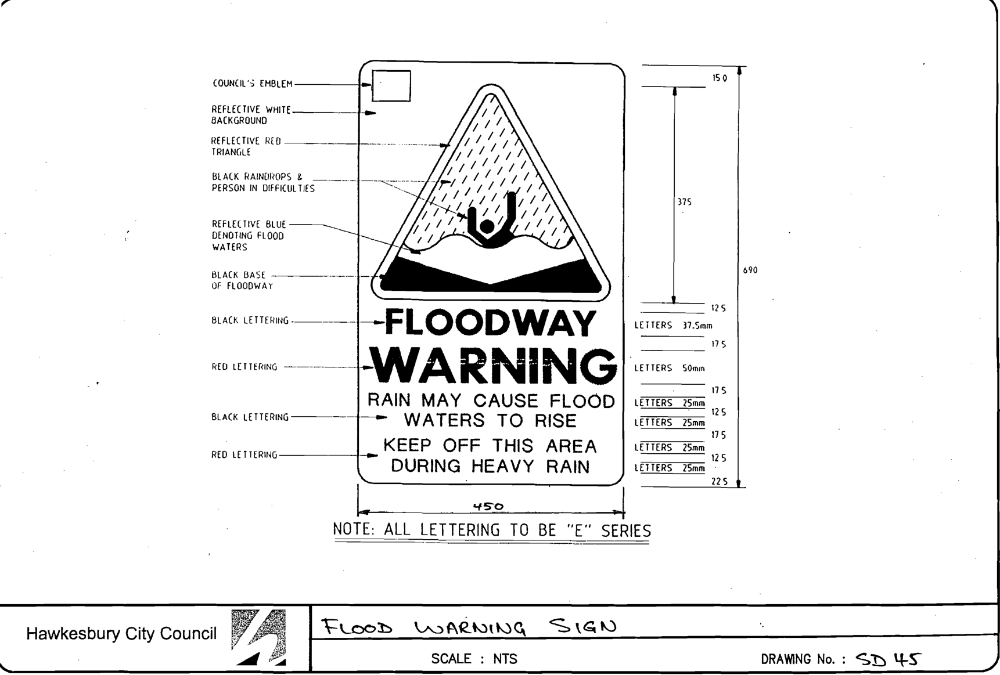
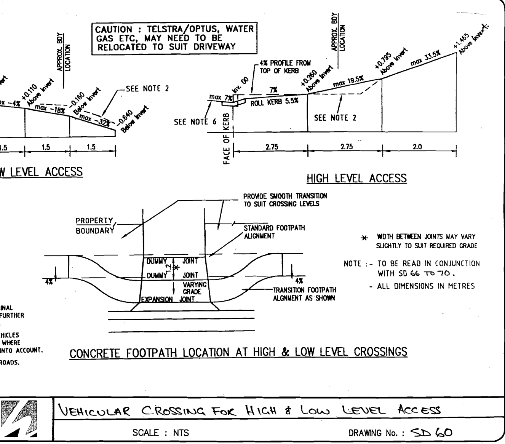

#### 4.  REFER ~,",4 ~~"t I ~$J)~FOR JOINT·

### --- - - IOt'IV FLOWPATH ~'.\

### ~---1­

REQUIREMENTS IN

5\.  MINIMUM 100m WIDE

SURROUND TO BE

#### & GUTTER. FLOWPATH

### CONCRETE PAVING. PROPOSED TOP OFJ . \ 150mm I 20/ 40/

### 2% '- PRAM RAMPSJ 10 10

PROVIDED TO KERB

& RAMP AREAS.

### SECTION X-X

#### t:OO~A-,,", TR~"'nv\~\ ~oft. ~\)Et..LA~ '. FLo\A.)"?A~

#### DRAWING No. :Sb~\\- C;~ S"cF5]

> [Picture on page 54: a map, saved as a picture (images/part-03-drawings-page-54-1.gif, 150 dpi); the street names and other small labels are on the picture.]
> Words printed on the picture (title and legend, copied from the PDF):
> COUNCIL ':; EMBLEM
> Bl ACK RAINDliOPS g,
> RED LE TTERING

#### REFLECTIVE WHITE ----I_

#### fIEFLECTlV( RED --------t---- - _

#### PERSON m O~FKULT[S

#### REFLEC TlVE BLUE _.

#### BLACK [lASE ---------.---.•­

#### BLACK LETH,IING.-----I--FLOODWAY LEllERS n.Smm

### 'ED """,,NG -----4-WARNING l.E TT ERS

### RAIN MAY CAUSE FLOOD

#### -1---­

### WATERS TO RISE

### -1__ KEEP OFF THIS AREA

### DURING HEAVY RAIN

### L

#### .~

### NOTE: ALL LETTERING TO BE "E" SERIES

#### SV~t0

### t="-OOh VuAf2.'(H~~

### DRAWING No. <;b ~S-

#### ' SEE

> [Picture on page 55: a map, saved as a picture (images/part-03-drawings-page-55-2.gif, 150 dpi); the street names and other small labels are on the picture.]
> Words printed on the picture (title and legend, copied from the PDF):
> X,..p 'l(f::)'"" ~ ~#T ,
> !!!9x -of% ~m-·----"f::)· ~
> SEE NOTE 2
> PR0\10E SNOOTH TRANSll10N
> " TRANSll1()l FOOTPATH
> SUCH TtY TO SUIT REWIRfD ~ADE
> NOTE: - TO BE READ IN CONJUNCTION
> - ALL DIMENSIONS IN METRES
> Al.~WENT AS '9iOWN

### xf::)' ,#> ~ \9.!l~ /

#### >­g

#### CAUTION: TELSTRA/OPTUS, WATER

#### ~~~l'

#### GAS ETC, MAY NEED TO BE

### fg

### )('#.#'

#### RELOCATED TO SUIT DRIVEWAY
