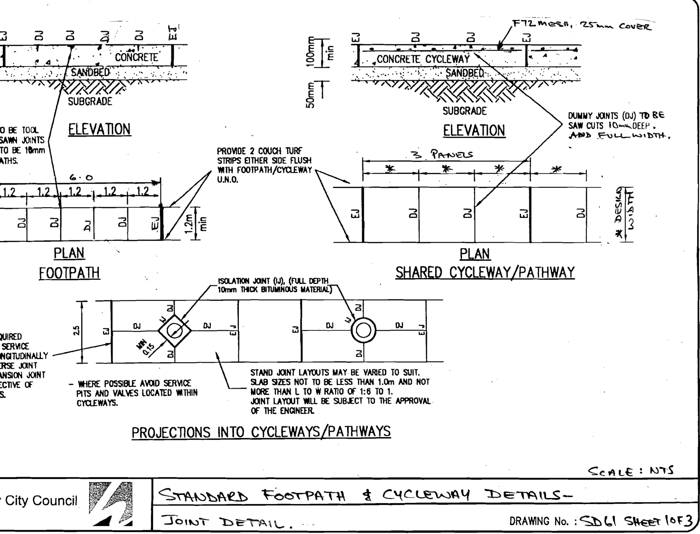
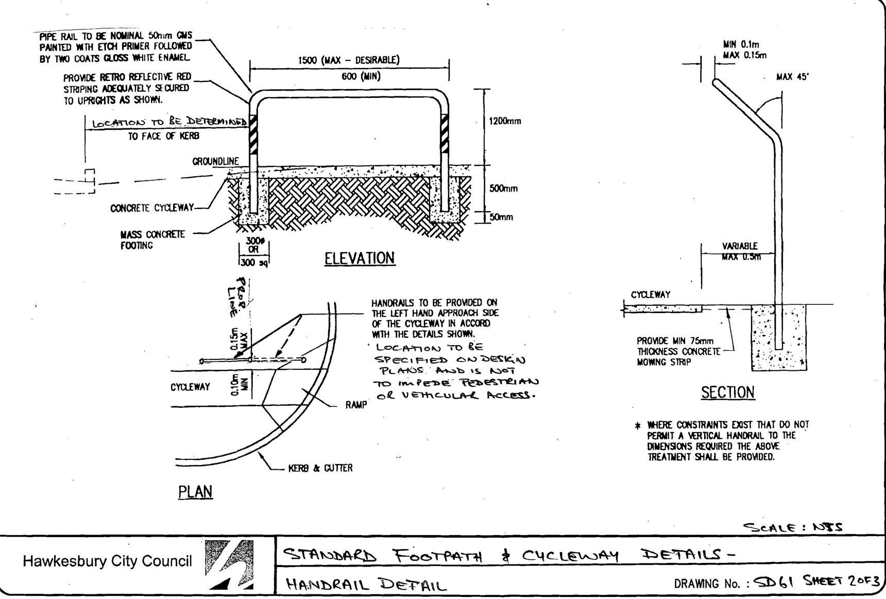

#### 41 PROflLE FROM '

#### ~9

#### NOTE 6

### TeP (J=" KERB " F

### ~F ,;-

#### ~

### ~~. n ~

### /

### _ _

### -----/

### r

### NOTE 7~.~

#### ~~ ".~ ~ti ~ 1 ~;-SEE NOTE 2

SEE

#### \

#### RCll. KERB 5.5"

#### /

#### ~ _1.01­

- ~

mQ)( -]X

-.c ~ -18% ~_ ~ ,

### I

### ~I

### I~'~·

### !1..

1.5

### .1.

### .1

### .1

### •I

### ~ I•

### 2.75 .1 • 275 • I• 20 .1

#### <

### ~I

### LOW LEVEL ACCESS

### HIGH LEVEL ACCESS

#### 1!2ill

1\. DEPTH Of

#### --------.-,- TO SlllT CROSSING Ifi9.S

SECONDARY FLOW IS CRITICAL.

PROVIDE MINIMUM 1Umm FREEBOARD

FROM 100 YEAR ARI CALCULATED flOW

LEVEL TO HIGH POINT IN DRIVEWAY.

### PROPERT~I ,r

2\. WiERE REQUIRED lHE APPUCANT

3\. THE

### *

"10TH E£TtIl£EN JaN15 l.lAY VARY

IS TO PR<MDE IN1ERIai C<JlS1R\JCl1()1

PADS Foo SER\1CE AUTHORITIES

ENSURING COORECT CO\f:R IS PRO\1DEO

TO F1NI~ED SURfA.c:£. lEVEl.S.

#### WITH SO ~~ Tt) -,0 •

ACCESSES ARE BASED ON THE 85TH

PERCENTILE VEHICLE DIMENSIONS WITHOUT

A TOWBAR.

4\. WHERE VEHICLES ARE MODIFIED, LONGITUDINAL

OR CROSSFALL GRADES ARE EXCESSIVE, FURTHER

ADVICE FROM COUNCIL WILL BE REQUIRED.

5\. COUNCIL WILL NOT BE RESPONSIBLE IF VEHICLES

CAN  NOT TRAVERSE THE DESI(jH ACCESS WHERE

### THE ABOVE GutDELIMES ARE NO r TAKEN INTO ACCOUNT.

### CONCRETE FOOTPATH LOCATION AT HIGH & LOW LEVEL CROSSINGS

6\. REFER TO HOTE 4 FOR SUPERElEVATED ROADS,

### \)t."\c...0L-A~ c..Ro~'1-jC. ~IC.. \\ \C-\\ t \"'O\NLE\)a.. Ac.e. e:ss

### DRAWING No. : <;:D bO

~

> [Picture on page 56: a map, saved as a picture (images/part-03-drawings-page-56-2.gif, 150 dpi); the street names and other small labels are on the picture.]
> Words printed on the picture (title and legend, copied from the PDF):
> . '"Z..s-....._ Cov~
> ? .., ~I
> , • 1 ~SA,a;,.~n' °
> 0 0, •• ' "
> .:. • ',' :.. .... /'1IL...LJ~U' '. " '/., It'
> OUIlWY JONTS (OJ) 1b &~
> STRIPS EImER SlO£ FlU~
> WITH FOOTPAnt/CYQ.£WAY __
> 1S(LA11ON JOINT (IJ), (FW. DEP~
> 10rnm Me< B1TUWlNWS MATERIAL'
> STANO nNT LAYOOTS MAY BE VARIED TO SUIT.
> SI..A9 SIZES NOT TO BE LESS mAN Urn AND NOT
> PITS AND VN...~S LOCATED WITHIN
> nNT LAYOOT WILL BE 9JB.ECT TO 1H£ APPROVAl..·
> Cf THE ENGINEER.

#### i:;j 0 W

-,

-,

-,

#### w o 0

E

### ~I~

#### ,..... E

### n~

### -

#### o E

### . . . . . _. '::c~~Ei<" [

### \ . ".. " . .,.

#### '.'

### ... , ~7 so: " Sf- > so: '\7 so: " X '7 'x '7' .

### 0 ~T

### ~T

o

Lf)

#### SAW CUTS m.........OEEf'.

OUWWY JOINTS (OJ) TO E£ TOel.

### ELEVATION

### ELEVATlON

F(BlED OR IIAY BE SAWN JOINTS

AS PER CYO..EWAYS. TO E£ 10mm

IN DEPTH FOO FOOTPATHS,

#### PROVIDE 2 COlla-! lURf

### 31

-,

-,

#### o

-,

#### w

#### . S. '?1"\-fV€\S

### t '*-

### *-

### \d

-,

### PLAN "

### EQQIEAlli.

### ELAti

### SHARED CYCLEWAY/PATHWAY

,

#### ..,.

MiERE OJ ARE REQUIRED

TO PRO.£.CT FR<II S£R~CE

PIT 9JRROUNDS L~GlruDlNA1.l y

mE NEXT TRANSVERSE J:lNT

~AlL BE AN DPANSIOO JOINT

#### AS SHOWN IRRESPEcn~ Cf - WiERE POSSIBlE AWD SERVICE

mE ABO\{ DETAILS.

#### NtH: mAN L TO WRAno Cf 1:6 TO 1.

### PROJECTIONS INTO CYCLEWAYS/PAlHWAYS

#### <:c.,q L~ : t-J"l1

### <;'~bi-\~ ~o\"1>A~ i C'{C.-~f\\-f '"::tJe:-rA\LS­

#### ..Jo,~\ b~'"rP.\\_. - _

### DRAWING No. :S-"hl,.\ <;~ \e>t:3

> [Picture on page 57: a map, saved as a picture (images/part-03-drawings-page-57-1.gif, 150 dpi); the street names and other small labels are on the picture.]
> Words printed on the picture (title and legend, copied from the PDF):
> BY TWO COATS Q..OSS YtlIT[ ENAMEL
> 1500 (MAX - DESIRABLE)
> PRO\1DE RElRO REfl.£CnVE Rm
> 10 UPRlQiTS AS SHO'Jftt
> lo~Ot0 TO g~ ):)~~lfl:)i;b
> TO f AC£ (J" KERB
> HANDRAILS TO BE PRO\1OED 00
> THE LEFT HAND APPROACH SlDE
> Of THE CYtl£WAY IN ACCOOO
> ~TH THE DETAILS SHO~.
> <s'?ecl Fle::b 0"':> ~~~IIJ
> :'. ', ....•
> -PLI'\rlO~·.· ~'b \!.. ~C>,
> PERMIT A ~l1CAI.. H~DRAlL TO THE .
> DlMEN9~S REQUIRED THE ABO\{ .
> lREAnlENT SHAI.l BE PROVIDED.

#### --P1PE-RAIL TOf£NciliNAL 5O'nm QlS

### PAlHT£D VIITH ETOi PRIMER f(X1~D~

### I

### I

### I

### STRlPIHG ~QUAm.y Sf CURED ----...... "r:

### ~

### ""- ,.

#### ""

#### n

### ---y- -­

### ELEVATION

#### ..~~: ." "·'1

### '. ..

: ....

### .:...

#### • Loc--A-'n 0 ~ 10 ~'E

### .

,', , ,

### ..

### ::~N7:J
