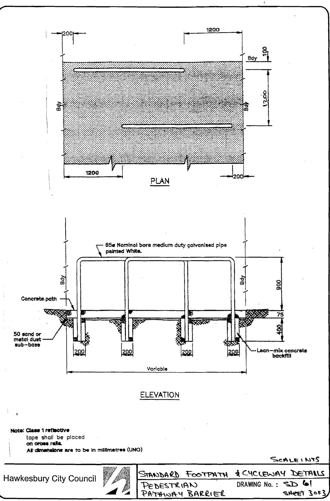
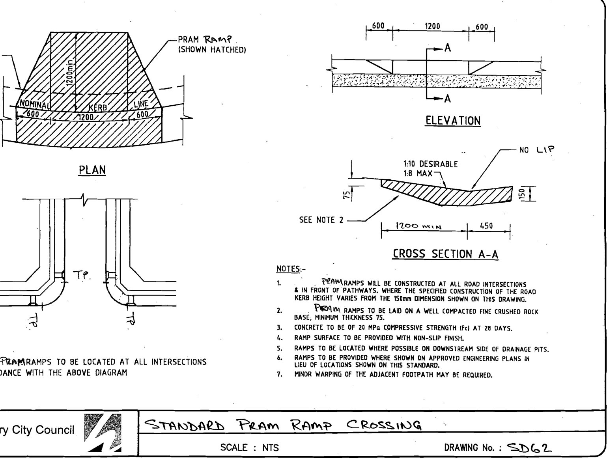
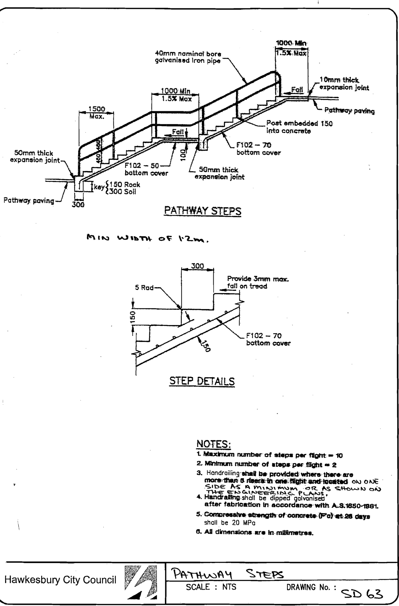

#### 10 ,~pe-'l:>e.- ~~re...~

#### . ofl... \1;crnLUL.A-t.. ~~.

### SECTION

### * vtiERE cnISlRAlNB EXIST lliAT 00 NOT

### P.lAti

#### Se..A \....~ : ~'"s

### "F~o~.f.\'"T'l\ * c.,-\LL~A-'1

### ~~,LS -

### \-\A-.NhRA\'- be::"+"A\L

### DRAWING No. : <:;l:> ~, c;t\tt, '2. o~3

> [Picture on page 58: a picture, saved as a picture (images/part-03-drawings-page-58-1.gif, 150 dpi).]
> Words printed on the picture (title and legend, copied from the PDF):
> 1200
> 6S. Nominel bore medium duty gatvClnised pipe
> paln1ed· WhltL
> metal: du.st
> Voriable
> . Note; ClaM 1mlilOtlVe
> tape sholl be placed
> A'·dImen~na are to b9 In mUnmetrea (UNO)
> "?€h~\il..\A~

### PLAN

### T

50 sand or

#### sub-baae

### ELEVATiON

#### on OI'OQ nIII&.

DRAWING No.: ~ to,

#### ~~, ,!b~~

### ~A-~Y\-Y \SA~2.1 E:1t

> [Picture on page 59: a picture, saved as a picture (images/part-03-drawings-page-59-1.gif, 150 dpi).]
> Words printed on the picture (title and legend, copied from the PDF):
> (SHOWN HATCHEDI
> NOTES:­
> 1\. _ N~RAMPS WILL BE CONSTRUCTED AT ALL ROAD INTERSECTIONS
> & IN FRONT OF PATHWAYS. WHERE THE SPECIFIED CONSTRUCTioN OF THE ROAD
> KERB HEIGHT VARIES FROM THE 150mm DIMENSION SHOWN ON THIS DRAWING.
> 2\. ~t\1 RAMPS TO BE LAID ON.A WELL COMPACTED FINE CRUSHED ROCK
> BASE·, MINIMUM THICKNESS 75•
> . ~
> 3\. CONCRETE TO BE OF 20 MPa C.OMPRESSIVE STRENGTH IFcI AT 28 DAYS.
> 4\. RAMP SURFACE TO BE PROVIDED WITH NON-SLIP FINISH.
> ~~RAMPS TO BE LOCATED AT ALL INTERSECTIONS
> IN ACCORDANCE WITH THE ABOVE DIAGRAM
> 5\. RAMPS TO BE LOCATED WHERE POSSIBLE ON DOWNSTREAM SIDE OF DRAINAGE PITS.
> 6\. RAMPS TO BE PROVIDED WHERE SHOWN ON APPROVED ENGINEERING PLANS IN
> LIEU OF LOCATIONS SHOWN ON THIS STANDARD.
> 7\. MINOR WARPING OF THE ADJACENT FOOTPATH MAY BE REQUIRED.
> '.

### ,,600 "I"

#### 1200 I~

### A

### PRAM 'RP-M~ .

150 KE.RB

### /:j.~:;:~: E(/j~·;'T?0·:D:l\<i: ~):..{(/'.::)}<~~.:~' ::~:.:(:~<. i:;:

### A

### ELEVATION

### PLAN

### ~~

### SEE NOTE 2 I.. 17..00"",\ tot

### .1. 450 ,I

### CROSS SECTION A-A

### -rr.

### -l

### ;}

### <;\i\l\:)bi\{tb ~iLAM KA~1> C- Rc>s..~,t0~

### DRAWING No. : SJ:)fo '2...

> [Picture on page 60: a map, saved as a picture (images/part-03-drawings-page-60-1.gif, 150 dpi); the street names and other small labels are on the picture.]
> Words printed on the picture (title and legend, copied from the PDF):
> . expGnsion joint
> Pn:Mde 3mm rncnc~
> taU on tread
> T\-\-e" e:-~ G..,_...,e-e::~,~_<;,.. p~s.
> 4\. Handrallhgsholl be dipped galvomsetl
> after fabrlcatlon In accordance·wfth. A:.S;185Q.-1D81.
> sholl be 20 MPa

#### 100(lMln·

#### 1OM.m thiele..
