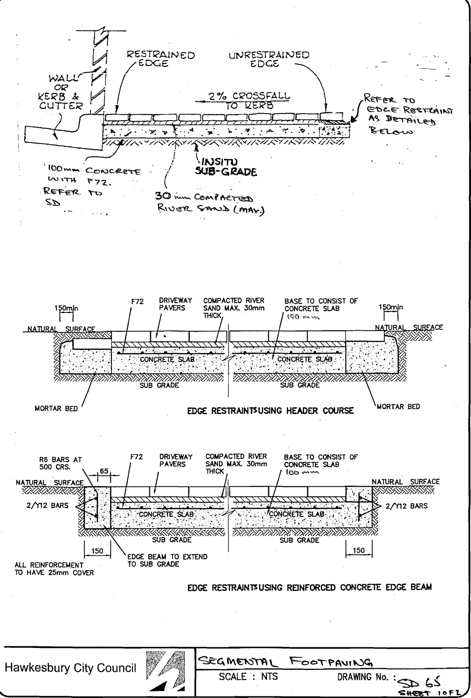

#### 1 OOMIn

#### expansfon jcint

#### ''--'-'- F1 02 ­ 50

### kflyggg ~~i1k

#### Pathway p:aving

### PATHWAY STEPS

#### 300

### -

### F102 -70

### STEP DElAilS

### NOTES:

#### 1. MBxftlum ntmber of steps per fight - 10

#### 2. MInfrrun. rwmber of ltepaPMfllght - 2

#### 3.  Hondrailin,g"1half be' provldectwtt.....-tbttr.'ar.

### rnors'1hans.....fftClMi:~:end"toattedO)y 0 ~ .

#### .SI1~E: M ~ ~\....,\M.'\)M· ·oR... "-s ~+\oov..>"-3 01\)

### 5··ComI:J.......·..~-ot-COIICI'....(pc)·_.· day8

#### 6. All dlmenaklna ..are In·mIIIImetre_.

### DRAWING No. : ~D bS

> [Picture on page 61: a map, saved as a picture (images/part-03-drawings-page-61-1.gif, 150 dpi); the street names and other small labels are on the picture.]
> Words printed on the picture (title and legend, copied from the PDF):
> BASE TO CONSIST OF
> COMPACTED RIVER BASE TO CONSIST OF
> R6 BARS AT
> SAND MAX. 30mm CONCRETE SlAB
> ~ ~ Yo / ~~
> EDGE BEAt.4 TO EXTEND
> TO SUB GRADE
> TO HAVE 25mm COVER

### ~~ (n,"'k)

#### -
