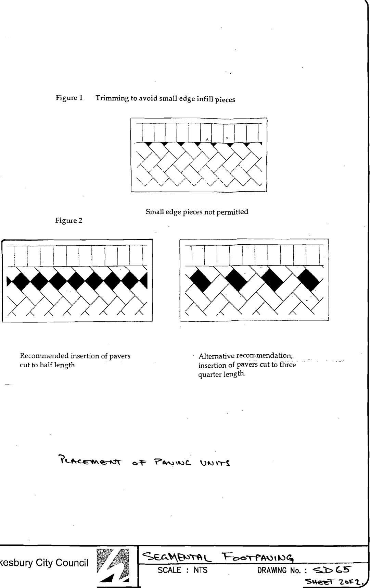
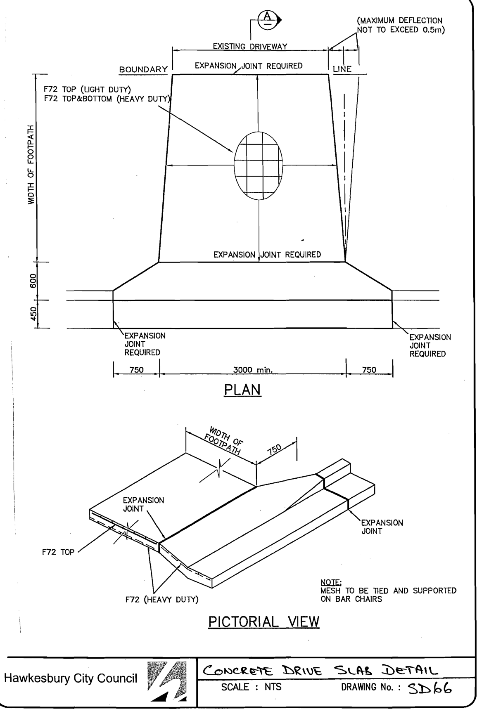
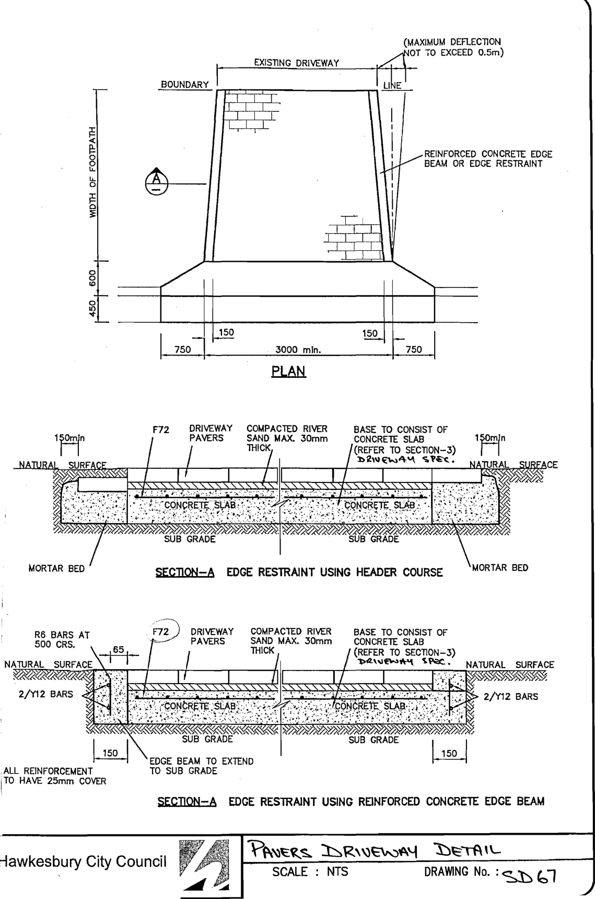
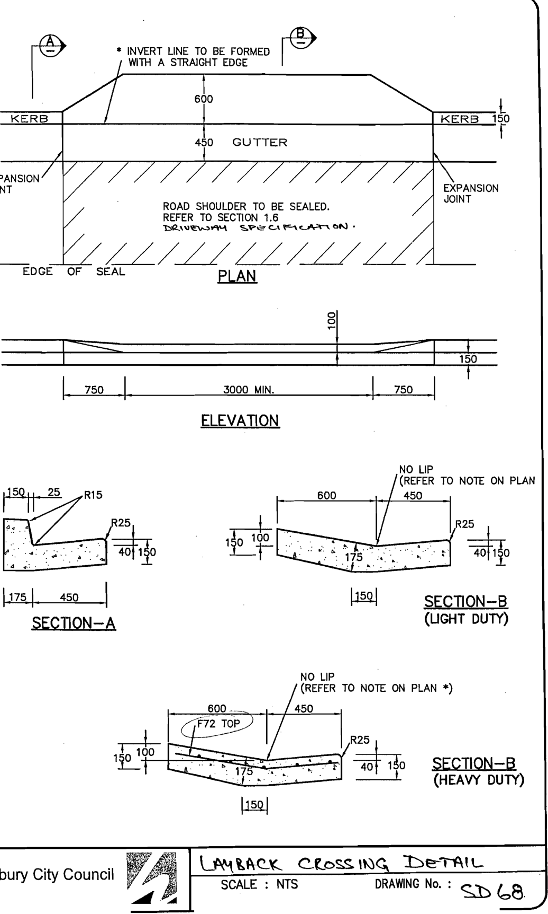
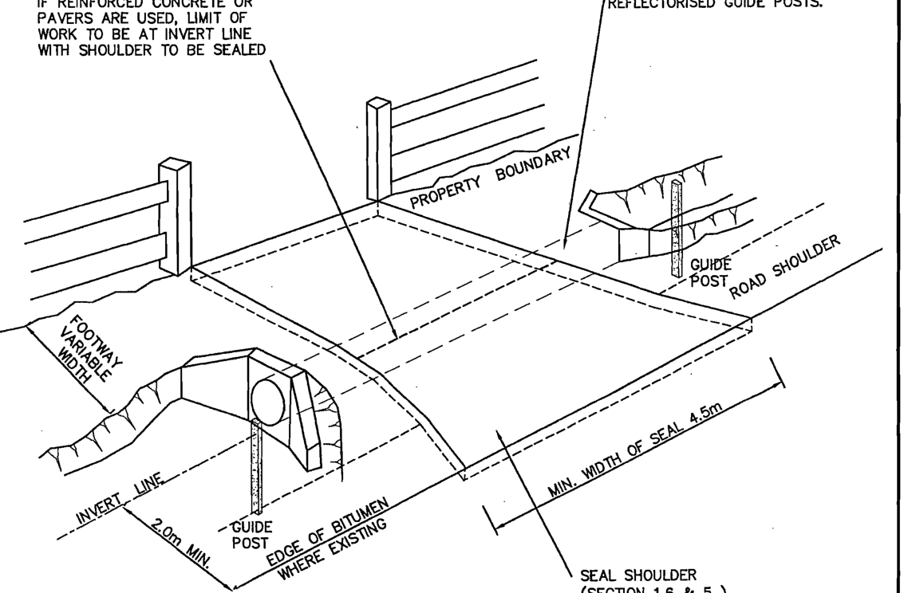
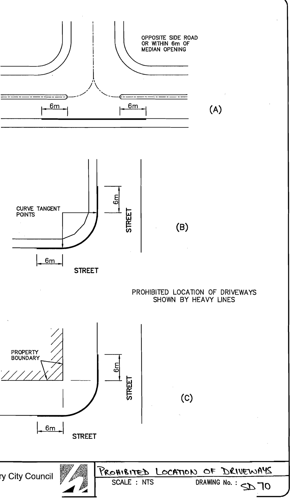
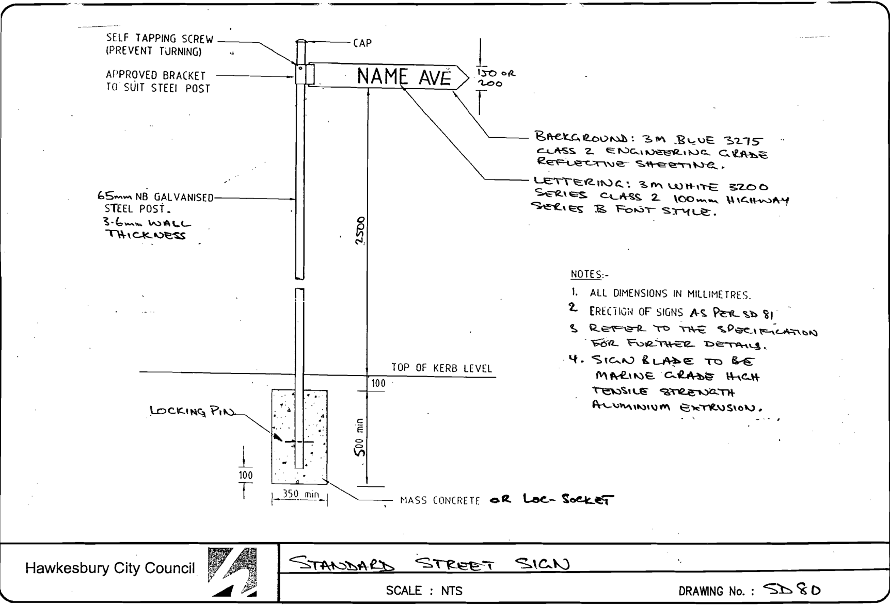
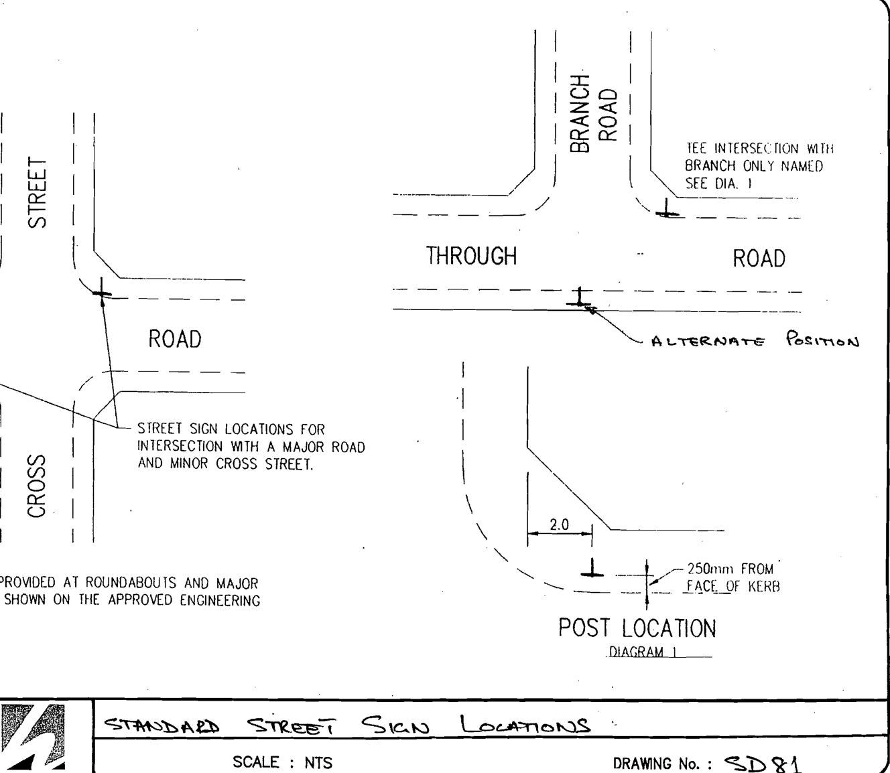
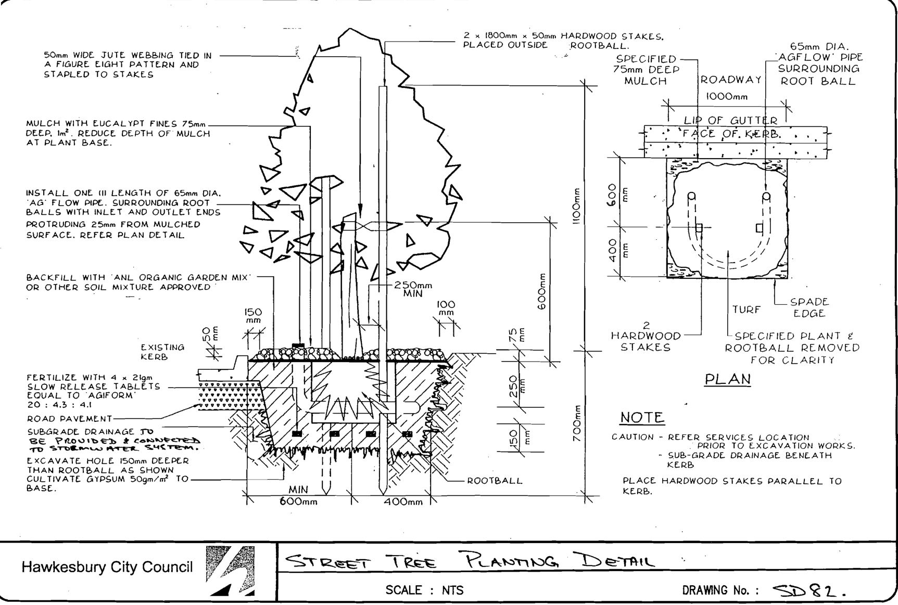

### 30 ~-.. C0Mfl\e..~

### R,x>>E\'L

#### leo "'" ~".•

#### EDGE RESTRAlNlSUSlNG HEADER COURSE

### W

#### EDGE RESTRAlNlSUSlNG REINFORCED CONCRETE EDGE BEAM

#### DRAWING No. :~ b~

#### "S IcFt.

> [Picture on page 62: a picture, saved as a picture (images/part-03-drawings-page-62-1.gif, 150 dpi).]
> Words printed on the picture (title and legend, copied from the PDF):
> 'S~~ "2. bt=-1...

Figure 1 Trimming to avoid small edge infill pieces

Figure 2

#### Small edge pieces not permitted

#### Recommended insertion of pavers

#### Alternative recommendation;.

#### cut to half length.

#### insertion of pavers cut to three·

#### quarter length.

### .1 Hawkesbury City Council

### DRAWING No. : <;..l:> 65"

> [Picture on page 63: a map, saved as a picture (images/part-03-drawings-page-63-1.gif, 150 dpi); the street names and other small labels are on the picture.]
> Words printed on the picture (title and legend, copied from the PDF):
> NOT TO EXCEED 0.5m)
> EXPANSION JOINT REQUIRED
> F72 TOP (LIGHT DUTY)
> F72 TOP&BOnOM (HEAVY DUTY
> EXPANSION JOINT REQUIRED
> MESH TO BE TIED AND SUPPORTED
> F72 (HEAVY DUTY)
> ON BAR CHAIRS

#### /"

,

### I

### ""­

### I

#### L

### I

### """

### I

#### [7

### I

### I

#### I

### ,­

### i'..".

### I.

#### 750 .1

### -t--.l7:§!50LJ

### PLAN

### PICTORIAL VIEW

### DRAWING No.: S'h f:, b

> [Picture on page 64: a map, saved as a picture (images/part-03-drawings-page-64-1.gif, 150 dpi); the street names and other small labels are on the picture.]
> Words printed on the picture (title and legend, copied from the PDF):
> '---------"';.;.;;.;;;~.:::-:~=.:...:....:...---lrifT TO EXCEED 0.5m)
> ,_ EXISllNG DRIVEWAY
> I I I
> I I I
> I I I
> I I I
> BEAM OR E
> I I I
> I I I
> SAND MAX. 30mm
> BASE TO CONSIST OF
> (REFER TO SECllON-3)
> b2,\)~"\-'" ... ,,~.
> R6 BARS AT
> SAND MAX. 30mm
> BASE TO CONSIST OF
> (REFER TO SECllON'-3)
> EDGE BEAM TO EXTEND
> TO SUB GRADE

### BOUNDARY I

### I -­

### I

### ! VRElNFORCED

### rl"

### ~

### I

### II

I I I ,

### I

### - ~

### ~ l-

### I

### PLAN

#### SECDQN-A EDGE RESTRAINT USING HEADER COURSE

#### SEC]QN-A EDGE RESlRAlNT USING REINFORCED CONCRETE EDGE BEAM

### DRAWING No. : SlJ b1

### .lHawkesbury City Council

> [Picture on page 65: a picture, saved as a picture (images/part-03-drawings-page-65-1.gif, 150 dpi).]
> Words printed on the picture (title and legend, copied from the PDF):
> WITH A STRAIGHT EDGE
> EXPANSION
> ROAD SHOULDER TO BE SEALED.
> NO LIP
> (REFER TO NOTE ON PLAN
> NO LIP
> R25
> \+---1---:-"':~"""'::'~:+:=--,.J.~
> .•.-'.-.---:.:~..'C
> ~ECTIQN-6.
> .... -:-""

### * INVERT LINE TO BE FORMED ~

### 1--­

#### 600

### KERB

### l

### ---'-;:.=.:.=I--..L-----~r_------------.1~BK"]E=;ER~...BL:J150r

#### 450 GUTTER

JOINT

#### REFER TO SECTION 1.6

#### bi2.,'\1~~ 'S.~e c..\ ~~ t>f'J •

### LL///LL~////

#### EDGE OF SEAL

### ~

#### o o,...

### I.

#### 3000 MIN.

#### 750

#### 750

### ELEVATION

#### 450

I

~-.rc;­

#### 300 L

### L

### I-m-I

#### 450

### I

### SECTION-B

#### (UGHT DUTY)

### ~

#### (REFER TO NOTE ON PLAN *)

#### 450

### ~O

#### (HEAVY DUTY)

### .. 1 Hawkesbury City Council

### DRAWING No. : ~ 68.

DRIVEWAY

### t

300mm MIN. COVER

BACKFILL ZONE:

### -l OR AS APPROVED

COMPACTED SELECTED FILL

~X::-:'~-----

SAND/GRAVEL

~375 MINIMUM REINFORCED

CONCRETE PIPE

HAUNCH ZONE:

COMPACTED

(134mm)

#### 1/3 PIPE DIA.

100mm

BEDDING ZONE:

COMPACTED SAND/GRAVEL

### ~

### PIPE BEDDING DETAIL

REINFORCED CONCRETE PIPE

LAY MIN. 375mm INTERNAL DIA.

4.88m LONG IN ACCORDANCE WITH

THE APPROVED POSIllON AND LEVEL

AND CONSTRUCT HEADWALLS ON

BOTH SIDES OF CROSSING WITH

> [Picture on page 66: a picture, saved as a picture (images/part-03-drawings-page-66-26.gif, 150 dpi).]
> Words printed on the picture (title and legend, copied from the PDF):
> PAVERS ARE USED, UMIT OF
> WORK TO BE AT INVERT LINE
> WITH SHOULDER TO BE SEALED
> SEAL SHOULDER

REFLECTORISED GUIDE POSTS.

IF REINFORCED CONCRETE OR

(SECllON 1.6 &. 5 ) ~'''\;W~ c:;.~~'l=\~O~

### EICTORIAL VIEW

### .l Hawkesbury City Council

### DRAWING No. : <S..b fo9

> [Picture on page 67: a map, saved as a picture (images/part-03-drawings-page-67-1.gif, 150 dpi); the street names and other small labels are on the picture.]
> Words printed on the picture (title and legend, copied from the PDF):
> OPPOSITE SIDE ROAD
> OR WITHIN 6m OF

### I

### I

### I

### I

### 1

### 1\ J\

/' ' .........

### ~___f~-=------ --­

### (A)

### " 6m '\

### ]~

#### POINTS .-------+--1 lJJ

### f!:

### (8)

### I, 6m .1

### STREET

#### PROHIBITED LOCATION OF DRIVEWAYS

#### SHOWN BY HEAVY LINES

### (C)

### I. 6m .1

### STREET

,

### .. 1Hawkesbury City Council

#### DRAWING No •

### . . Sb,0

> [Picture on page 68: a map, saved as a picture (images/part-03-drawings-page-68-1.gif, 150 dpi); the street names and other small labels are on the picture.]
> Words printed on the picture (title and legend, copied from the PDF):
> SELF TAPP/NG SCREW
> 1\. ALL DIMENSIONS IN MILLIMETRES.
> TOP OF KERB LEVEL

### 1

### NAM

#### TO SUfT STHI POST

#### '\ Le:\'I\:::R.lt0t::,. '. ~"" U)l'h-rE ~'Z..oC>

### "'5"",_ NB GALVANISED

#### ~-f(...\E:=S. CL~s. 2. \00-.-. \\\c..~~

### ~\ ~ 'E. 'Fe...:;, 'S.:T"'1 ~ •

### STEEL post.

#### o

~·b_.... ~~H..L­

#### T'\\-\ C-\(...tV~

### n

#### 2.. fRt::CTIGi~ OF SIGNS A-c;, p~ ~:~ C61

### ~ R~:TfL '\C ~ <lO:.()~\~c...A=\\.b~

#### -~lL.. ~lf2-~~ "D~~•

### . ~. "S tc....1V ~ ~e: "'T'1::) ~

#### M ~\ t-.:)\:. c..~~ ~c...\t

#### 100 .

### ~e~'M~ ?,~~~ •. ~

### "

V,

### .

### 1

### 100T-

### 1- 35_~-.J!!.!~_~~ t-1ASS CONCRETE ofl. Le~­ ~~~

### <;'~b1\-Lb S~~, ~\c....".)

### DRAWING No. : "S'h ~ D

> [Picture on page 69: a map, saved as a picture (images/part-03-drawings-page-69-1.gif, 150 dpi); the street names and other small labels are on the picture.]
> Words printed on the picture (title and legend, copied from the PDF):
> BRANCH ONLY NAMED
> lEE INTERSECfION I'.HH
> STREET SIGN LOCATIONS FOR
> AND MINOR CROSS STREET.
> INTERSECTIONS WHERE SHOWN ON THE APPROVED ENGINEERING

### I

### l

#### SEE DIA. I

### -_._----------_/

#### /

### \" ~~- - --

### ::r: I

### UO

### :z « I

### «0

### I I

#### 0:::: 0:::

### I I

### en

### I \

### I­

### I

### I­

### I

#### if)

### THROUGH

#### --

### ROAD

### l

#### /

### -- - - - - -~ -.. -- - -- - ---- -­

#### ~

### ROAD

#### "-.. A \..~RNfl\~ POS\~b~

### I

### --

### MAJOR

### -_.- -

---1'~

### --- ------""-, 1

#### INTERSECTION WITH A MAJOR ROAD

### I

### I if)

#### if)

### I o

### I 0­

### - I

### \

### -"

### " I. 2~'--~

### -"" '-... ~ ----4 .r

#### 250mll1 FROM'

#### NO TE: STREET SIGNS TO BE PROVIDED AT ROUNDABOU IS AND MAJOR

#### ------ _ ___ ~~_ .£JlCL..9F I<ERA

PLANS.

### POST LOCATION

#### _DIAGRAM 1

### S~b"~ s."Tit~ c;\c...~ Lol.A:no"-JS

### DRAWING No. : ~b ~ i

,

,

~---------------------------­

> [Picture on page 70: a map, saved as a picture (images/part-03-drawings-page-70-1.gif, 150 dpi); the street names and other small labels are on the picture.]
> Words printed on the picture (title and legend, copied from the PDF):
> 2 >< IBOOmm ><
> 50mm WIDE JUTE WE~BING TIED IN
> A FIGURE EIGHT PATTERN AND
> STAPLE.D TO STAKES
> 50mm HARDWOOD STAKES.
> MULCH WITH EUCAL YPT FINES 75mlO
> DEEP. 1m2 . REDUCE DEPTH OF MULCH
> A T PLANT BASE.
> • ••• I • .. •
> INS TALL OIJE III LENGTH OF 65"'10 DIA.
> 'AG' FLOW PIPE.. SURROUNDIt-W. ROOT
> BALLS WITH INLET AND OUTLET
> ..... 46t1 ~I
> PROTRUDIIJG 25mm FROM MULCHED
> SURF ACE. REFER PLAN DE TAIL
> BACKFILL WITH 'ANL ORGANIC
> OR OTHER SOIL MiXTURE APPROVED'
> SPCCIFIE.D PLANT E
> FOR CLARIT Y
> FERTILIZE. WITH 4 x 21gm
> SLOW RELEASE TABLE. TS
> EQUAL TO 'AGIFORM'
> v ••••• vv ••
> ••• vvv ••
> SUBGRADE. DRAINAGE j\;)
> CAUTION - REFER SERVICES LOCATIOt,!
> 'BE. ?~O"'b'E'":b ~ c......:.~~'C..~
> PRIOR TO EXCAVATION WORKS,
> - S,UB-GRADE DRAINAGE BENE-A TH
> PLACE HARDWOOD STAKES PARALLEL TO
> E.XCAVATE. HOLE. 150mm DE.EPER
> THAN ROOT~ALL AS SHOWN
> CUL TlVATE GYPSUM 509m/n1 TO

#### ------------''-.

### MULCH ROADWA y I ROOT 'e;,ALL

,

#### R

#### B.

### E  ° °

### R

### ql

### '-

### t //

### --

### ........ -_

### mm n

### E 6

### o

### PLAN

20 : 4.?> : 4.1

#### '-' ~

### /(' g

### NOTE

#### o o

### '1"0 STb........'-'V ~ c;;.4<'~.

#### OlE

### ~

### ~

### S't2...~ , -\-\2...~

### YL"'N~~

#### D~I'A-''-

### DRAWING No. ~~'L.
