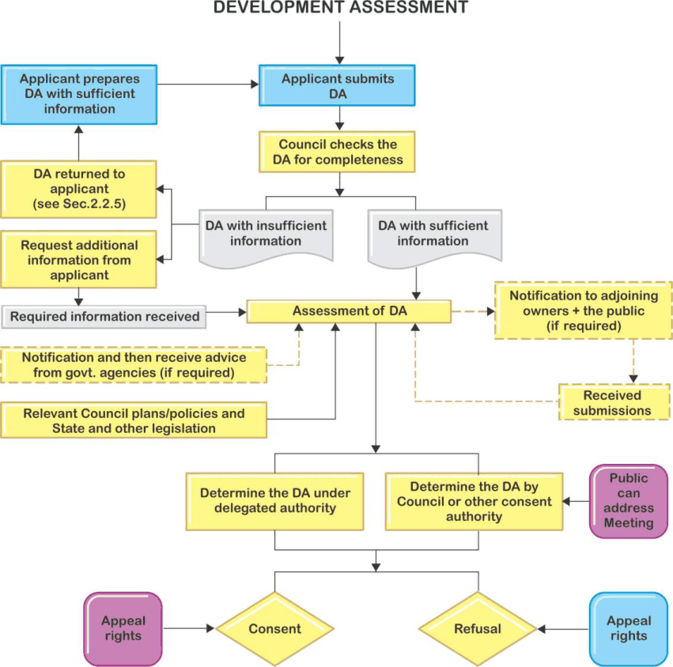

## Chapter 2 TYPES OF DEVELOPMENT AND THE

### DEVELOPMENT APPLICATION

### PROCESS

### 2.1 TYPES OF DEVELOPMENT

Within the Hawkesbury LGA, LEP 2012 is the main planning instrument which identifies development that:

can be carried out without Council’s consent;

can be carried out only with Council’s consent; and,

is prohibited.

Different types of development are also identified in the NSW Planning legislation.  Various types of development are discussed briefly below:

#### 2.1.1 Development Without Consent

#### Exempt Development

This type of development is considered to be of minimal environmental impact.   Under Section 76 of the Act, Exempt Development may be carried out without the consent of Council (see Chapter 1, Part B of the DCP for more details).

#### 2.1.2 Development With Consent

(a) Complying Development

Under Section 76A of the Act, development consent for the carrying out of complying development may be obtained by the issue of a complying development certificate either by Council or an Accredited Certifier (see Chapter 2, Part B of the DCP for more details).

(b) Local Development

The majority of proposals are Local Development and require the lodgement of a DA with Council.

(c) Designated Development

“Designated development” is defined in Schedule 3 of the Regulation.  This schedule lists types of developments that require a more rigorous environmental impact assessment. These applications require the preparation of an Environmental Impact Statement (EIS) which must be undertaken in accordance with the requirements of the Director – General of the NSW Department of Planning and Infrastructure.

Note:  The EIS is a more detailed assessment of the potential impacts of the development and of measures to minimise these impacts. When preparing an EIS it is strongly recommended that you use the services of a suitably qualified consultant. You should carefully research the consultant’s capacity for and experience in preparing such documentation and if necessary ask to see examples of their work.

(d) Integrated Development

“Integrated development” is defined by Section 91 of the Act and is development (not being complying development) that, in order for it to be carried out, requires development consent and one or more of the following approvals:

Fisheries Management Act 1994

Heritage Act 1977

Mine Subsidence Compensation Act 1961

Mining Act 1992

National Parks & Wildlife Act 1974

Petroleum (Onshore) Act 1991

Protection of the Environment Operations Act 1997

Roads Act 1993

Rural Fires Act 1997

Water Management Act 2000

Note:  The above list may be subject to future review and therefore it is always necessary to check the current version of the Act

With integrated development, there is an integrated assessment of the proposal with both Council and the relevant approval body assessing the DA.  If an approval body provides the Council with “general terms of approval” these must be included in any consent issued by Council, if Council intends to approve the DA.  If the approval body refuses to provide “general terms of approval”, then Council must refuse the DA.

(f) Regional Development

Regional development is development which is notified and assessed by a local council and then determined by the relevant joint regional planning panel (regional panel). Regional development is defined in Schedule 4A of the Act. Regional development includes:

development with a capital investment value (CIV) over $20 million,

development with a CIV over $5 million which is council related, lodged by or on behalf of the Crown (State of NSW), private infrastructure and community facilities or eco-tourist facilities,

extractive industries, waste facilities and marinas that are designated development,

certain coastal subdivisions,

development with a CIV between $10 million and $20 million which are referred to the regional panel by the applicant after 120 days, and

Crown DAs (with a CIV under $5 million) referred to the regional panel by the applicant or local council after 70 days from lodgement as undetermined, including where recommended conditions are in dispute.

Note:  It should be noted that development that meets the specific capital investment value (CIV) or other criteria to be State significant development is excluded as being regional development. For example, manufacturing industries, hospitals and education establishments with a CIV over $30 million are considered State significant. Other exclusions apply.

(g) State Significant Development (SSD)

State Significant Development (SSD) is development that is declared under section 89C of the Act. State Environmental Planning Policy (State and Regional Development) 2011 specifies a range of developments including certain agricultural produce industries, education establishments, intensive livestock agriculture, hospitals, manufacturing industries, medical facilities, tourist facilities, warehousing, waste and resource management facilities energy, tourist, education and hospital facilities as SSD. In addition the Minister for Planning and Infrastructure may also declare development to be SSD by an order. These developments are assessed by the DP&I in consultation with relevant councils, NSW Government agencies and the community.

A full list of SSD development types and specified sites can be found in Schedules 1 and 2 of the State and Regional Development SEPP.

#### 2.1.2 Prohibited Development

The Land Use Table in Part 2 of LEP 2012 lists the types of development that are prohibited in each zone. In addition, relevant SEPP should be considered for any provisions which may prohibit development on the site.

### 2.2 THE DEVELOPMENT ASSESSMENT PROCESS

#### 2.2.1 Pre-Development Application Consultation

Pre-DA consultation is considered to be an important aspect of the DA process.  It provides the opportunity for Council staff to advise applicants about the permissibility of a proposal, relevant sections of this DCP that apply to the development, any inherent site constraints which are known to Council, issues that need to be addressed, and the information needed to be included in the DA.  This will ensure that all relevant issues are addressed, sufficient information is provided, and minimise time delays and expenses.

Prospective applicants are advised to contact Council's Customer Service Unit on (02) 4560 4444 to discuss their proposals prior to preparing and submitting applications. Where large and complex developments are proposed such as residential flat developments, multi-dwellings, mixed-use developments, large commercial/business premises, industrial developments and retail complexes, applicants are encouraged to prepare preliminary concept plans prior to organising a pre-DA meeting with Council.

#### 2.2.2 Development Application Requirements

DA requirements are included in Council’s ‘Guidelines for Submitting Applications’. A copy of the Guidelines can be obtained from Council’s Customer Service Unit or on Council’s website.

Applicants are encouraged to use the services of a professional town planner, and other related experts, to assist in the preparation of Statement of Environmental Effects (SEE) for major or more complex development proposals (see Planning Institute of Australia NSW Division for a list of consultant town planners).

#### 2.2.3 Lodgement of a Development Application

The lodgement of a DA is required for any proposed development where LEP 2012 or any other environmental planning instrument specifies that a proposed development may only be carried out with development consent.  A DA may be made by the owner of the land to which the DA relates or by any other person, with the consent in writing of the owner of that land.

Note:  Where a public authority prepares a DA, the consent in writing of the owner of the land is not required, if the authority forwards a copy of the application to the owner prior to the making of that application.

#### 2.2.4 Development Assessment

In assessing an application, Council will take into consideration the matters specified in Section 79(c) of the Environmental Planning & Assessment Act, 1979 and as are of relevance to the proposed development. The diagram in Section 2.2.9 depicts the assessment process.

#### 2.2.5 Additional Information

Council may request the applicant to provide additional information on the proposed development to enable a proper assessment of the proposal. For example, where a DA is unclear or illegible, or is not accompanied by the appropriate fee, if any relevant integrated approvals have not been identified in the application, or if the DA is not accompanied by a Species Impact Statement where one is required, the DA may be returned to the applicant. In addition, Council may “stop the clock” and request additional information. This means that the time for Council assessing the development is extended. The assessment clock is not restarted again until Council is satisfied that there is sufficient information to appropriately assess the DA.

#### 2.2.6 Notice of Council Meeting

Where a DA is referred to a Council meeting for determination, persons who made submissions and the applicant will be advised in writing of the date of the relevant Council meeting. If the DA is to be determined by the Joint Regional Planning Panel (JRPP), persons who made submissions and the applicant will be advised in writing of the date of the relevant JRPP meeting.

#### 2.2.7 Notification of Determination

Following determination of a DA (including an application for the modification of the development consent) the applicant and all persons who made submissions will be advised in writing of Council’s determination of the application.

#### 2.2.8 Review of Determination

In the event of an application being refused by Council or where the applicant is dissatisfied with any condition of consent, the applicant may request Council to review the determination under Section 82A of the Act.

#### 2.2.9 Development Assessment Process

> [Picture on page 16: a picture, saved as a picture (images/part-a-introduction-page-16-2.gif, 150 dpi).]
