### 1.2 LANDSCAPING REQUIREMENTS

A landscape concept plan is required for most developments in the Hawkesbury.  The landscape plan is to be prepared by a suitably qualified person, and must incorporate the

#### requirements detailed below.

#### 1.2.1 Existing Environment

#### Climate Control

Landscaping should attempt to enhance and reinforce positive climatic influences and minimise

#### the impact of adverse climatic features.

#### Existing Vegetation

Landscaping should retain, protect and enhance existing native vegetation.  Maximum advantage should be taken of existing mature trees and shrubs on the site and these should be incorporated into the overall landscape strategy.

During construction, all trees and stands of vegetation which are to be preserved, should be protected by temporary staking or fencing which shall be the drip line of the tree, to ensure root and trunk damage does not occur as a result of machinery movements or storage of building materials.

Landscaping

#### Long-Term Maintenance

The use of environmentally suitable, low-maintenance species is encouraged. That is, primarily indigenous native species endemic to the locality which are hardy, drought-resistant, and, in some cases, salt-tolerant and best adapted to the conditions of the site.

Maintenance requirements should be minimised by utilising design features such as mowing edges, walls and the installation of watering systems where appropriate.

#### 1.2.2 Proposed Landscaping

#### Area

#### Figure C0.1 Landscaping area

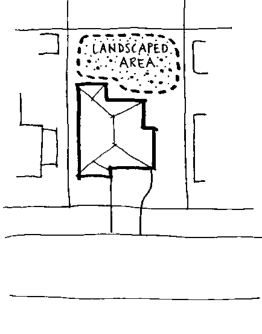

> [Picture on page 8: a picture, saved as a picture (images/part-c-general-guidelines-page-8-10.gif, 150 dpi).]

Other sections of this DCP identify the amount of areas required for different developments to be provided as open space.

A major proportion of the total amount of open space required shall be provided as a single parcel with suitable dimension to

#### accommodate its use.

#### Location

#### Figure C0.2

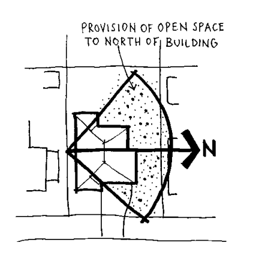

> [Picture on page 8: a picture, saved as a picture (images/part-c-general-guidelines-page-8-20.gif, 150 dpi).]

The main parcel of recreation space should be located on the northern, north-eastern or north-western sides of residential buildings in order to achieve the optimum solar aspect, to avoid winter shadow and exposure to cold winds, and to ensure that such space is usable all year round.

On larger sites where the topography may include southerly slopes or areas shaded during winter months, such areas should not be used to locate the main open space parcel or parcels.  However, in some localities experiencing adverse northerly winds, protected south-facing courtyards may have merit.

Landscaping

In the case of caravan parks and tourist development, the main open space parcel shall be located close to caravan or unit sites, but shall be separate from internal roads to ensure safe conditions for children with respect to traffic.

#### Planting Considerations

> [Picture on page 9: a picture, saved as a picture (images/part-c-general-guidelines-page-9-6.gif, 150 dpi).]

The detailed landscape design should take into account the placement of evergreen and deciduous tree species to ensure winter sun penetration into buildings and outdoor open space/recreation areas.

Where there are existing native trees on the site, the planting should include a proportion of similar species so as to retain the character of the area.

Landscaping should include a suitable proportion of trees, other than palms, in order to: ƒ reduce the visual impact of buildings;

ƒ shade their western elevations from the hot afternoon summer sun;

ƒ promote privacy between sites; and ƒ provide shade for car parking areas, outdoor recreation areas, and children's play areas.

Planting of trees in straight lines should generally be avoided.  Planting should be in clumps with a mix of suitable trees, shrubs and ground covers.

Shrub masses should be used to reduce the visual impact of parking and service areas, and to act as windbreaks and privacy screens for outdoor open space areas.

#### Wind Buffers

Existing stands should be retained as wind buffers.  Where clearing is necessary, it should be undertaken only in a direction at right angles to the prevailing winter winds.

Landscaping

#### Figure C0.3

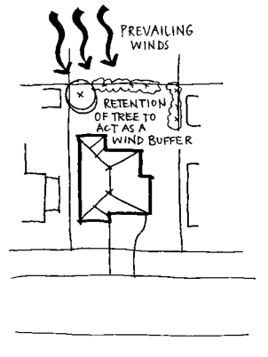

> [Picture on page 10: a picture, saved as a picture (images/part-c-general-guidelines-page-10-2.gif, 150 dpi).]

#### Drainage

Existing vegetation should be retained along natural drainage lines and supplementary planting should be considered, to reduce moisture levels and lower stormwater velocities, thus reducing the possibility of erosion of top soil.

#### Figure C0.4

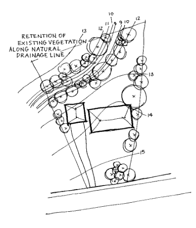

> [Picture on page 10: a picture, saved as a picture (images/part-c-general-guidelines-page-10-8.gif, 150 dpi).]

#### Treatment

A minimum of 50% of the main open space parcel shall be suitably treated, provided with outdoor furniture and equipment, and screened where necessary, to provide outdoor seating, recreation and children's play areas, where appropriate to the development, to Council's satisfaction.

Landscaping

#### Screening

Suitable screen fencing will be permitted, where appropriate, to ensure privacy and clothes drying areas and to block out undesirable views.  Screen walls may be constructed of brick, timber or other approved materials and shall be suitably designed to achieve integration with the overall landscape treatment.

#### Climate

A site's microclimate is directly affected by a combination of the prevailing climatic conditions such as the site's aspect (the direction it faces), the topography, the vegetation and the structures.  With due consideration to the prevailing weather conditions, landscaping can effectively control climatic impacts on buildings and outdoor spaces.

#### Wind Control

> [Picture on page 11: a picture, saved as a picture (images/part-c-general-guidelines-page-11-17.gif, 150 dpi).]

Landscaping should protect buildings and outdoor spaces from unfavourable and cold winter winds.

#### Figure C0.5

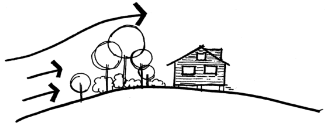

> [Picture on page 11: a picture, saved as a picture (images/part-c-general-guidelines-page-11-21.gif, 150 dpi).]

A moderately penetrable shelter belt (60% solid, 40% opening) is the most effective in protecting from unfavourable winds.  If it is too dense it will cause turbulence.

#### Figure C0.6

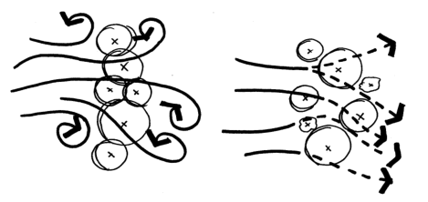

> [Picture on page 11: a picture, saved as a picture (images/part-c-general-guidelines-page-11-25.gif, 150 dpi).]

A good windbreak will give protection over a distance equal to at least eight times its height.

Landscaping

#### Figure C0.7

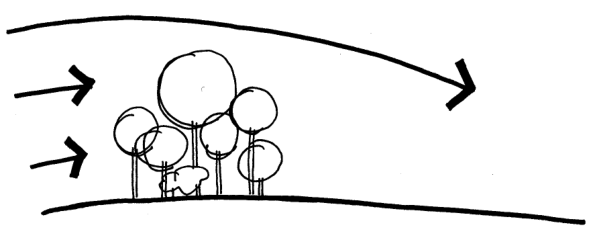

> [Picture on page 12: a picture, saved as a picture (images/part-c-general-guidelines-page-12-2.gif, 150 dpi).]

#### Solar Radiation Control

Landscaping should maximise winter sun and minimise summer sun.

#### Figure C0.8

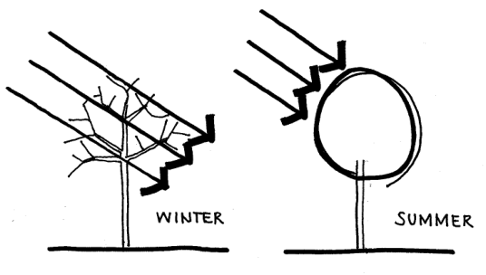

> [Picture on page 12: a picture, saved as a picture (images/part-c-general-guidelines-page-12-6.gif, 150 dpi).]

#### Landscaping should reduce glare and reflection, particularly off driveways and car parks.

#### Figure C0.9

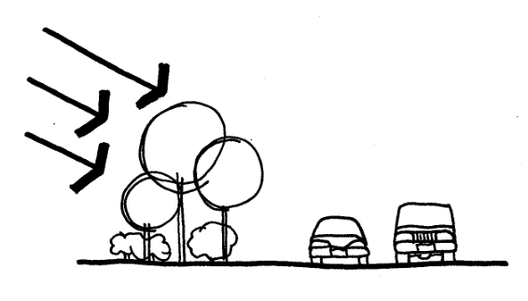

> [Picture on page 12: a picture, saved as a picture (images/part-c-general-guidelines-page-12-9.gif, 150 dpi).]

In summer the western elevations of buildings should be protected from the afternoon sun with trees of suitable mature height.

Landscaping

#### Low shrubs, bushes and grasses should be used to reduce the reflection of solar energy from

roadways or any other paved surface.

#### Run-off

Retarding basins can be complemented with planting for extra absorption.

#### Mounding

Earth mounds can perform a variety of functions including:

ƒ screening; ƒ buffer strips;

ƒ barriers;

ƒ design features; ƒ water retention;

ƒ noise reduction;

ƒ light control; and ƒ windbreaks.

Wherever utilised, mounds should form an integral part of the landscape strategy.

#### Figure C0.10

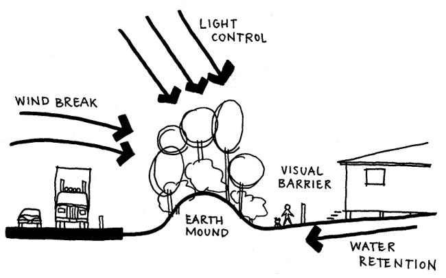

> [Picture on page 13: a picture, saved as a picture (images/part-c-general-guidelines-page-13-17.gif, 150 dpi).]

Landscaping

#### Typical Mound Detail

#### Mounds must be stabilised by appropriate planting to avoid erosion.  Use mulch and ground

cover for moisture retention and stability.  Soil should have good moisture holding capacity. Mounds which are to be turfed should have slopes not exceeding 1 in 3.

#### Car Park Mounding

The following detail illustrates the use of mounding to contain effectively noise and car headlights in a car parking area.

Provided mounds are densely planted, they will also act as a pedestrian barrier.

#### Figure C0.11

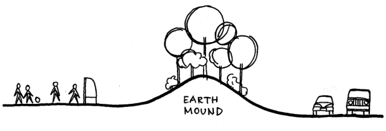

> [Picture on page 14: a picture, saved as a picture (images/part-c-general-guidelines-page-14-10.gif, 150 dpi).]

#### Drainage Retardation

Mounds or weirs can be incorporated into minor (non-permanent) drainage lines as landscape features, and restrict water flow during storms.

#### Noise

Landscaping creates a natural buffer for machinery noise and adds to the amenity of the area.

#### Pedestrian Access

Landscaping should aim to provide a streetscape environment that encourages people to walk or cycle.

Pathways and laneways should create a series of attractive experiences while ensuring safety and surveillance is not compromised.

Pedestrian crossings can be used to highlight access points and perceptually emphasise the pedestrian environment.

Landscaping

#### Edging

#### Figure C0.12

#### Figure C0.12

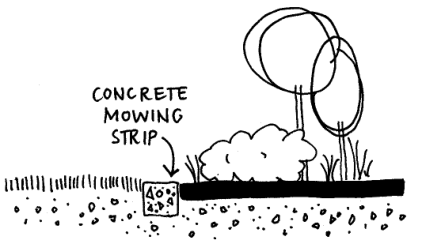

> [Picture on page 15: a picture, saved as a picture (images/part-c-general-guidelines-page-15-4.gif, 150 dpi).]

Grassed areas should be separated from garden beds with suitable garden edging.

Grassed areas should be separated from garden beds with suitable garden edging.

Mowing strips of concrete, brick or timber should be constructed to facilitate ease of maintenance and to enhance appearance.

Mowing strips of concrete, brick or timber should be constructed to facilitate ease of maintenance and to enhance appearance.

#### Mulching

All planting beds and mounds are to be mulched with suitable material to a minimum depth of 100 millimetres.  These areas should then be over planted with suitable ground covers to create a living mulch.

The use of black plastic or similar impermeable membranes on planting beds is not acceptable, as it interferes with air and water entering the soil.

#### Figure C0.13

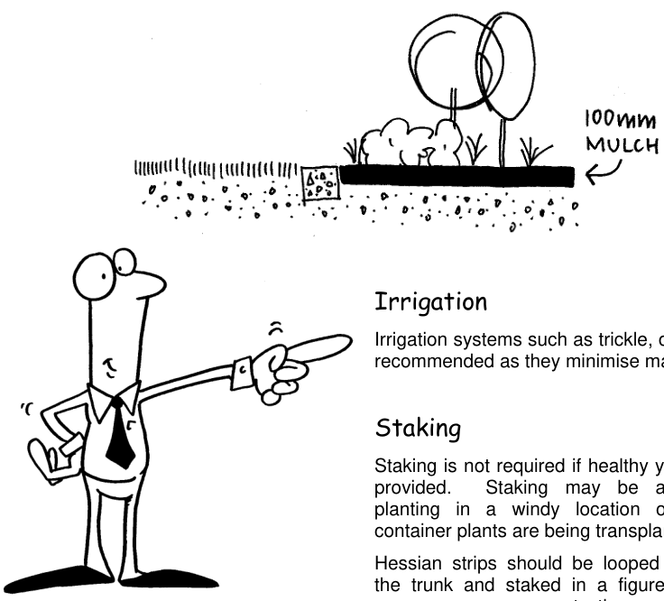

> [Picture on page 15: a picture, saved as a picture (images/part-c-general-guidelines-page-15-22.gif, 150 dpi).]

#### Irrigation

Irrigation systems such as trickle, drip or spray are recommended as they minimise maintenance.

#### Staking

Staking is not required if healthy young plants are provided.  Staking may be advisable when planting in a windy location or where large container plants are being transplanted. Hessian strips should be looped loosely around the trunk and staked in a figure eight to allow some sway movement, thus encouraging root

Landscaping

growth.

#### Fertilising

Many native plants are adapted to conditions of low soil fertility, such as species (Banksia, Grevillea and Hakea).  Care should be taken when fertilising these types of plants, and only fertilisers with low phosphorous content should be used.

#### Species Variety

While some species will grow in full sun or fairly exposed in areas, other factors such as soil type and drainage may limit their use in certain situations.  In these cases it may be more appropriate to select plants native to the Hawkesbury area.

To assist with the choice of suitable species, Appendix D in this DCP includes a categorised species list.  Species and varieties have been identified along with other information relating to habitat and growing conditions.

#### Access and Mobility

Landscaping design shall allow for easy access for people dependent on walking frames,

#### wheelchairs and pushing prams.  Designs shall include:

ƒ location and design of designated vehicle parking bays; ƒ grades and widths of access paths and ramps;

ƒ outdoor furniture and other fixtures;  and

ƒ reference to Australian Standards.

Landscaping

Chapter 2 CAR PARKING AND ACCESS

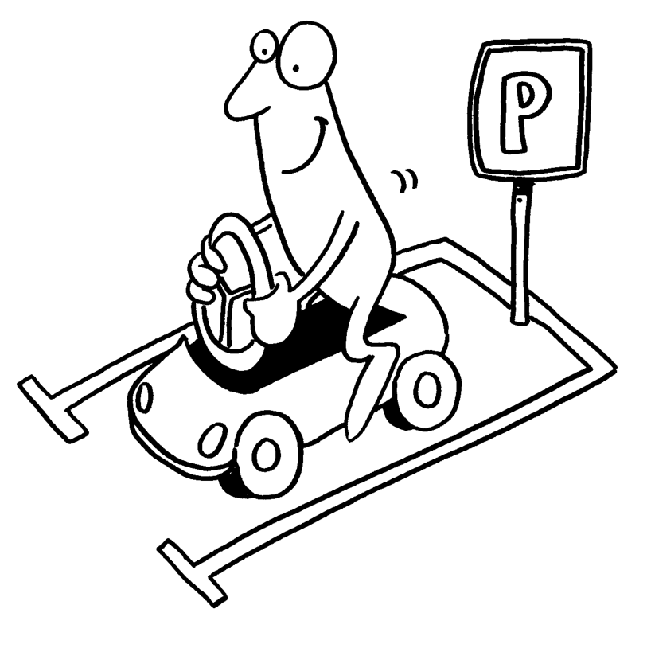

> [Picture on page 17: a picture, saved as a picture (images/part-c-general-guidelines-page-17-3.gif, 150 dpi).]
