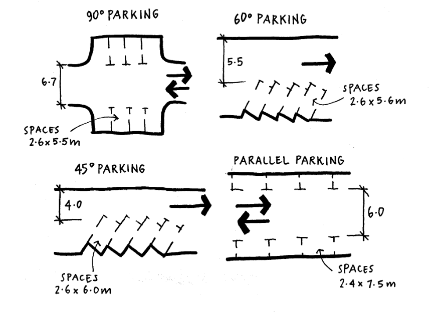

### 2.6 ACCEPTABLE DESIGN SOLUTIONS

ƒ Minimum dimensions for car parking spaces and aisle widths to be in accordance with the following table and diagram.

| Parking Layout | Parking Space Dimensions (metres) | Traffic Flow | Aisle Width (metres) |
|---|---|---|---|
| 90O Parking | 2.6 x 5.5 | Two Way | 6.7 |
| 60O Parking | 2.6 x 5.6 | One Way | 5.5 |
| 45O Parking | 2.6 x 6.0 | One Way | 4.0 |
| Parallel | 2.4 x 7.5 2.4 x 7.5 | One Way Two Way | 4.0 6.0 |

Carparking

#### Figure C0.1

> [Picture on page 25: a picture, saved as a picture (images/part-c-general-guidelines-page-25-2.gif, 150 dpi).]

ƒ Car parks to provide separate ingress and egress points where more than 50 parking spaces are provided or where traffic turnover is high.

ƒ Driveways to be located at least 1 metre from adjoining property boundaries. ƒ Driveways to have a minimum width of 6 metres at or in front of the building line except for single dwellings. This may be reduced in width for residential developments behind the building line in accordance with the following table.

Note: The Australian Standard shall not be used in determining design and layout of car parking.  Consideration will be given to reduce widths where aisle widths are provided.

| Number of Dwellings | Minimum Driveway Width |
|---|---|
| 9 or fewer | 3 metres |
| 10 to 20 | 4 metres |
| more than 20 | 5.5 metres |

ƒ Where parking spaces are located 900 to the driveway alignment, the minimum driveway width adjacent to the space is to be 6.7 metres to allow adequate manoeuvring.

Carparking
