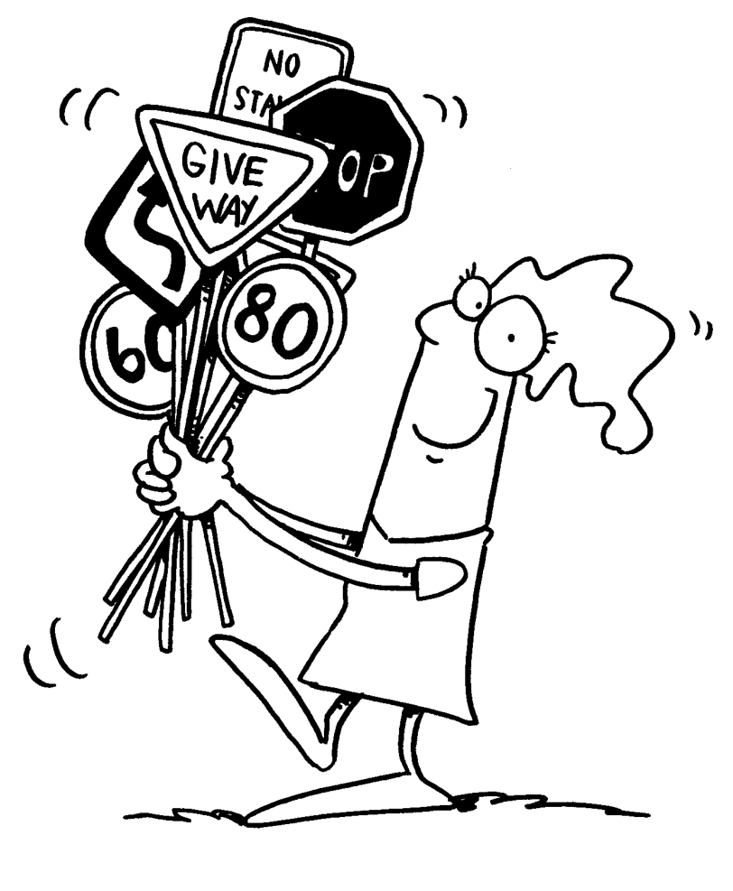

### 2.7 ACCESS AND MOBILITY

The provision of parking for persons with a disability is to be provided in accordance with Australian Standard 2890.1 – 1993 and the Building Code of Australia.  Such spaces shall be located so as to allow convenient and safe access within sites.

The width of a disabled parking space should allow for the disembarking of either the disabled driver or passenger.  The disembarking zone is not to be shared with general pedestrian access.  The space should be long enough to allow for the loading/unloading of wheelchairs.

Acceptable design solutions involving car parking spaces for disabled persons are: ƒ it should be located as close as practicable to and be linked to an entrance of the building, or to a wheelchair accessible lift by a continuous accessible path of travel;

ƒ a firm surface and a fall not exceeding 1 in 40 in any direction; ƒ a minimum length of 5.5 metres, a minimum width of 3.8 metres and a minimum height of 2.5 metres;

ƒ clearly visible sign incorporating the international symbol of access for disabled people; ƒ an overlap allowance (maximum 500 millimetres) applies when, parallel to the car parking space, there is an adjoining walkway or similar surface which is: à at the same level as the car parking space; à firm and level, with a fall not exceeding 1 in 40 in any direction; à not another car parking space; and à not less than 1,000 millimetres in width;

ƒ a vertical clearance of not less than 2,500 millimetres provided from the entrance of the car parking space to a distance of not less than 2,160 millimetres from the far end when entering the space; and

ƒ non-slip or textured paint used for line markings.

Carparking

Chapter 3 SIGNS

> [Picture on page 27: a picture, saved as a picture (images/part-c-general-guidelines-page-27-3.gif, 150 dpi).]
