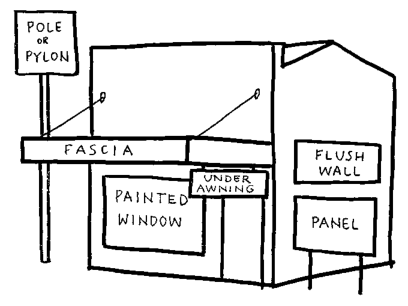
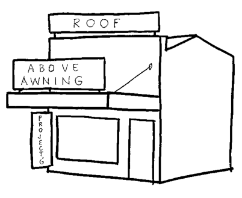

### 3.2 SIGNS IN COMMERCIAL AND INDUSTRIAL ZONES

#### Aim

‰ To permit adequate business identification and advertising to identify the nature of the business conducted on the premises.

#### Objectives

¾ The design and location of signs are to: à be integrated and in proportion with the architecture and structure of the host building;

à be placed to ensure that architectural features of the building, views or vistas are not obscured;

à consider existing signs to avoid visual or physical clutter; and à avoid obstruction of pedestrian access or line or sight of vehicular traffic.

¾ Signs shall be simple, concise and uncluttered in appearance.  Emphasis should be on clarity of communication.

Signs

¾ Advertising other than real estate signs shall relate to the use occurring on the respective property.

¾ A common structure for signage shall be provided for multi unit developments.

¾ Directional signage should be located in a convenient point close to the main entry to the development.

#### Rules

#### Figure C0.1 Acceptable signage

> [Picture on page 30: a picture, saved as a picture (images/part-c-general-guidelines-page-30-8.gif, 150 dpi).]

Signs that are generally acceptable are: à under the awning signs; à painted window signs; à pole or pylon signs up to 6 metres in height;

à fascia signs - signs attached to the fascia or return of an awning;

à flush wall signs - attached to the wall of a building and projecting not more than 300 millimetres;

à top hamper signs - attached to the transom of a doorway or display window of a building.

#### Figure C0.2 Unacceptable signage

> [Picture on page 30: a picture, saved as a picture (images/part-c-general-guidelines-page-30-22.gif, 150 dpi).]

Signs that are unacceptable are: à pole or pylon signs above 6 metres in height;

à roof sign - signs erected on or above the roof or parapet of a building;

à above awning signs - signs attached to the upper side of an awning);

à horizontal projecting signs -attached to the wall of a building and projecting more than 300 millimetres horizontally;

à vertical projecting signs - attached to the roof of a building and projecting more than 300 millimetres vertically;

à moving, blinking or flashing signs;  and à fin signs - signs erected on or above the canopy of a building.

Compliance with the requirements of State Environmental Planning Policy No. 64 - Advertising and Signage.

Signs
