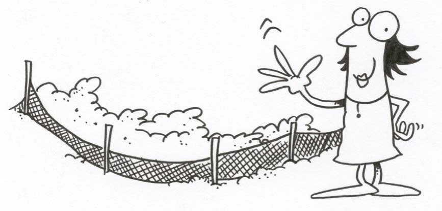

### 3.8 PROHIBITED SIGNS

Hawkesbury Local Environmental Plan 1989 prohibits the following signs:

ƒ signs mounted on motor vehicles or trailers (whether registered or unregistered) where the vehicle or trailer is parked in a location of position for a period of time such that its principal function is for the display of an advertisement and not for the transportation of goods or people;

> [Picture on page 34: a picture, saved as a picture (images/part-c-general-guidelines-page-34-13.gif, 150 dpi).]

ƒ any ‘freestanding portable sign’ not being co vered by a current insurance policy; and

any form of

ƒ

advertising sign attached to telegraph poles, trees, street posts or the like.

rohibited signs will be required to be removed from display upon notification from an

P authorised Council officer.  Should the prohibited sign be displayed after such notification is given, then the sign may be confiscated and disposed of at the waste depot.  Alternatively, where the sign is affixed to private property, failure to remove the sign after notification may result in legal action being taken against the person benefiting from the sign.

Signs

Chapter 4 SOIL EROSION AND

### SEDIMENT CONTROL

> [Picture on page 35: a picture, saved as a picture (images/part-c-general-guidelines-page-35-4.gif, 150 dpi).]
