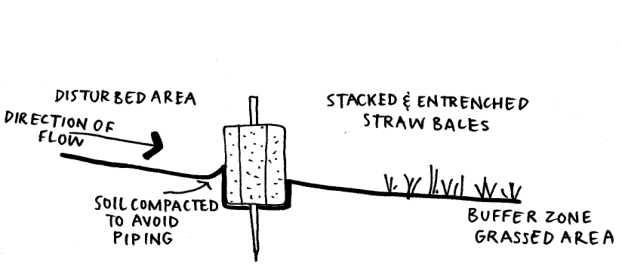
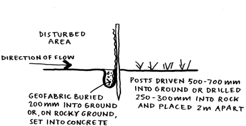
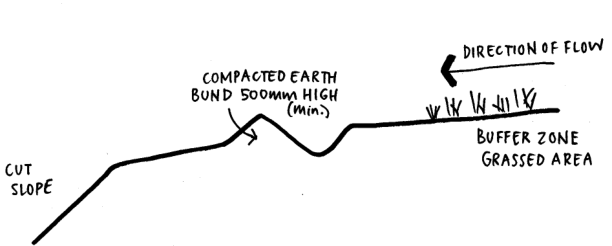
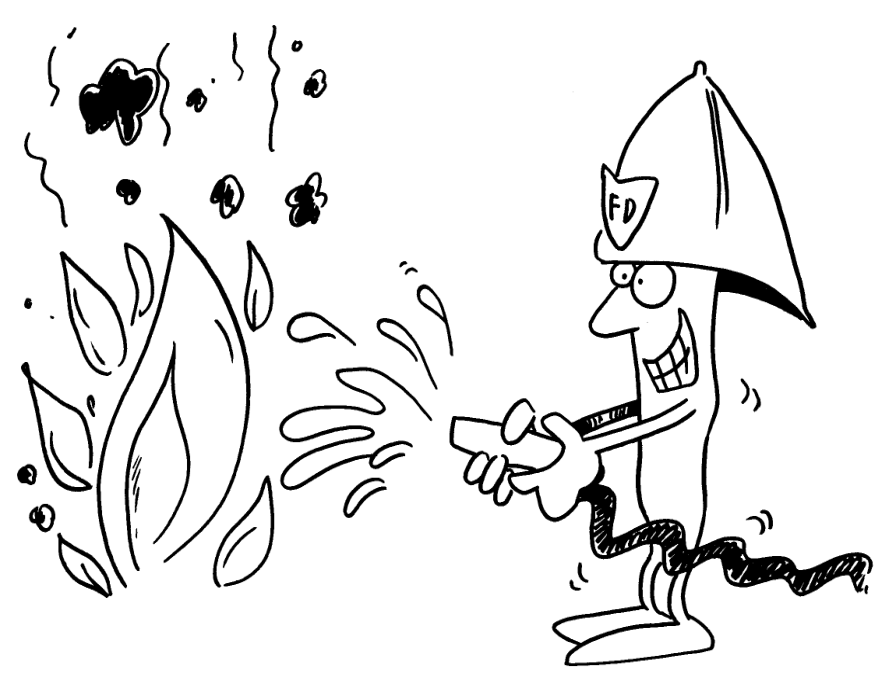

### 4.7 EXPLANATORY NOTES ON BASIC CONTROL METHODS

Sediment is generated when soil erosion occurs. Prevention of soil erosion, must therefore be the first priority.  Temporary sediment control measures most commonly used during urban development include the following: ƒ Sediment Retention Barriers - materials used in their construction include straw bales, geofabric attached to wire fences, geofabric over straw bales, stabilised earth, hessian bags filled with aggregate or dry sand cement mix, etc.  Actual choice generally depends on constraints imposed by availability and cost.

ƒ Straw Bales - used in temporary situations instead of earth to construct bunds, perimeter banks or catch drains.  They will probably need replacement at intervals of less than four months.  Users should ensure that they are: à bound with wire or plastic rather than twine; à placed lengthways in rows, single or twin, with straws parallel to the ground surface;

à embedded into the soil to a depth on the upslope side of at least 0.1 metre; and à anchored securely to the ground by two stakes or pickets driven through the centre.

#### Figure C0.1 Construction of straw bale bund

> [Picture on page 42: a picture, saved as a picture (images/part-c-general-guidelines-page-42-19.gif, 150 dpi).]

ƒ Sediment Fencing - used instead of bunds. The sediment fence must not be placed outside the property boundary. Installation inside the boundary is recommended as follows: à excavate a small (150 to 200 millimetres deep) trench along the line of the fence, ensuring any loose spoil is deposited on the upslope side;

à geofabric buried 200 millimetres into ground; or on rocky sites set into surface concrete;

à posts to be at a maximum of 2 metre centres, and driven into ground 500 to 700 millimetres or drilled into rock 250 to 300 millimetres;

à height from ground level to top of fabric to be minimum 500 millimetres;

Soil Erosion and Sediment Control

à any joints overlap a minimum 300 millimetres and are either sewn or securely attached to a post; and

à for strength, fabric may be reinforced with chain, weldmesh or wire fence.

#### Figure C0.2 Construction of geo-fabric lined silt fence

> [Picture on page 43: a picture, saved as a picture (images/part-c-general-guidelines-page-43-5.gif, 150 dpi).]

ƒ All erosion and sediment control measures must be regularly inspected and adequately maintained.  They must function efficiently until the development is completed and the site rehabilitated.

ƒ Temporary control measures not required after rehabilitation should be removed and the area stabilised and revegetated.

ƒ Permanent control measures will require a long term maintenance strategy to ensure their ongoing efficiency.

#### Figure C0.3 Use of bunds and channels to divert water from a cut slope

> [Picture on page 43: a picture, saved as a picture (images/part-c-general-guidelines-page-43-14.gif, 150 dpi).]

Soil Erosion and Sediment Control

Soil Erosion and Sediment Control

Chapter 5 BUSHFIRE PRONE LAND

> [Picture on page 45: a picture, saved as a picture (images/part-c-general-guidelines-page-45-3.gif, 150 dpi).]
