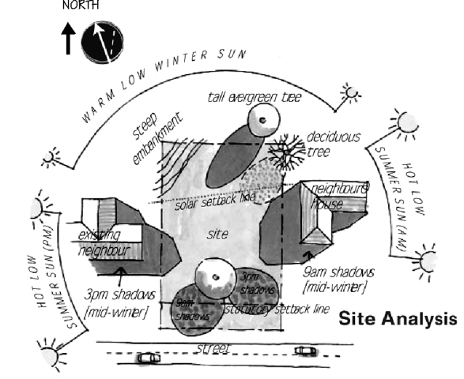
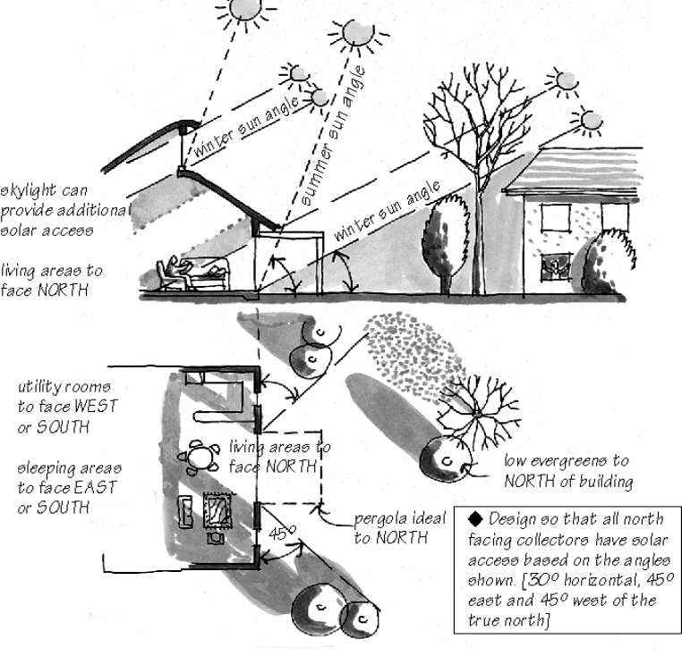
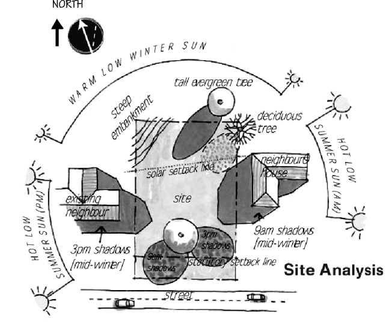
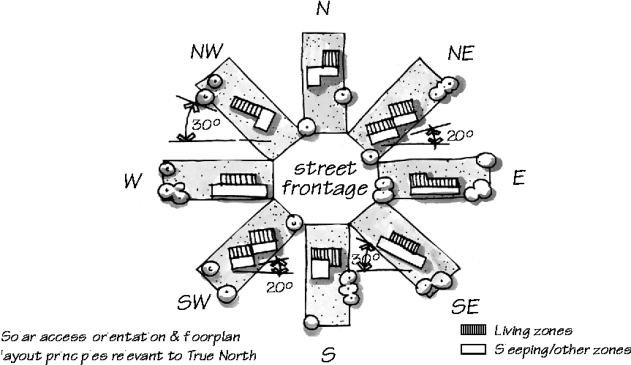

### 6.4 SOLAR ACCESS

#### Aim

‰ To preserve solar access to north facing solar collectors, private open space and clothes drying facilities in all residential development.

#### Objectives

¾ Full solar access is to be maintained to solar hot water or photovoltaic panels.

¾ Design so that all north facing solar collectors have in front of them a volume bounded by an imaginary inclined plane, angled up at 30o to the horizontal and two vertical planes 45o either side of the centre-line which is clear of all shadow-forming objects such as trees, garages, neighbouring dwellings.

¾ Step building heights and setbacks to permit solar access requirements. ¾ Position solar collectors in areas where no shadows fall (determine through site analysis).

#### Rules

( a ) Solar collectors face 20o west of north and 30o east of north and receive direct sunlight between the hours of 9.00am and 2.00pm on June 21.

( b ) Four hours of direct sunshine is received by 75% of other north facing solar collectors designed/installed under this Plan (refer Definitions, Appendix A).

( c ) Sunlight is available to at least 50% of required private open space for at least 2 hours between 9.00am and 3.00p, on 21 June.  Where existing overshadowing is greater than the above, it should not be further reduced.

( d ) Any new development will not reduce the solar access of solar collector/s of an adjoining property to less than 4 hours per day in mid-winter except solar hot water panels to which full access must be maintained.

( e ) Sunlight is available to a clothes drying area for at least 4 hours on June 21, to a plane 1 metre above the finished ground levels under the drying lines.

Energy Efficiency

#### Figure C6.1

> [Picture on page 54: a picture, saved as a picture (images/part-c-general-guidelines-page-54-2.gif, 150 dpi).]

#### HELPFUL HINTS Site Analysis

A solar site analysis assists in siting your building[s] to achieve maximum solar access in winter,

#### including:

à true north point [refer Definitions, Appendix A] à spot levels or contours à shadows cast by trees and surrounding structures à solar setback line [refer Definitions, Appendix A] where necessary

Energy Efficiency

#### Figure C6.2

> [Picture on page 55: a picture, saved as a picture (images/part-c-general-guidelines-page-55-2.gif, 150 dpi).]

#### Building Orientation

#### To maximise winter solar access and minimise summer heat gains:

#### à face the long axis of your building up to 30° east and 20° west of true north

à face living spaces to the north, sleeping areas to the east or south and utility areas to the west or south

Energy Efficiency

#### Figure C6.3

> [Picture on page 56: a picture, saved as a picture (images/part-c-general-guidelines-page-56-2.gif, 150 dpi).]

Energy Efficiency

#### Figure C6.4

> [Picture on page 57: a picture, saved as a picture (images/part-c-general-guidelines-page-57-2.gif, 150 dpi).]

#### HELPFUL HINTS Site Analysis

A solar site analysis assists in siting your building[s] to achieve maximum solar access in winter, including:

à true north point [refer Definitions, Appendix A] à spot levels or contours à shadows cast by trees and surrounding structures à solar setback line [refer Definitions, Appendix A] where necessary

#### Figure C6.5

> [Picture on page 57: a picture, saved as a picture (images/part-c-general-guidelines-page-57-12.gif, 150 dpi).]

Energy Efficiency

#### Building Orientation

#### To maximise winter solar access and minimise summer heat gains:

à face the long axis of your buildings up to 30° east and 20° west of true north

à face living spaces to the north, sleeping areas to the east or south and utility areas to the west or south

#### Figure C6.6

> [Picture on page 58: a picture, saved as a picture (images/part-c-general-guidelines-page-58-8.gif, 150 dpi).]

#### Solar Access General Guidelines

#### Consider:

à solar access early in the design process à existing winter shadows of trees/structures to the north, NE and NW of your site

Energy Efficiency

à possible future developments to the north, NE and NW of your site versus overshadowing

à the design of windows, shading devices and roof overhangs pergolas to the north

à consider the addition of a sun porch or greenhouse [consider vents; high performance glass; external shading devices]

#### Medium Density and Multi-Unit Housing

à consider the spacing between buildings à consider high level windows to the north in the case of attached dwellings
