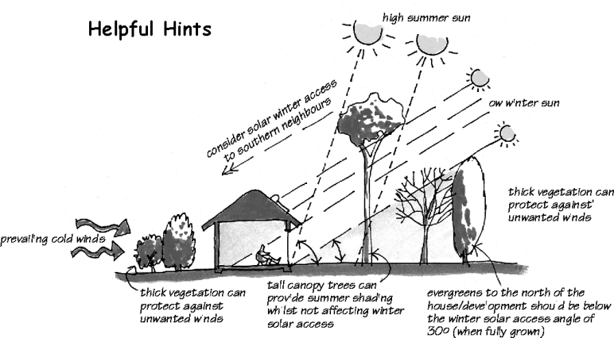

### 6.5 LANDSCAPING

#### Aims

‰ To ensure that streetscape components do not detrimentally affect solar access to individual dwellings.

#### Objectives

¾ Street tree species are selected to provide summer shading while not impeding solar access to dwellings in winter.

¾ Trees are planted or retained so as not to impede solar access to dwelling.

¾ Streetscapes contribute as winter windbreaks.

#### Rules

( a ) Select deciduous trees for solar efficiency where shadows may impact on housing. ( b ) Plant taller tree species on northern side of east-west aligned;  shorter species on southern.

( c ) Select plantings with low maintenance and low water consumption. ( d ) Retain existing vegetation in master plan to minimise solar obstruction to dwellings. ( e ) Select evergreen species for windbreaks and plant them along south or west side of area being protected against the wind.

( f ) Ideally, select indigenous species that preserve solar access of adjoining properties.

Energy Efficiency

#### Figure C6.7

> [Picture on page 60: a picture, saved as a picture (images/part-c-general-guidelines-page-60-2.gif, 150 dpi).]
