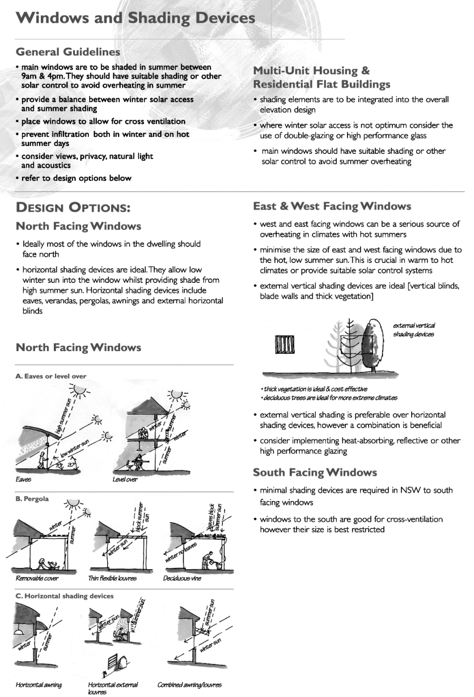
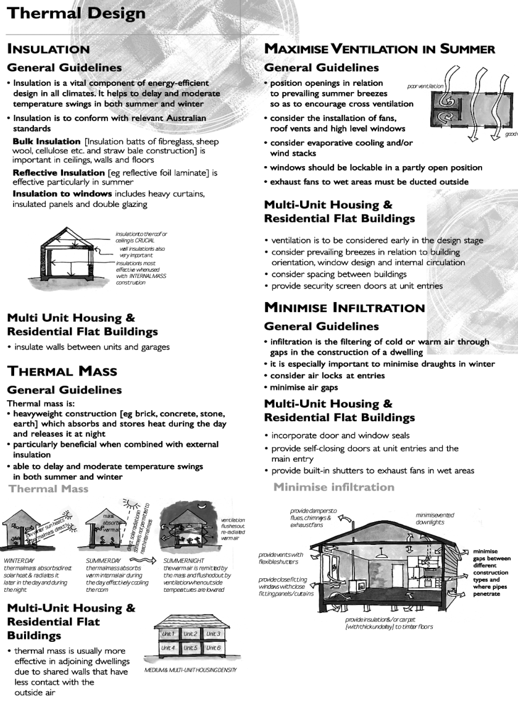

### 6.6 RESIDENTIAL DEVELOPMENT

#### Aims

‰ To maximise the use of renewable energy sources in design and construction of residential development.

#### Objectives

¾ The selection of an energy efficient heating/cooling system should be made during dwelling design stage.

¾ Heating/cooling systems should target only those spaces which require heating or cooling, and ensure efficient distribution/redistribution of warm/cool air.  where a space heating and cooling system is installed it should be selected for maximum energy efficiency.

#### HELPFUL HINTS Space Heating and Cooling

à Consider natural forms of heating and cooling.  These should be considered in design process.

à Select an energy efficient heating/cooling system dwelling design stage. à The incorporation of programmable thermostats is highly recommended. à The incorporation of a control system is recommended [to regulate air flow between zones via dampers and regulation fan speed].

Energy Efficiency

à Ductwork should be insulated to ≥ R1.5. à Refrigeration lines are to have a minimum of 20mm foam insulation. à Energy efficient and renewable energy systems are highly recommended.

#### Dual Occupancy, Multi-Unit and Shop-Top Housing

à Individual HW units should be placed indoors and close to wet areas. à An individual HW heater can double as an airing cupboard. à Appliances with maximum energy efficiency should be installed.

#### HELPFUL HINTS Lighting General Guidelines

à Maximise the use of natural lighting. à Design lighting fixtures to suit the purpose of specific rooms [eg task or effect lighting in study, general spread of lighting in family room].

à Provide separate switches for special purpose lights. à Incorporate energy-efficient lamps, fittings and switches [eg. Compact fluorescent lighting].

à Locate switches at exits to rooms/lobbies etc to encourage switching off. à Incorporate dimmers, motion detectors, automatic turn-off switches where appropriate.

#### Dual Occupancy, Multi-Unit and Shop-Top Housing

à Light switches in common areas are to be time switched. à Incorporate fittings with high efficiency reflectors suitable for compact fluorescent lamps and fluorescent tubes.

à Motion detectors are to be used for unit entries, lobbies and outdoor security. à Provide automatic turn-off switches for outdoor purposes. à Allowance is made for outdoor drying space with solar access.

#### Rules

#### a) A minimum NatHERS rating of 3.5 stars is achieved for the relevant the development

type.

b) A hot water system with a Greenhouse Score of 3.5 stars or greater is installed and which suits the needs of the occupants.

Energy Efficiency

#### Hot Water and Appliances

| Water Heater Types | Star Rating |  |
|---|---|---|
| Solar Gas Boost* | Storage | 5 |
| Gas | Instantaneous | 4 |
| Gas Storage | High Efficiency | 4 |
| Gas Central Boiler | With insulated circulating ring main | 4 |
| Electric Storage | Heat Pump | 4 |
| Gas Storage | Low Efficiency | 4 |
| Solar Electric Boost* | Continuous | 4 |
| Solar Electric Boost* | OP2 | 4 |
| Electric | Instantaneous | 2 |
| Electric | Continuous | 1 |
| Electric Storage | Storage [OP1 OP2] | 1 |

\*Greater than 50% solar contribution

#### Water Heating

#### General Conditions

à All newly installed hot water [HW] systems are to have a minimum rating of 3.5 stars [refer table above]

à HW systems are to be located as close as possible to wet areas [kitchen, bathroom, laundry, etc]

à Insulation of tanks and/or pipes is beneficial à Cluster wet areas so as to minimise pipe runs à Roof design should consider the option of a north facing solar HW system.

ƒ The dwelling should be designed so that artificial lighting is unnecessary during daylight hours, and when required uses energy efficient lamps and fittings requiring less that 3 watts/m2 of installed lighting.

ƒ Dryers, where necessary, should have a greenhouse score of at least 3.5 stars and have direct ventilation to outside.

ƒ At least AAA rated water efficient shower heads, toilets and aerators on bathroom hand basins and kitchen sinks are installed.

ƒ Design dwelling specifically for its site (locate northern wall to maximise solar access, and orient one of the building's axes between 30o and 20o west of true north.  where this is not possible in existing subdivisions, provide properly shaded north facing glass to living areas and maximise solar access by the use of site analysis including existing shadows diagram.

Energy Efficiency

ƒ Living zones (lounge, family, dining, kitchen] located on northern side, for maximum thermal comfort.

ƒ External shading to north facing windows should provide maximum shading in summer and minimum shading in winter.  This type of shading can be eave overhangs or fixed awnings designed to meet a 70o (from the horizontal) line drawn from the bottom of the window to the eave.

ƒ Pergolas, verandas and eaves to the western and eastern aspects designed to maximise summer shade and minimise winter shade by deciduous climbing vines on pergolas or operable louvers.

ƒ The proportion of north-facing (30o east to 20o west of true solar north) windows in a plan compared to other aspects should be as close to 75% as the site and plan will allow.

ƒ Provision of lighter coloured roof and walls.

ƒ Openings designed to take advantage of prevailing wind direction;  passive solar design not only takes advantage of cooling daytime breezes but depends on cool night-time ventilation to flush out the heat of the day so that the structure is cool for the next day.

Energy Efficiency

#### HELPFUL HINTS

#### Figure 6.8

> [Picture on page 64: a picture, saved as a picture (images/part-c-general-guidelines-page-64-3.gif, 150 dpi).]

Energy Efficiency

#### Figure C6.9

> [Picture on page 65: a picture, saved as a picture (images/part-c-general-guidelines-page-65-2.gif, 150 dpi).]

Energy Efficiency
