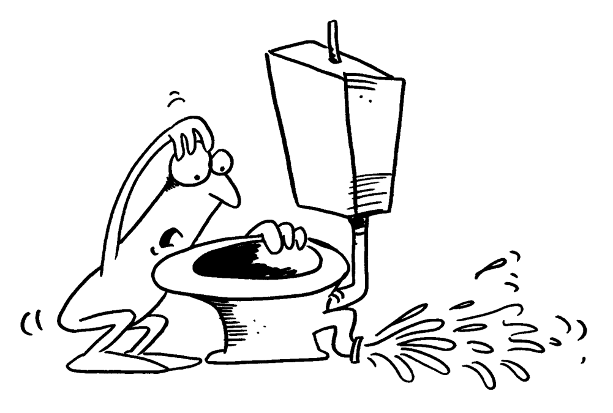

### 6.7 SCORING YOUR HOUSE/DEVELOPMENT

#### NatHERS Certification

NatHERS certification is required under this DCP for all housing types. A range of computer software tools have been developed in Australia to simulate and rank thermal performance in buildings across a wide variety of climatic zones. NatHERS [refer Definitions, Appendix A] is a sophisticated thermal modelling tool designed for use by experienced professionals and industry personnel.

NatHERS certification can be determined by accredited third party assessors within the building industry as well as accredited Council officers.  A list of accredited assessors is available from Council or the NSW House Energy Rating Management Body (HMB), telephone: 9385 5593 or www.fbe.unsw.edu.au/units/solarch/hmb.

#### Exemptions

There are special conditions under which an exemption can be claimed from the achievement of minimum energy performance for dwellings and alterations and additions. Where one or more of the special conditions apply, approval is subject to:

ƒ Single dwellings – provision of ceiling (min R2.5 rating) and wall (minimum R1.5 rating) insulation, and underfloor (min R2.0 rating) insulation to elevated timber floors.

ƒ Dual occupancy, multi-unit and shop-top housing – assessment on merit. An Energy Performance Statement will be required.

ƒ The seven special conditions are: à block geometry – orientation or shape of block such as to preclude the northerly orientation defined as 20o west of north to 30o east of north;

à block overshadowing – the adverse slope of a block, existing obstruction or planned or existing development resulting in overshadowing of northerly windows;

à block topography or geology – slope drainage of geotechnical constraints such as to preclude slab-on-ground type construction;

à novel construction – where the prescribed assessment techniques do not address or reliably assess the performance of the construction being adopted and there are prima facie grounds for believing the prescribed techniques significantly underestimate the construction’s performance;

à conflicting guidelines – existing lease and development conditions, any other policy or guidelines that Council determines will have priority over this DCP (heritage requirements, which preclude the attainment of the minimum rating requirement);

à uneconomic requirements – where it can be demonstrated that the attainment of the 3.5 star rating would require additional expenditure which is not cost effective

Energy Efficiency

within a five year period. The technique to establish the uneconomic nature of the requirements is the subject of a guide note available from Council; and

à water heater – where it is demonstrated that the installation of a low greenhouse gas emission water heating system (greenhouse score 3.5 or greater) would require additional expenditure which is not cost-effective within a five year period. The technique to establish the uneconomic nature of the requirements is the subject of a guide note available from Council.

#### For further information contact:

Energy Smart Information Centre (ESIC) Sydney Building Information Centre 525 Elizabeth Street, Surry Hills NSW 2010 Ph: 1300 363 768 or (02) 8303 1565 Fax: (02) 8303 0566

House Energy Rating Management Body (HMB)

Solarch

Faculty of Built Environment

University of New South Wales, NSW 2052 Ph: (02) 9385 5593 Fax: (02) 9385 4507 Email: hmb@unsw.edu.au

Website: http://www.fbe.unsw.edu.au/units/solarch/hmb

NSW Sustainable Energy Development Authority (SEDA) PO Box N442, Grosvenor Place NSW 1220 Ph: (02 9249 6100 Fax: (02) 9299 1519 Email: seda@seda.nsw.gov.au Web: www.seda.nsw.gov.au

Energy Efficiency

Chapter 7 EFFLUENT DISPOSAL

> [Picture on page 68: a picture, saved as a picture (images/part-c-general-guidelines-page-68-3.gif, 150 dpi).]
