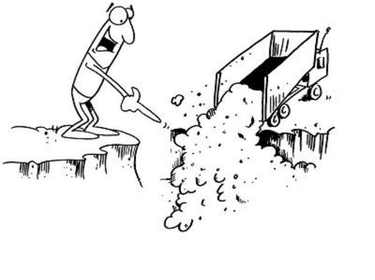

### 7.4 RULES

( a ) Waste water feasibility studies

With the exception of single dwellings in low risk areas as defined by Council's Septic Safe Program, or a toilet, shower and/or hand basin within a shed, garage or other outbuilding used in association with an existing approved development in a low risk area as defined by Council's Septic Safe Program, all developments

Effluent Disposal

requiring or relying on an existing or proposed on-site sewage management facility must be accompanied by a waste water feasibility study (or similar) prepared by a suitably qualified and experienced expert.   The feasibility study must contain the following information:

à Description of the proposed development

à Site and Soil Assessment.

This is to be an assessment of the site and surrounding area in relation to

> [Picture on page 72: a picture, saved as a picture (images/part-c-general-guidelines-page-72-8.gif, 150 dpi).]

the following factors:

- Size and shape

- Topography and exposure

- Run on and upslope seepage

- Erosion Potential

- Location of any landfill

- Drainage including likelihood of flood water inundation

- Proximity to watercourses

- Assessment of existing vegetation

- Proximity to threatened species, populations or ecological communities or their habitats

- Climate data obtained from the nearest Bureau of Meteorology of Australia weather station or from their Silo data set which ever is the closest

- Groundwater depth

- Buffer distances

- Soil type including assessment of depth, colour, texture, permeability, salinity and sodicity, instability, cation exchange capacity, mobility of nutrients, fertility, Ph  and potential to overcome soil limitations

- Assessment of the performance of any existing systems and feasibility of connection to any reticulated sewage system in the vicinity of the site.

à Assessment and Recommendation of Suitable Systems

This is to include:

Effluent Disposal

- estimations of the number of occupants and expected peak and averaged volume of waste water generated by the development

- calculations for nitrogen and phosphorus balances

- water balance calculations (based on a daily data set) for  land application areas

- the suitability of a various systems (such systems may include conventional septic tanks, aerobic wastewater treatment systems, amended soil mound systems and composting toilets)

- identification of land application areas and the suitability of the application area to receive waste water

- methods of disposal and concept design plans of disposal lines/trenches and full specification

- using daily water balance calculations, an assessment of the need for wet weather storage

- assessment of the need or advantages gained by primary tank outflow filters

- identification of recommended buffer distances/zones.

à Installation, Operation and Maintenance

The study must be accompanied by:

- details of recommended system(s)

- the operation and maintenance requirements for the proposed sewage management facility

- the proposed operation, maintenance and servicing arrangements intended to meet those requirements

- actions to be taken in the event of a breakdown in, or other interference with, its operation

- the estimated operational life of the system and options for system restoration/renewal at the end of the operational life of the system.

à Site Plan

This is to be a drawn to scale plan showing the location of:

- the sewage management facility proposed to be installed or constructed on the premises

- any other sewage management facility and land application area on the site

Effluent Disposal

- any existing buildings within 250m of the sewage management facility or land application area

- any dams, watercourses, drainage line or pipe work, vegetation, environmentally sensitive areas within 100 metres of the sewage management facility or land application area

- contours

- retaining walls, embankments and swimming pools.

à Specifications

- Specifications shall include (where applicable) details such as pump sizes, air pump capacities, cross sectional details of the proposed system and a technical description of the processes used

- Information as to the expected quality of effluent to be disposed on-site with specific reference to the following: ‚ Biological Oxygen Demand (mg/L) ‚ Suspended Solids (mg/L) ‚ Total Nitrogen (mg/L) ‚ Total Phosphorus (mg/L) ‚ Faecal Coliform (cfu/100ml) ‚ PH ‚ Dissolved Oxygen (mg/L) ‚ Residual Chlorine (mg/L).

à Certification

- The report is to certify that all site and soil investigations, water balance reports, proposed sewage management facilities and land application areas, and construction, installation and maintenance recommendations comply with the relevant provisions of Australian Standard 1547: 2000 On site domestic – waste water management, Standards Australia0/Standards New Zealand; On-Site Sewerage Risk Assessment System, NSW Department of Local Government; On-Site Sewage Management for Single Households, NSW Department of Local Government; and relevant NSW Health accreditations.

(b) Availability of Council Pump Out Service

On 10 August 1999 Council resolved the following:

Effluent Disposal

The only developments to be approved in respect of unsewered land that will rely on tanker removal of septic tank effluent are as follows:

a) single dwelling houses;

b) light industry and single shops which do not require a water supply greater than that which can be delivered via a normal domestic connection without on-site storage or which are not connected to a reticulated water supply

Subdivision of unsewered land that will rely on tanker removal of septic tank effluent will not be approved.

(c) Connection to Reticulated Sewage Service

Council will require that all new subdivisions and other new development are connected to a reticulated sewer system where it is reasonably available. This may include the extension of the reticulated sewer to service the development.

(d) Subdivision of Rural or Environmental Protection zoned land

In the case of the subdivision of Rural or Environmental Protection zoned land, any sewage management facility proposed to service the lots to be created which is not a composting toilet, convention septic tank and trench system, or a household Aerated Wastewater Treatment System will be required to be installed prior to release of the Subdivision Certificate.

Effluent Disposal

Chapter 8 MANAGEMENT OF

### CONSTRUCTION & DEMOLITION WASTE

### September 2005

> [Picture on page 76: a picture, saved as a picture (images/part-c-general-guidelines-page-76-6.gif, 150 dpi).]
