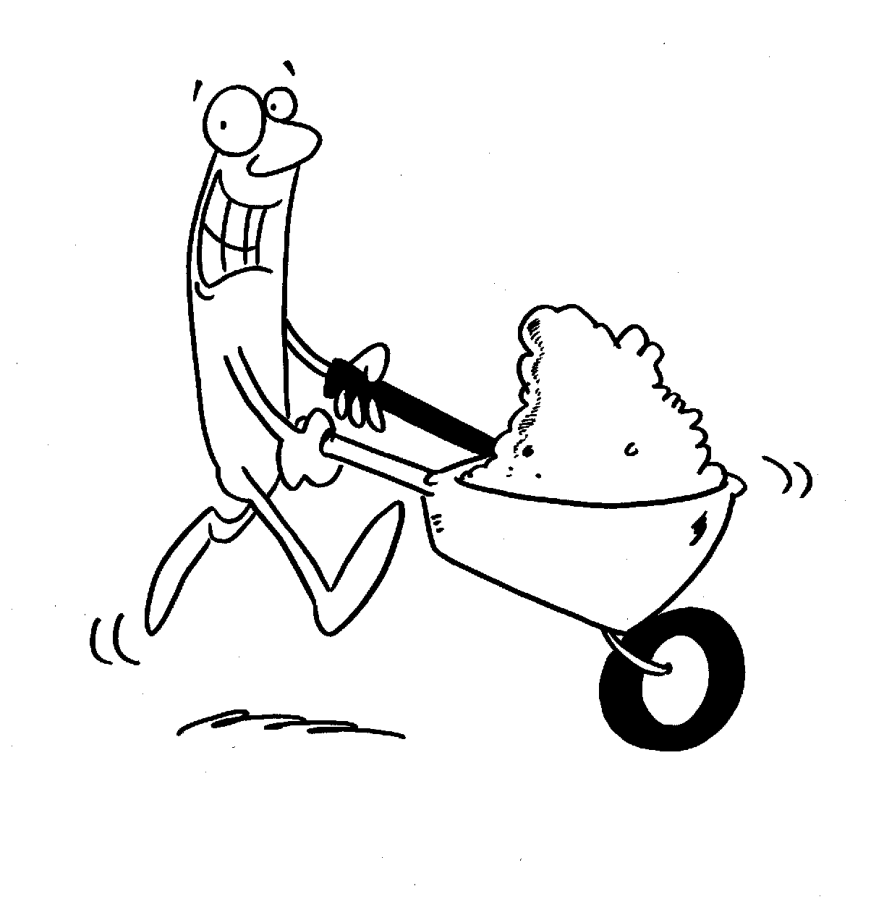

# Hawkesbury Development Control Plan 2002 - Part C General Guidelines

> This chapter is split into 44 section file(s), one per numbered heading, in the order they appear in the PDF.

Source PDF: [DCP_PARTC.pdf](https://planfortomorrow.sharepoint.com/sites/Planfortomorrow/Shared%20Documents/00%20NSW-Planning-Resources/dcp/hawkesbury-development-control-plan-2002/part-c-general-guidelines/DCP_PARTC.pdf)

### PART C GENERAL GUIDELINES

> The PDF's contents list (page numbers of the printed document) is not repeated here - see Sections below.

Chapter 1 LANDSCAPING

> [Picture on page 5: a picture, saved as a picture (images/part-c-general-guidelines-page-5-3.gif, 150 dpi).]

<!-- sections -->
## Sections

1. [1.1 LANDSCAPING OBJECTIVES](01-1-1-landscaping-objectives.md)
2. [1.2 LANDSCAPING REQUIREMENTS](02-1-2-landscaping-requirements.md)
3. [2.1 CAR PARKING AIMS](03-2-1-car-parking-aims.md)
4. [2.2 OBJECTIVES](04-2-2-objectives.md)
5. [2.3 LANDSCAPING](05-2-3-landscaping.md)
6. [2.4 ACCESS CONSIDERATIONS](06-2-4-access-considerations.md)
7. [2.5 RULES](07-2-5-rules.md)
8. [2.6 ACCEPTABLE DESIGN SOLUTIONS](08-2-6-acceptable-design-solutions.md)
9. [2.7 ACCESS AND MOBILITY](09-2-7-access-and-mobility.md)
10. [3.1 OVERALL SIGNAGE OBJECTIVES](10-3-1-overall-signage-objectives.md)
11. [3.2 SIGNS IN COMMERCIAL AND INDUSTRIAL ZONES](11-3-2-signs-in-commercial-and-industrial-zones.md)
12. [3.3 SIGNS ON HERITAGE ITEMS](12-3-3-signs-on-heritage-items.md)
13. [3.4 SIGNS IN RESIDENTIAL, RURAL AND SCENIC PROTECTION ZONES](13-3-4-signs-in-residential-rural-and-scenic.md)
14. [3.5 REAL ESTATE SIGNS](14-3-5-real-estate-signs.md)
15. [3.6 TEMPORARY SIGNS](15-3-6-temporary-signs.md)
16. [3.7 SANDWICH BOARD/A FRAME SIGNS](16-3-7-sandwich-board-a-frame-signs.md)
17. [3.8 PROHIBITED SIGNS](17-3-8-prohibited-signs.md)
18. [4.1 INTRODUCTION](18-4-1-introduction.md)
19. [4.2 SOIL EROSION CONTROL OBJECTIVES](19-4-2-soil-erosion-control-objectives.md)
20. [4.3 GUIDELINES FOR EARTHWORKS AND EROSION CONTROL](20-4-3-guidelines-for-earthworks-and-erosion.md)
21. [4.4 GUIDELINES FOR BUILDING PROJECTS](21-4-4-guidelines-for-building-projects.md)
22. [4.5 GUIDELINES FOR SITE REHABILITATION AND LANDSCAPING](22-4-5-guidelines-for-site-rehabilitation-and.md)
23. [4.6 APPROPRIATE VEGETATION](23-4-6-appropriate-vegetation.md)
24. [4.7 EXPLANATORY NOTES ON BASIC CONTROL METHODS](24-4-7-explanatory-notes-on-basic-control.md)
25. [5.1 INTRODUCTION](25-5-1-introduction.md)
26. [6.1 INTRODUCTION](26-6-1-introduction.md)
27. [6.2 OBJECTIVES](27-6-2-objectives.md)
28. [6.3 SUBMISSION REQUIREMENTS](28-6-3-submission-requirements.md)
29. [6.4 SOLAR ACCESS](29-6-4-solar-access.md)
30. [6.5 LANDSCAPING](30-6-5-landscaping.md)
31. [6.6 RESIDENTIAL DEVELOPMENT](31-6-6-residential-development.md)
32. [6.7 SCORING YOUR HOUSE/DEVELOPMENT](32-6-7-scoring-your-house-development.md)
33. [7.1 INTRODUCTION](33-7-1-introduction.md)
34. [7.2 AIMS](34-7-2-aims.md)
35. [7.3 OBJECTIVES](35-7-3-objectives.md)
36. [7.4 RULES](36-7-4-rules.md)
37. [8.1 INTRODUCTION](37-8-1-introduction.md)
38. [8.2 GENERAL PRINCIPLES](38-8-2-general-principles.md)
39. [8.3 COMPLIANCE WITH WASTE MANAGEMENT PLANS](39-8-3-compliance-with-waste-management-plans.md)
40. [8.4 HOW TO MANAGE WASTE ON-SITE](40-8-4-how-to-manage-waste-on-site.md)
41. [8.5 COMPLYING DEVELOPMENT](41-8-5-complying-development.md)
42. [8.6 OBJECTIVES](42-8-6-objectives.md)
43. [8.7 WASTE MANAGEMENT PLAN](43-8-7-waste-management-plan.md)
44. [8.8 SAMPLE WASTE MANAGEMENT PLAN](44-8-8-sample-waste-management-plan.md)
