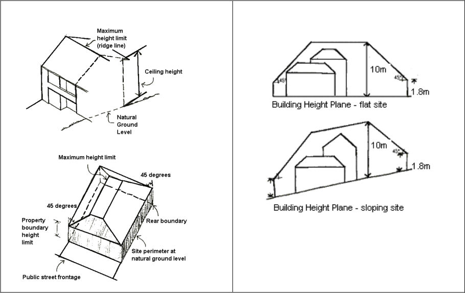
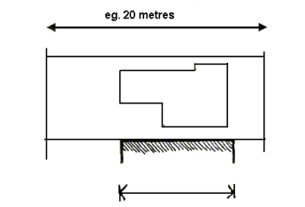

### 1.3 HEIGHT

#### Aims

(a) To protect the privacy, use of private open space and solar access within the development and on adjoining land.

(b) To ensure that the bulk of the new development is not excessive and relates well to the local context.

(c) To allow adequate natural light and ventilation between dwellings with sufficient separation for acoustic and visual privacy.

_____________________________________________________________________________________________________RESIDENTIAL DEVELOPMENT

#### Objectives

All parts of the building are to be within the Building Height Plane.

Walls not built on the boundary are to be built to allow access to comply with the Building Code of Australia.

#### Figure D1.1 Building Height Plane

> [Picture on page 10: a picture, saved as a picture (images/part-d-specific-development-page-10-6.gif, 150 dpi).]

#### Rules

(d) New buildings are to be constructed within the Building Height Plane for the relevant residential use. (Refer to Table 1).  The Building Height Plane is to be adjusted for sloping sites to follow the natural ground level as shown in Table 1.

Table 1:

Maximum heights above natural ground level for each type of dwelling (in metres).

| Residential Use | At property boundary | At ceiling height | Maximum height at ridgeline |
|---|---|---|---|
| Single dwelling | 1.8m | 7m | 10m |
| Multi-unit housing | 1.8m | 7m | 10m |
| Walk-up flats | 3.5m | 8m | 12m |

RESIDENTIAL DEVELOPMENT _____________________________________________________________________________________________________

(e) Building to the side & back boundary within the Building Height Plane is permitted where: it can be shown that building to the boundary does not reduce the privacy of neighbouring dwellings and their private open space and does not reduce their existing solar access; and the continuous length of the boundary walls is not more than 10m or is a maximum of 50% of the boundary length; whichever is the shorter. Refer to Figure D1.2.

(f) Exemptions to the Building Height Plane may be granted in the following circumstances: single dwellings proposed on flood prone land; single dwellings proposed on lots with a frontage of less than 14m at the building line;  and chimneys, satellite dishes and aerials.

Applicants seeking an exemption to the Building Height Plane must demonstrate clearly why the compliance is unreasonable.

#### Figure D1.2 Length of building on the boundary

> [Picture on page 11: a picture, saved as a picture (images/part-d-specific-development-page-11-18.gif, 150 dpi).]
