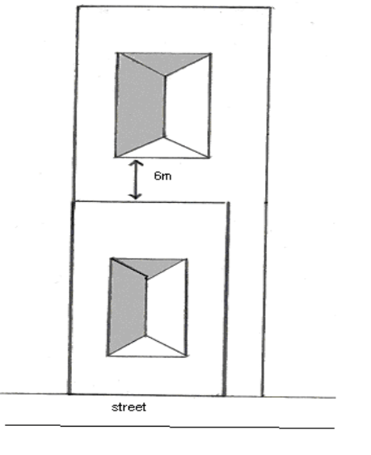
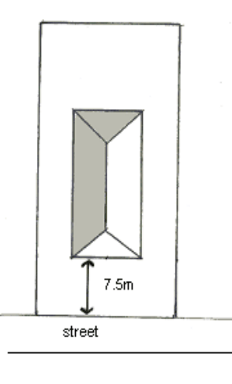

### 1.4 SETBACKS

#### Aims

(g) To establish, maintain or enhance attractive streetscapes.

(h) To maintain roadways that are safe for all users - pedestrians, cyclists and motor vehicles - by ensuring adequate sightlines.

(i) To allow some flexibility for residences to achieve better orientation for sun, shade, wind and neighbouring development, and better use of allotments to create private open space and courtyards.

_____________________________________________________________________________________________________RESIDENTIAL DEVELOPMENT

#### Objectives

If it can be proven that site constraints require the dwelling to be set closer to the street. This may be, for example, to overcome problems associated with slope, with

> [Picture on page 12: a picture, saved as a picture (images/part-d-specific-development-page-12-4.gif, 150 dpi).]

overshadowing, or sites with significant flora and fauna or heritage items.

#### Figure D1.3 Setbacks for internal lots

> [Picture on page 12: a picture, saved as a picture (images/part-d-specific-development-page-12-7.gif, 150 dpi).]

#### Rules

(a) For sites fronting Main, Arterial or Collector roads, buildings are to be set 10 metres back from the front  boundary unless there are exceptional physical circumstances.  The 10m setback commences after any road widening which may affect the subject land.

(b) For sites fronting a local road buildings are to be set 7.5m back from the front boundary. In areas where there is prior development the established pattern is to be regarded as the standard setback.

(c) For internal lots the general setback from the rear boundary of the property in front is to be 6 metres.

(d) For the minor frontage on corner blocks, the minimum building setback is to be 2  metres.

RESIDENTIAL DEVELOPMENT _____________________________________________________________________________________________________

#### Figure D1.4 Setback

> [Picture on page 13: a picture, saved as a picture (images/part-d-specific-development-page-13-2.gif, 150 dpi).]
