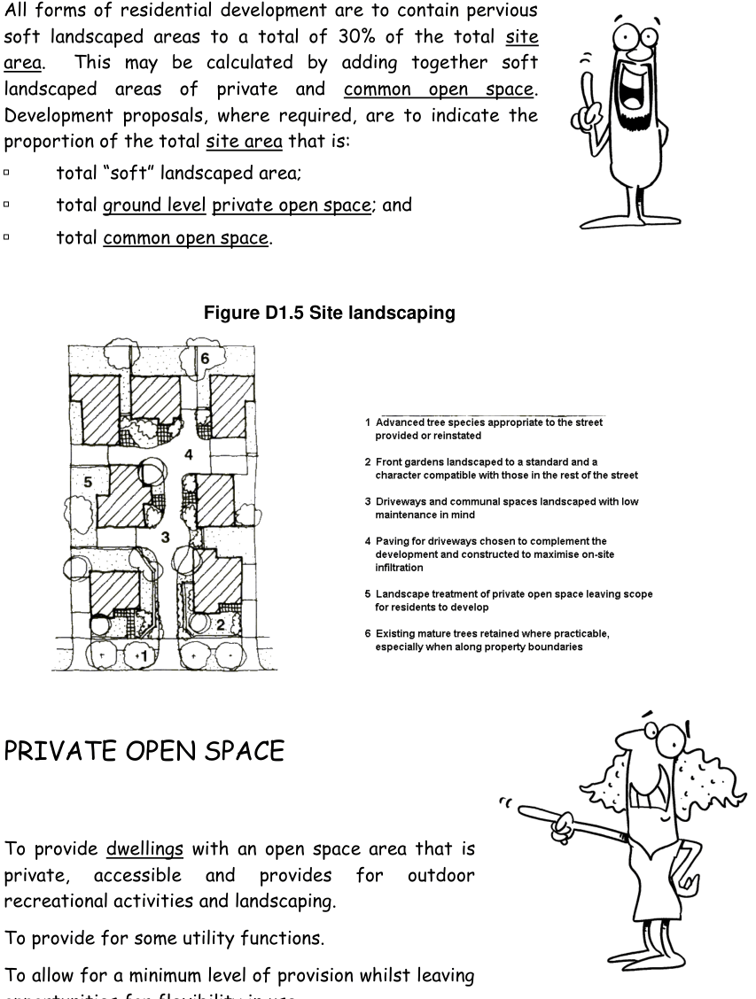

### 1.6 LANDSCAPED AREAS

#### Aims

(h) To create a pleasant and safe living environment by enhancing the setting of buildings and the environmental quality of the neighbourhood.

(i) To ensure that planting and building structures are compatible in protecting existing landscape features.

(j) To provide for privacy and shade and to assist in microclimate management.

(k) To maximise absorptive landscaped areas for on-site infiltration of stormwater by limiting the area of hard surfaces at ground level.

#### Objectives

The preparation of a site landscaping plan prepared by a suitably qualified person, such as shown in Figure D1.5 and Part C Chapter 1 Landscaping, that fulfils the objectives of this Development Control Plan must be included in the design and assessment process.

Existing trees and other landscape features, such as rock outcrops and water elements should be retained to become an integral part of the overall landscape design.

Provide landscaping which is in scale with the proposal and the street giving consideration to the future growth of the proposed planting in relation to buildings, structures and services.

Select and site trees to: aid climate control by providing shade in summer and sunlight in winter; enhance the privacy of outdoor living spaces; and be consistent with the prevailing landscape character, whether that is a native or exotic theme.

RESIDENTIAL DEVELOPMENT _____________________________________________________________________________________________________

#### Rules

(a) All forms of residential development are to contain pervious

> [Picture on page 15: a picture, saved as a picture (images/part-d-specific-development-page-15-3.gif, 150 dpi).]
> [Picture text on page 15 is stored in the PDF without readable letters (no character map), so it could not be copied; see the original PDF.]

soft landscaped areas to a total of 30% of the total site

area.  This may be calculated by adding together soft landscaped areas of private and common open space. Development proposals, where required, are to indicate the proportion of the total site area that is: total “soft” landscaped area; total ground level private open space; and total common open space.

#### Figure D1.5 Site landscaping
