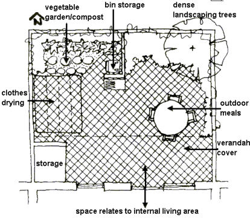
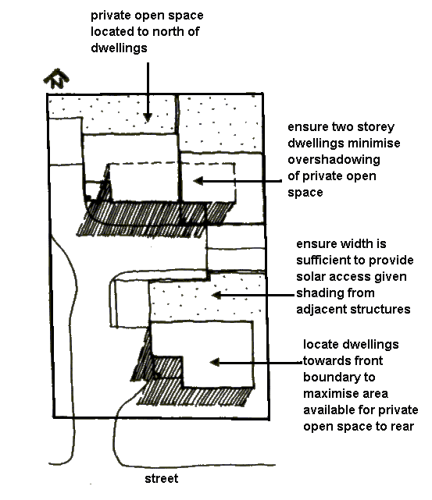
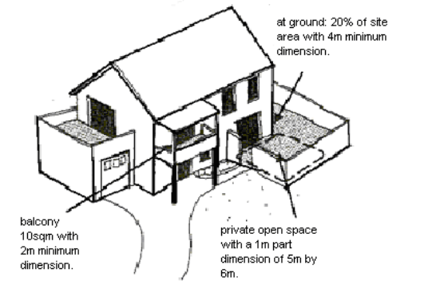

### 1.7 PRIVATE OPEN SPACE

#### Aims

(b) To provide dwellings with an open space area that is private, accessible and provides for outdoor recreational activities and landscaping.

(c) To provide for some utility functions.

(d) To allow for a minimum level of provision whilst leaving opportunities for flexibility in use.

(e) To locate private open space by taking into account factors such as solar access, outlook, streetscape, privacy and the location of adjoining dwellings.

_____________________________________________________________________________________________________RESIDENTIAL DEVELOPMENT

#### Objectives

Each private open space area must be on the same level and directly accessible from the dwelling's main living area, such as that shown in Figure D1.5.

Private open space areas must be located to receive good solar access to provide for maximum year round use.

Adequate screening of the private open space must be provided to protect the privacy of the occupants and their neighbours.

#### Figure D1.6 Private open space fulfils a number of functions

> [Picture on page 16: a picture, saved as a picture (images/part-d-specific-development-page-16-9.gif, 150 dpi).]

Figure D1.7 Shape and aspect of private open space in a multi-unit housing development

> [Picture on page 16: a picture, saved as a picture (images/part-d-specific-development-page-16-11.gif, 150 dpi).]

RESIDENTIAL DEVELOPMENT _____________________________________________________________________________________________________

#### Rules

(a) Single dwelling houses and multi unit housing are to provide at least one area of private open space for each dwelling.

(b) The total of private open space at ground level must be a minimum of 20% of the site area, regardless of permeability of the surface.  This space must: be capable of containing a rectangle 5 metres x 6 metres per dwelling that has a slope less than 1:10; not be comprised of any area with a dimension less than 4 metres; and be exclusive of clothes drying areas, driveways, car parking and other utility areas.

> [Picture on page 17: a picture, saved as a picture (images/part-d-specific-development-page-17-15.gif, 150 dpi).]

#### Figure D1.8 Minimum dimensions of private open space

> [Picture on page 17: a picture, saved as a picture (images/part-d-specific-development-page-17-17.gif, 150 dpi).]

(c) Private open space shall not be located in the front boundary setback.

(d) Any above ground level balcony or rooftop area designed for private open space must have a minimum area of 10 square metres with a minimum dimension of 2 metres, as shown in Figure D1.8.  This area is not included in the calculation for the provision of total private open space.
