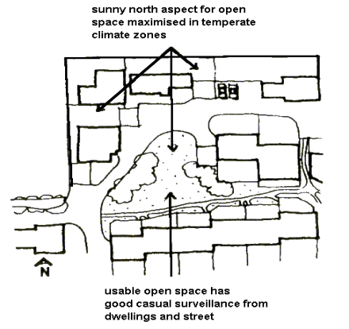

### 1.8 COMMON USE OPEN SPACE

#### Aims

(e) To provide occupants in multi-unit dwellings with designated communal areas for relaxation and recreation.

_____________________________________________________________________________________________________RESIDENTIAL DEVELOPMENT

(f) To provide facilities that are relevant to the projected needs of the occupants of the development.

(g) To include retained and/or significant vegetation and other landscape features in areas which can be maintained for the benefit of all occupants.

#### Objectives

All forms of residential development, containing five or more dwellings, other than single dwelling houses and multi unit housing, must provide landscaped open space areas for common use of the occupants.

Common open space should be well designed and landscaped and include equipment such as seating, shade structures, barbecue and child play equipment which meets the needs of the development’s occupants.

The type of activity, hours of use, noise generation and on-going maintenance and safety of any proposed recreational facility is to be considered in the design stage.

> [Picture on page 18: a picture, saved as a picture (images/part-d-specific-development-page-18-14.gif, 150 dpi).]

#### Figure D1.9 Orientation of common open space

> [Picture on page 18: a picture, saved as a picture (images/part-d-specific-development-page-18-16.gif, 150 dpi).]

#### Rules

(a) For development proposals than contain five or more dwellings common use open space is required.  Concession may be given where it is demonstrated that sufficient useable private open space for each dwelling has been provided.

(b) The common open space should generally have access only from within the site.

RESIDENTIAL DEVELOPMENT _____________________________________________________________________________________________________

(c) Common open space for multi-unit housing developments should be accessible from all dwellings within the development.  Surveillance of this space should be possible from at least two dwellings, as shown in Figure 9.

(d) Any proposed communal recreational facilities must be designed and located to avoid nuisance or danger to neighbours, residents and visitors.
