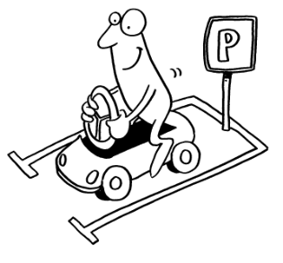
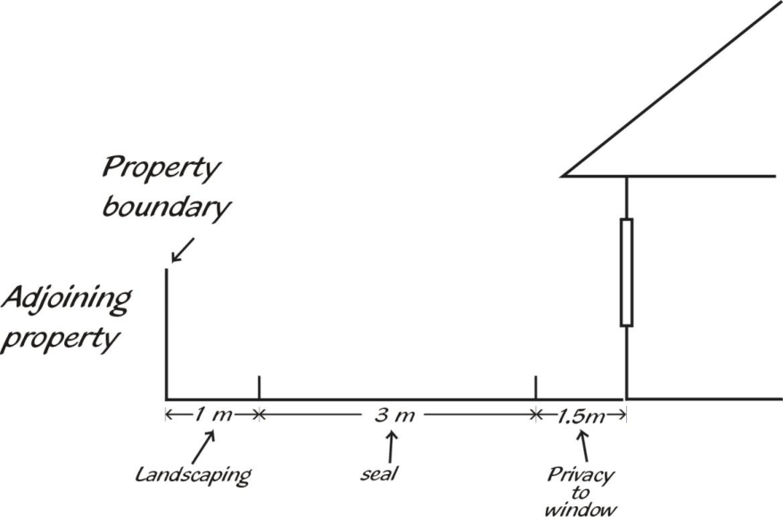

### 1.9 VEHICLE ACCESS AND CAR PARKING

> [Picture on page 19: a picture, saved as a picture (images/part-d-specific-development-page-19-7.gif, 150 dpi).]

#### Aims

(e) To integrate car parking and access as unobtrusively as possible into the streetscape and landscape.

(f) To ensure safe access, egress and passage through a site for vehicles and pedestrians.

(g) To provide adequate off street parking for the normal needs of occupants and visitors.

(h) To maintain the amenity of adjoining properties.

#### Objectives

Driveway access to the street should generally be confined to a single point, in order to

> [Picture on page 19: a picture, saved as a picture (images/part-d-specific-development-page-19-19.gif, 150 dpi).]

maintain street parking and landscaping opportunities

Vehicles are to be able to leave and enter the site in a forward direction.

#### Rules

(a) Driveways next to any side or rear boundary must have a landscape strip of at least 1 metre to separate them.  See Figure D1.10.

(b) Shared driveways, access lanes and car parks must be setback a minimum of 1.5 metres from windows to main habitable rooms of dwellings.  This standard does not apply if the floor level of the dwelling is at least 1 metre above the driveway.

(c) All driveways must have a minimum width of 3 metres and must be sealed to prevent surface erosion.

(d) For development that contains more than 2 units driveways are to have a minimum driveway width of 6m from the layback/kerb line to 6m inside the property.

_____________________________________________________________________________________________________RESIDENTIAL DEVELOPMENT

#### Figure D1.10 Vehicle Access

> [Picture on page 20: a picture, saved as a picture (images/part-d-specific-development-page-20-2.gif, 150 dpi).]

(e) Garages and carports must not visually dominate the street facade, should occupy less than 50% of the building facade and must be compatible with the building design.

(f) Uncovered car parking spaces and turning areas can be located within the front setback to the required building line provided that this area is dominated by landscaping and/or addresses established streetscape patterns.

(g) Where parking spaces are located as 90º to the driveway alignment the minimum driveway width adjacent to the space is to be 6.7m, increased an necessary to allow adequate manoeuvring  on site.

(h) On site manoeuvring areas shall be provided to allow entry and exit to the site in a forward direction (except for a single dwelling).

(i) On site manoeuvring areas shall be provided to allow entry and exit to and from all car spaces including garage, carports, uncovered spaces and visitor spaces by a single turning movement (except for a single dwelling).

(j) Attached dual occupancies will be assessed on merits in relation to onsite manoeuvring.

(k) Where more than 3 units are served by an access or the access is greater than 30m long, a turning area shall be provided at or near the end of the access.

RESIDENTIAL DEVELOPMENT _____________________________________________________________________________________________________

(l) On site manoeuvring shall be based on the Ausroads Standard 5.0m design vehicle. Templates for this standard are provided in the appendices.  When using the templates a minimum of 150mm shall be provided between any fixed object and the extremities of the swept paths.

(m) All on site car spaces shall comply with the minimum dimensions set out in Part C Chapter 2 (Car Parking and Access).  Where a space adjoins a wall, fence or other fixed structures, the width shall be increased as follows to allow adequate door opening: On one side only to 3.2m On both sides to 3.8m.

(n) Refer to the following chapters for additional requirements:

Part C Chapter 2 - Carparking and Access Part C Chapter 6 - Energy Efficiency Part D Chapter 3 - Subdivision.
