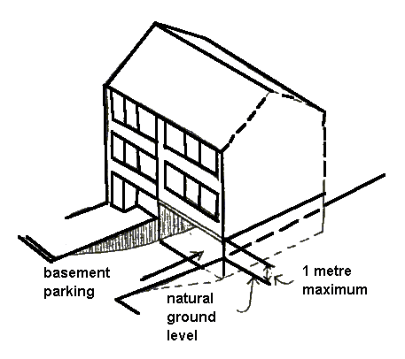

### 1.10 BASEMENT PARKING

#### Objectives

Where basement parking is proposed an assessment of the potential of the site to contain archaeological significance shall be carried out by a suitably qualified

> [Picture on page 21: a picture, saved as a picture (images/part-d-specific-development-page-21-19.gif, 150 dpi).]

consultant.

Basement parking should be drained by gravity.

#### Rules

(a) Only the basement’s parking entry should be seen as a separate level in a building.  Large exposed foundations, voids and walls are not to be used. Refer to Figure D1.11

(b) No part of a basement should extend more than 1 metre above natural ground level so the height of the building is not excessive.

(c) Consideration may be given to a sump and pump where storm water volumes are low based on merits of the site

Note:  For additional requirements for the number of car parking spaces required and their design and construction refer to the Part C Chapter 2 Car Parking and Access.

_____________________________________________________________________________________________________RESIDENTIAL DEVELOPMENT

#### Figure D1.11  Basement parking

> [Picture on page 22: a picture, saved as a picture (images/part-d-specific-development-page-22-2.gif, 150 dpi).]
