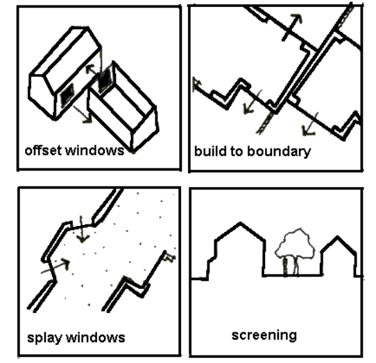
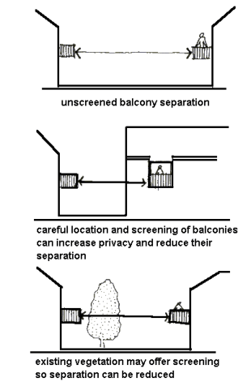
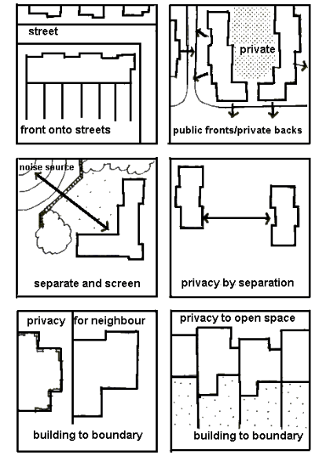
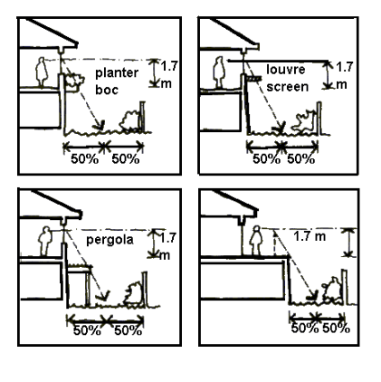
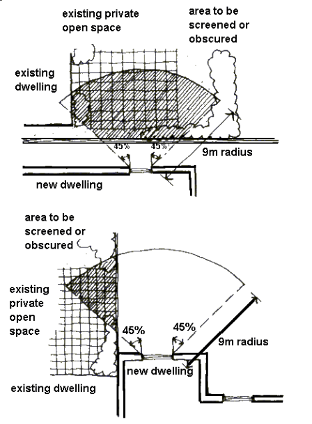

### 1.11 VISUAL PRIVACY

#### Aims

(d) To consider visual and acoustic privacy of residents and neighbours.

(e) To avoid the overlooking of adjacent dwellings and private open space.

(f) To contain noise within dwellings or communal areas.

#### Objectives

The layout of buildings should avoid first floor or elevated windows facing directly onto the windows, balconies, or overlooking the yards of adjoining dwellings unless effective screening is provided.

#### Rules

(a) Where there is potential for loss of privacy the proposal should incorporate some of the techniques illustrated in  Figure D1.13, Figure D1.15, Figure D1.16, Figure D1.17, Figure D1.18 or similar.

(b) Where there is no alternative to a window, it should be screened as shown in the hatched area in Figure D1.16.

RESIDENTIAL DEVELOPMENT _____________________________________________________________________________________________________

#### Figure D1.12 Locating windows to limit overlooking

> [Picture on page 23: a picture, saved as a picture (images/part-d-specific-development-page-23-2.gif, 150 dpi).]

Figure D1.13 Screening can reduce the need for separation and

improve the level of privacy

> [Picture on page 23: a picture, saved as a picture (images/part-d-specific-development-page-23-5.gif, 150 dpi).]

_____________________________________________________________________________________________________RESIDENTIAL DEVELOPMENT

Figure D1.14 Privacy is a key consideration at the site planning and layout stage

> [Picture on page 24: a picture, saved as a picture (images/part-d-specific-development-page-24-2.gif, 150 dpi).]

Figure D1.15 Techniques for providing privacy to a lower dwelling's private open space

> [Picture on page 24: a picture, saved as a picture (images/part-d-specific-development-page-24-4.gif, 150 dpi).]

RESIDENTIAL DEVELOPMENT _____________________________________________________________________________________________________

#### Figure D1.16 Screening views to adjacent private open space

> [Picture on page 25: a picture, saved as a picture (images/part-d-specific-development-page-25-2.gif, 150 dpi).]
