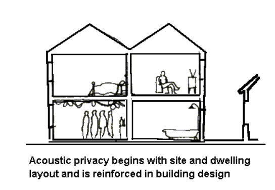
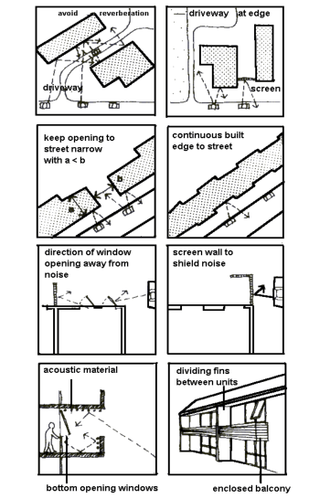

### 1.12 ACOUSTIC PRIVACY

#### Aim

(c) To achieve levels of acoustic privacy that are reasonable for a residential neighbourhood.

#### Objectives

Shared walls and floors between dwellings are to be constructed to limit noise transmission.  Specifications for window, floor, ceiling and wall construction of proposals must comply with the provisions of the Building Code of Australia and Australian Standards.

Site layout should separate active recreational areas, parking areas, vehicle accessways, and service equipment areas from bedroom areas of dwellings.

_____________________________________________________________________________________________________RESIDENTIAL DEVELOPMENT

#### Figure D1.17 Acoustic privacy by design

> [Picture on page 26: a picture, saved as a picture (images/part-d-specific-development-page-26-2.gif, 150 dpi).]

#### Rules

(a) Acoustic privacy is to be considered at the design stage and techniques such as those shown in Figure D1.17 or similar are to be used.

(b) Site layouts should ensure parking areas, streets and shared driveways have a line of sight separation of at least 3 metres from bedroom windows as indicated in Figure D1.18.

(c) A distance of at least 3 metres should separate openings of adjacent dwellings.

#### Figure D1.18 Some ideas for reducing noise transmission

> [Picture on page 26: a picture, saved as a picture (images/part-d-specific-development-page-26-11.gif, 150 dpi).]

RESIDENTIAL DEVELOPMENT _____________________________________________________________________________________________________
