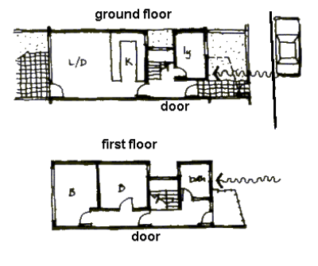
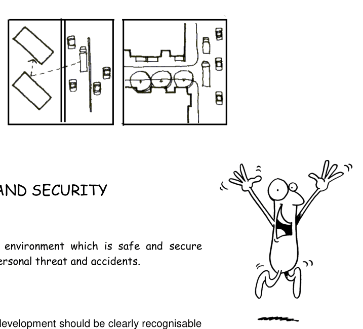

### 1.13 EXTERNAL NOISE AND VIBRATION

#### Aims

(d) To ensure an acceptable level of amenity for all residents.

(e) To incorporate building construction and landscape techniques to act as a barrier or buffer to reduce noise and vibration levels.

(f) To ensure that attenuation methods are consistent with existing town character attributes and themes.

(g) To ensure that the attenuation measures of aircraft noise are not an unreasonable interference to the activities of the household.

#### Objectives

Noise and vibration mitigation measures must be considered at the design stage for site layout, orientation of buildings, location of sleeping, recreation, utility and work areas, as shown in, and in the use of suitable construction techniques and materials.

Noise amelioration measures should not cause a greater nuisance from reflected sound for existing development.  Figure D1.20 shows examples of reflection and attenuation

> [Picture on page 27: a picture, saved as a picture (images/part-d-specific-development-page-27-16.gif, 150 dpi).]

as part of overall site design.

#### Rules

(a) A noise and vibration assessment must be undertaken by a suitably qualified noise consultant for any proposed residential development other than a single dwelling house located within 100 metres of the railway line or within Australian Noise Exposure Forecast (ANEF) 25 or greater.

(b) Proposals must comply with the current Environment Protection Authority criteria and the current relevant Australian Standards for noise and vibration and quality assurance and incorporate appropriate mitigation measures.

_____________________________________________________________________________________________________RESIDENTIAL DEVELOPMENT

Figure D1.19 Service rooms located closer to the noise source can protect other more-

often used and noise-sensitive rooms

> [Picture on page 28: a picture, saved as a picture (images/part-d-specific-development-page-28-3.gif, 150 dpi).]

Figure D1.20 Avoid angled buildings that can reflect noise on to other buildings. Balconies, offsets and trees can reduce inter-reflection between parallel buildings

> [Picture on page 28: a picture, saved as a picture (images/part-d-specific-development-page-28-6.gif, 150 dpi).]
> Words printed on the picture (title and legend, copied from the PDF):
> All areas in a development should be clearly recognisable
