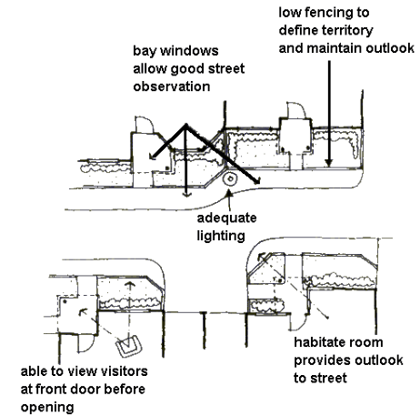

### 1.14 SAFETY AND SECURITY

#### Aims

(c) To create an environment which is safe and secure from theft, personal threat and accidents.

#### Objectives

as private, common or public space.  Responsibility for supervision and maintenance of these areas should be understood at the design stage and explained in the application.

RESIDENTIAL DEVELOPMENT _____________________________________________________________________________________________________

#### Figure D1.21 Security by design - casual surveillance of the street

> [Picture on page 29: a picture, saved as a picture (images/part-d-specific-development-page-29-2.gif, 150 dpi).]

#### Rules

(a) Each dwelling is to be provided with direct and convenient pedestrian access to a private or public road.

(b) Barriers to prevent movement between internal roof spaces of adjoining dwellings are required.

(c) Elements to be incorporated in site and building design, such as those shown in Figure D1.21 include: doorway/entry safety and surveillance to and from the footpath; illumination of public spaces including all pedestrian paths, shared areas, parking areas and building entries to the relevant Australian Standard;

> [Picture on page 29: a picture, saved as a picture (images/part-d-specific-development-page-29-13.gif, 150 dpi).]

visibility to the street from the front of the development; restricted access to the rear of the site.
