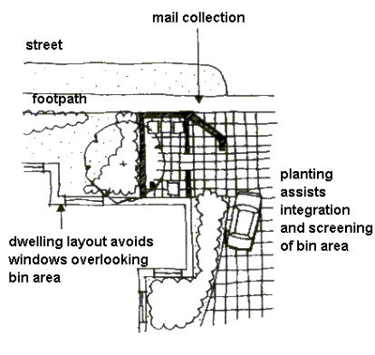

### 1.17 RECYCLING, GARBAGE AND MAIL COLLECTION AREAS

#### Objectives

To ensure that each dwelling has arrangements for recycling, garbage and mail collection.

#### Rules

(a) Collection areas must be integrated into the overall site and building design, such as the example shown in Figure D1.22.

RESIDENTIAL DEVELOPMENT _____________________________________________________________________________________________________

Figure D1.22 Mail and garbage collection areas, where provided, should be integrated

with building and landscaped areas

> [Picture on page 31: a picture, saved as a picture (images/part-d-specific-development-page-31-3.gif, 150 dpi).]
