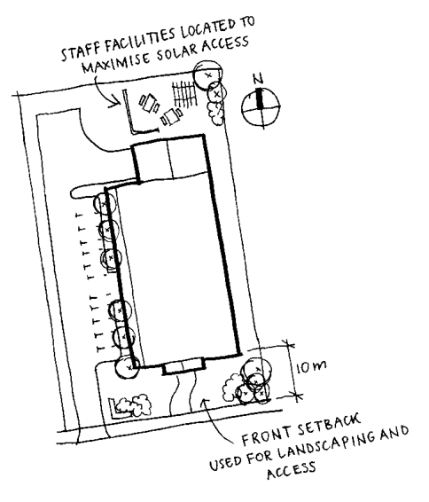

### 2.2 BUILDING SETBACKS

#### Aims

(c) To ensure an attractive and maintained streetscape.

(d) To ensure that there is adequate vehicular sight distance at intersections.

(e) To minimise the cost of future widening to main or arterial roads.

(f) To provide adequate solar access to staff recreation areas.

#### Objectives

Buildings are sited so as to: make adequate provision for landscaping; and allow for adequate lines of sight for pedestrians, cyclists and motorists.

______________________________________________________________________________________________________INDUSTRIAL DEVELOPMENT

#### Figure D2.1

> [Picture on page 38: a picture, saved as a picture (images/part-d-specific-development-page-38-2.gif, 150 dpi).]

Buildings are sited so that solar access to staff recreation areas and landscaping of adjoining developments is not compromised.

Buildings and landscaping are to be sited to provide visual amenity for employees.

> [Picture on page 38: a picture, saved as a picture (images/part-d-specific-development-page-38-6.gif, 150 dpi).]

#### Rules

(a) On arterial or sub arterial roads all buildings are to be setback 15 metres from the front property boundary.

(b) On all other streets, buildings are to be setback 10 metres from the front property boundary. Consideration will be given to reducing the setback to 4 metres where the proposal demonstrates a high level of design and architectural treatment plus suitable landscaping.  This setback can also apply to buildings that are projected at first floor level over car parking areas.

(c) Where land has two road frontages (not being collector, regional sub-arterial and state arterial road) the building setback to the shorter frontage will be considered on its merits, dependent upon the development proposed and its location.

INDUSTRIAL DEVELOPMENT ______________________________________________________________________________________________________

(d) The area between the street frontage and the minimum required building setback is to be reserved for landscaping and access.  The provision of car parking spaces within this setback area will be considered provided the car spaces are not within 5m of the front boundary and are suitably screened by landscaping.

(e) Landscaping is required in the front setback.  A landscape concept plan is required

> [Picture on page 39: a picture, saved as a picture (images/part-d-specific-development-page-39-6.gif, 150 dpi).]

in accordance with Part C Chapter 1 Landscaping.
