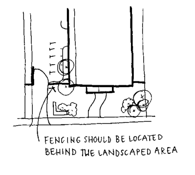

### 2.5 FENCING

#### Aims

(f) To allow for security and ensure that fencing contributes to the streetscape and amenity of the industrial areas.

#### Objectives

Fencing between the building and street frontage is not encouraged.  Where it is required for safety or security reasons, it should be of a standard or style that does not detract from the landscaping or building facades.

#### Figure D2.2

> [Picture on page 41: a picture, saved as a picture (images/part-d-specific-development-page-41-10.gif, 150 dpi).]

#### Rules

(a) Fencing located behind the landscaped area only.  Decorative open style fencing will be considered forward of the building line.

(b) Prepainted solid metal fencing is not acceptable.
