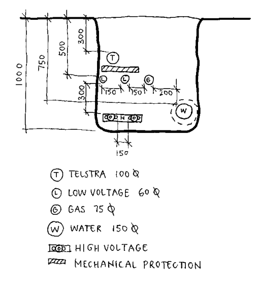

### 3.5 UTILITY SERVICES

#### Aims

(f) To provide public utilities in a safe, efficient and cost effective manner.

(g) To provide public utilities in such a way as to maximise retention of vegetation.

___________________________________________________________________________________________________________________ SUBDIVISION

#### Objectives

All lots created for residential purposes should have an adequate provision of utility services and not result in a detrimental impact on the environment.

The design and provision of public utilities should conform to the cost effective criteria of the relevant servicing authority.

Compatible public utility services should be located in common trenches so as to minimise the  land required, soil erosion and the cost of providing the services.

#### Figure D3.1 Typical joint trenching layout

> [Picture on page 48: a picture, saved as a picture (images/part-d-specific-development-page-48-9.gif, 150 dpi).]

Adequate buffers should be maintained between utilities and houses to protect residential amenity and health.

The provision of utility services should not detrimentally impact on the landscape character of an area.

Adequate water supplies for both domestic and fire fighting purposes should be available.

#### Rules

(a) Underground power provided to all residential and industrial subdivisions.  Where infill subdivision is proposed, the existing system, whether above or underground shall be maintained.

SUBDIVISION ___________________________________________________________________________________________________________________

(b) All lots created are to have the provision of power.

(c) Where reticulated water is not available, a minimum storage of 100,000 litres must be provided.  A minimum of 10,000 litres must be available at all times on Bushfire Prone Land.
