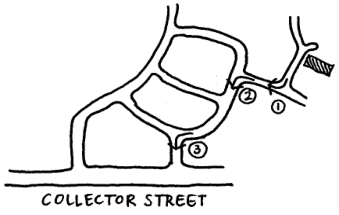
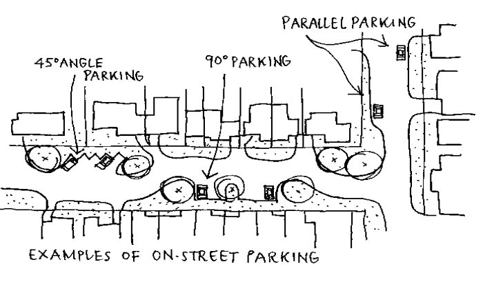
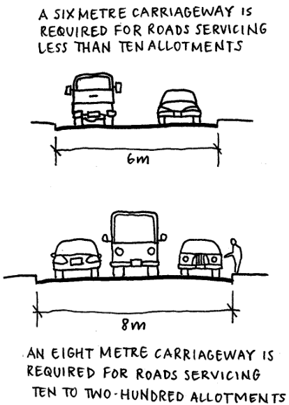
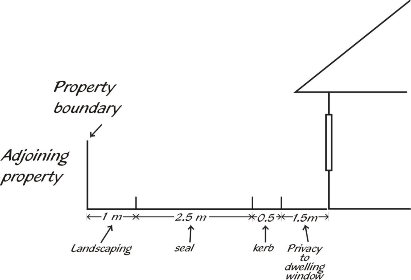
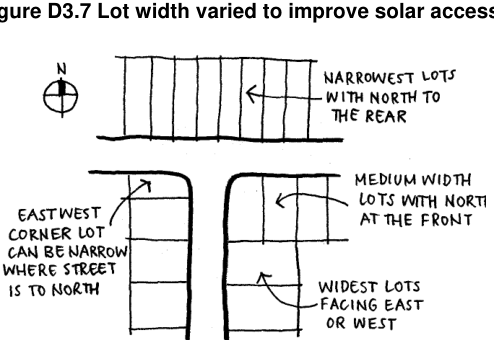
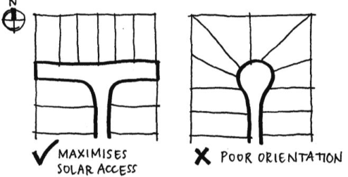

### 3.7 RESIDENTIAL SUBDIVISION

#### 3.7.1 Residential Local Street Design

#### Aims

(f) To create street networks in which the function of each street is clearly defined.

(g) To ensure that vehicular and pedestrian access is simple, safe and direct.

___________________________________________________________________________________________________________________ SUBDIVISION

(h) To minimise the impact of traffic on the residential amenity of the locality.

#### Objectives

Street widths should reflect the role and function of the street in the road hierarchy.

Streets should be designed to allow on street car parking.

Streets should be designed to cater for service vehicles.

Streets should be designed to provide interest and variety in the streetscape through kerbs (where appropriate), landscaping and paving treatments.   The street design should be compatible with the existing road pattern in the locality.

Junctions along residential streets should be spaced to create safe and convenient vehicle movements.

The street network should create a convenient route for residents between their home and higher order roads.

The street network should facilitate walking and cycling within the neighbourhood and to local activity centres.

The street network should take into account existing topography and existing open space systems.

Streets should not operate as through traffic routes for externally generated traffic while at the same time limiting the length of time local drivers need to spend in a low speed environment.

Streets and lots should be located so that residential dwellings are not subjected to

> [Picture on page 50: a picture, saved as a picture (images/part-d-specific-development-page-50-21.gif, 150 dpi).]

unacceptable traffic noise.

#### Figure D3.2

> [Picture on page 50: a picture, saved as a picture (images/part-d-specific-development-page-50-24.gif, 150 dpi).]

#### Rules

(a) The design specifications in Figure D3.3 are met.

(b) A minimum spacing of staggered junctions in a local street network should be 20 metres.

(c) The street network should be orientated where practical, to promote efficient solar access for dwellings as shown in Part C Chapter 6 Energy Efficiency.

SUBDIVISION ___________________________________________________________________________________________________________________

(d) Cul-de-sacs for residential roads should have minimum seal radii of 8.5 metres and boundary radii of 12.0 metres.

(e) Cul-de-sacs should not exceed 200 metres in length unless topographic constraints render other options impracticable.

(f) Off street parking shall be provided in cul-de-sacs at the rate of 1 space per lot.

(g) Streets should be designed to allow for the provision of suitable and safe conditions for street trees.

#### Figure D3.3 Design specifications

| Widths (m) |
|---|
| Road Type Description Carriage Footway Road -way Reserve |
| Residential Roads Major collector Major bus routes and interprecinct traffic 13 3.5 20 Medium collector Through roads serving open space, 11 3.5 18 shops etc possible bus route Local & Minor Through roads, Cul-de-sacs and short 8 3.5 15 collector through roads Local access Less than 10 properties 6 3.5 13 roads |

#### Figure D3.4 Examples of on-street parking

> [Picture on page 51: a picture, saved as a picture (images/part-d-specific-development-page-51-11.gif, 150 dpi).]

___________________________________________________________________________________________________________________ SUBDIVISION

#### Figure D3.5 Design specifications for local, minor & local access roads

> [Picture on page 52: a picture, saved as a picture (images/part-d-specific-development-page-52-2.gif, 150 dpi).]

#### 3.7.2 Residential Accessway Design

An accessway is a driveway or private road which services between one and five allotments.

#### Aims

(h) To ensure that vehicular access to all lots within the subdivision is simple, safe and direct.

(i) To ensure that accessways do not detract from the amenity of localities.

#### Objectives

Accessways design should provide safe and efficient entrance/exit to individual lots.

Accessways should be landscaped and treated so as to reduce the visual and environmental impact of hard paved areas.

Accessway designs should minimise the impact on the amenity of the existing and future dwellings.  They should be sited away from noise and visually sensitive components of existing and future dwellings.

SUBDIVISION ___________________________________________________________________________________________________________________

Accessways should provide interest and variety and avoid lengthy straight sections.

> [Picture on page 53: a picture, saved as a picture (images/part-d-specific-development-page-53-2.gif, 150 dpi).]

#### Rules

(a) Accessways should have a minimum width of 4 metres and sealed pavement of 2.5 metres.

(b) Accessways should not serve more than 5 lots.

(c) Accessways should have a maximum grade of 25% (1:4) at any point.

(d) Where the accessways is steep or fronts a local collector or higher order road (greater than 3,000 vehicles per day) or a high pedestrian area, accessways should be designed so that vehicles can be driven both onto and off the property in a forward direction.

(e) Where vehicles would otherwise have to reverse more than 50 metres, a turning area should be provided to enable the vehicles to enter and leave the site in a forward direction and reduce the need to reverse over long distances.

(f) Refer to Part D Chapter 1 Residential Development for further requirements regarding accessways should a subdivision be part of a residential development.

___________________________________________________________________________________________________________________ SUBDIVISION

#### Figure D3.6 Vehicle access

> [Picture on page 54: a picture, saved as a picture (images/part-d-specific-development-page-54-2.gif, 150 dpi).]

#### 3.7.3 Planning for Pedestrians and Cyclists in Residential Areas

#### Aims

(g) To encourage walking and cycling by providing safe and convenient movement networks to points of attraction within and beyond the land being subdivided.

(h) To ensure that land within the subdivision provides access for all.

#### Objectives

The location of footpaths or cycle paths should be defined using the following parameters: demand for footpaths and cycle paths; opportunities to link open space networks and communities including public transport, local activity centres and schools; topography; cyclist and pedestrian safety; and safety for persons with a disability.

The alignment of footpaths should allow safe and convenient use by pedestrians, cyclists and persons with a disability and should be variable enough to accommodate trees and other significant features.

SUBDIVISION ___________________________________________________________________________________________________________________

Paths should be constructed to provide a stable surface for pedestrians, cyclists and persons with a disability and which is easily maintained.

#### Rules

(a) No footpaths are required on streets with traffic volumes less than 300 vehicles per day.

(b) Footpaths should be provided on one side of streets with traffic volumes between 300 vehicles per day and 2,000 vehicles per day, and on both sides of streets with traffic volumes over 2,000 vehicles per day.

(c) Footpaths are to be designed in accordance with Australian Standard AS1428.2- 1992 Design for Access and Mobility.

#### 3.7.4 Stormwater Management

#### Aims

(d) To control the flow of water into the natural and man made drainage systems in such a way to minimise impacts from storm water runoff.

(e) To contribute positively to the environmental enhancement of catchment areas.

(f) To provide water quality management systems which:

ensure that disturbance to natural stream systems is minimal; and storm water discharge to surface and underground receiving waters, both during construction and during residential use of the subject land, does not degrade the quality of the water at the receiving end.

#### Objectives

Drainage from subdivision sites should be consistent in both water quality and quantity terms with the predevelopment storm water patterns.

Drainage systems should be designed so as to ensure safety and minimise the likelihood of storm water inundation of existing and future dwellings.

Adequate provision should be made for measures during construction to ensure that the

> [Picture on page 55: a picture, saved as a picture (images/part-d-specific-development-page-55-27.gif, 150 dpi).]

landform is stabilised and erosion controlled.

#### Rules

(a) Where site topography prevents discharge of storm water directly to the street gutter or a Council controlled pipe system, inter allotment drainage provided to accept run off from all existing or future impervious

___________________________________________________________________________________________________________________ SUBDIVISION

areas on the subject land.   The design and construction of the inter allotment drainage system should be in accordance with the requirements of the Australian Rainfall and Runoff (1987).

(b) Where proposals require the creation of easements over downstream properties for drainage purposes, a letter of consent from the owner(s) of the downstream properties should be submitted with DAs.

(c) Stormwater piped in roads and through allotments in all residential subdivisions.

(d) For subdivision proposals comprising 5 lots or more or where Council deems it necessary, a soil and water management plan should be prepared by a properly qualified practitioner with the aim of minimising erosion and maximising the quality of any water leaving the site.

#### 3.7.5 Lot Size and Shape

#### Aims

(e) To ensure that newly created allotments have dimensions which allow flexibility and choice of housing design whilst minimising development costs.

(f) To promote allotments of varying sizes which provide pleasant streetscapes, satisfy user requirements and minimise environmental impacts.

#### Objectives

Lot sizes and dimensions should enable dwellings to be sited to: protect natural and cultural features; acknowledge site constraints including soil erosion and bush fire risk; retain special features such as trees and views; dispose of effluent on site where sewer not available;  and Provide for wildlife habitats and the growth of trees.

Lot sizes and configurations should be varied to provide a mix of allotment types which

> [Picture on page 56: a picture, saved as a picture (images/part-d-specific-development-page-56-26.gif, 150 dpi).]

create pleasant streetscapes and encourage a variety of housing types.

#### Rules

(a) In calculating the area of a battle-axe or hatchet shaped allotment the accessway is to be excluded.  The area of an allotment effected by a "right of carriage way" or private road should also be excluded.

(b) Allotments should have a minimum width of 15 metres at the building line. Council may consider a lesser dimension but only as part of an integrated housing development.

SUBDIVISION ___________________________________________________________________________________________________________________

(c) Lots should be able to accommodate a building envelope of 200m2 with a minimum dimension of 10 metres.

(d) An allotment should not be less than 20 metres in depth to ensure there is some flexibility in the choice of housing design and siting as well as the availability of suitable space for other activities normally associated with a dwelling.

(e) Vegetation which adds significantly to the visual amenity of a locality and/or which is environmentally significant should be conserved in the design of the subdivision proposal.

(f) Lots should be designed to allow the construction of a dwelling with a maximum cut or fill of 1 metre from the natural ground level.

#### 3.7.6 Solar Access and Lot Orientation

#### Aims

(g) To encourage the design of subdivisions which maximise solar access.

(h) To ensure flexibility in the siting of buildings to take advantage of a northern orientation.

(i) To maximise the number of allotments which have good solar access and therefore which optimise the design performance of energy smart homes.

#### Objectives

Lots should be designed to maximise solar access.

Lots should be orientated to take advantage of micro climatic benefits and have dimensions to allow adequate on site solar access, taking into account likely future dwelling size and a relationship of each lot to the streets.

Lots are of a suitable shape to permit the location of a dwelling with suitable solar access and private open space.

#### Rules

(a) Lots orientated to provide long access in a northerly direction (plus or minus 200).

(b) Eighty per cent of lots in a new subdivision having 5 star solar access, and the remainder either 4 or 3 star.

(c) On a street running north-south, lots to be increased in width to enable private open space on the northern side of the building envelope.

(d) Lots designed so that future buildings will not overshadow neighbouring houses to the south, and have a sufficiently long northern facade to receive winter sun.

___________________________________________________________________________________________________________________ SUBDIVISION

(e) Compliance with Part C Chapter 6 on Energy Efficiency.

> [Picture on page 58: a picture, saved as a picture (images/part-d-specific-development-page-58-2.gif, 150 dpi).]

#### Figure D3.7 Lot width varied to improve solar access

#### Figure D3.8 Solar orientation at a cul-de-sac

> [Picture on page 58: a picture, saved as a picture (images/part-d-specific-development-page-58-5.gif, 150 dpi).]

#### 3.7.7 Torrens Title Subdivision of Existing Dwellings

#### Rules

(a) All Development Applications for the Torrens Title Subdivision incorporating existing dwellings are to comply with Part C Chapter 2 Car Parking and Access, Part C Chapter 6 Energy Efficiency and Part D Chapter 1 Residential Development.
