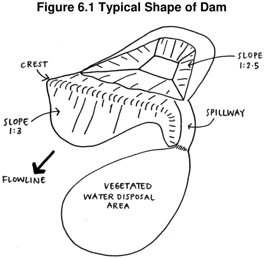
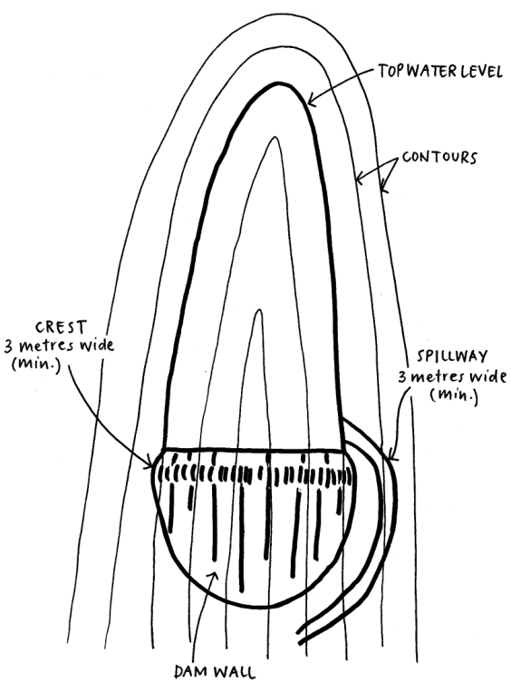
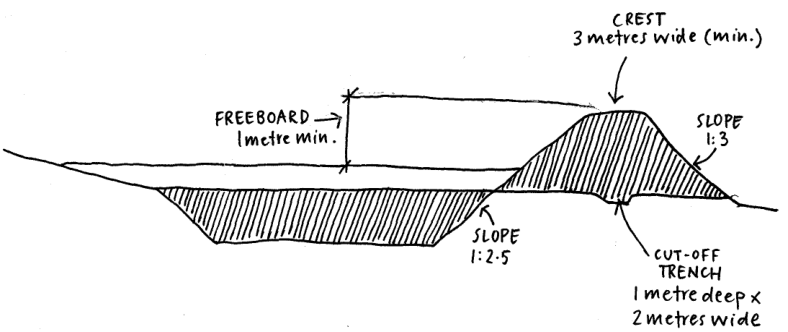
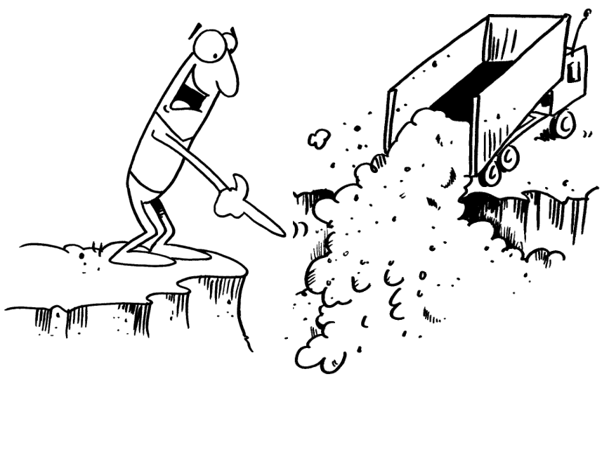

### 6.3 DESIGN AND CONSTRUCTION REQUIREMENTS

The following standards have been largely developed by DLWC and are to be complied with in relation to dam construction.

#### 6.3.1 Crest

#### Rules

(a) The width of the dam crest is to be a minimum of 3 metres for a 3 metre high dam

wall.  The crest should increase in width 0.5 metre for every metre above a 3 metre high dam.

#### 6.3.2 Freeboard

#### Rules

(a) A minimum of 1 metre is to be established for freeboard. This should increase by 10% for every metre over a 3 metre high wall.

#### 6.3.3 Embankments

#### Objectives

The material used to construct an embankment should be sufficiently impervious to keep seepage low and to be stable.

#### Rules

(a) A soil with 25% clay content is ideal to form an impervious barrier.

(b) The following soil types should not be used for dam construction:

sand; gravels; organic soils; peat.

(c) Topsoil should be stripped and stockpiled from the excavation and wall areas before the dam wall is constructed, with the stockpile located clear of any natural watercourse. There should be no excavation above high water mark.

(d) The embankment is to be completed with at least 100 millimetres of top soil. It is be planted with a good holding grass such as couch. Trees or shrubs are not to be planted on the embankment as roots may provide seepage paths for water.

____________________________________________________________________________________________________________DAM CONSTRUCTION

(e) The slope of the upstream embankment batters should be no steeper than the ratio of 2.5 horizontal to 1.0 vertical, while the downstream batter should be no steeper than 3.0 horizontal to 1.0 vertical.

#### 6.3.4 Spillway

#### Objectives

An earth spillway is required on all dams in order to pass surplus runoff around the dam

> [Picture on page 82: a picture, saved as a picture (images/part-d-specific-development-page-82-7.gif, 150 dpi).]

which would otherwise pass over the embankment.

#### Rules

(a) The spillway should be a minimum of 3 metres in width increasing in size dependent on the size of the dam and catchment.  Generally, spillways are to be designed so as not to overflow more than half the depth of the freeboard.

(b) The width of the outlet is not to be less than the inlet width. The spillway also is not to direct flows onto the downstream toe. The spillway area should be grassed, stable and able to accept runoff flow. In some instances it may be necessary to turf the spillway

area. The spillway cut batter should have a maximum steepness of 2.5 horizontal to 1.0 vertical.

(c) A small diameter (100 millimetre) pipe be required where spring flows or small flows of long duration occur to ensure that the spillway does not erode.

(d) Where dams are to be constructed in gullies or water courses, a diversion weir is to be constructed up stream of the dam.  The weir is to incorporate two pipes 200 millimetres in diameter.

#### 6.3.5 Cut-Off Trench

#### Objectives

All dams are required to have a cut-off trench.

#### Rules

(a) The cut-off trench is to be constructed along the entire length of the embankment at a minimum width of 2 metres.  The trench should be excavated at least 1 metre into impervious soil and backfilled with impervious material.

DAM CONSTRUCTION ___________________________________________________________________________________________________________

#### 6.3.6 Vegetation Filters and Tree Planting

#### Objectives

Water running into the dam should be passed through a fenced and well-grassed filter

zone. The vegetation in this area will filter out much of the unwanted material like silt, fertiliser, manure, dead vegetation and litter and rubbish.  Farm dams, where cultivating exists, must include a silt trap.

Where silting of the dam is a problem, vegetation filters of stiff long-stemmed grasses can be used with silt traps to reduce water velocity and cause more silt to be trapped before it enters the dam. A typical silt trap is about one-tenth the size of the dam.

A fence around the dam wall and spillway can improve water quality downstream of the

dam. Spillways should be kept well-grassed and free from debris. A build-up of debris in the spillway could reduce its capacity and cause the dam to be overtopped.

Trees around the dam can help reduce evaporation and reduce the growth of undesirable water weeds and algae. Do not allow trees or shrubs to grow on or near the

wall. When trees growing on the wall die, the decomposing roots can form tunnels which lead to seepage and leaks. Shrubs also provide cover for rabbits which can damage the wall by burrowing.

#### Rules

(a) A gate should be provided in the fence so that the filter area can be renovated by light grazing during rapid growth seasons. Prolonged grazing in dam catchments has potential to cause algal and weed growth in the dam due to the introduction of nutrients from manure.

____________________________________________________________________________________________________________DAM CONSTRUCTION

> [Picture on page 84: a picture, saved as a picture (images/part-d-specific-development-page-84-1.gif, 150 dpi).]

Figure 6.1 Typical Shape of Dam

#### Figure D6.2 Typical plan view of dam

> [Picture on page 84: a picture, saved as a picture (images/part-d-specific-development-page-84-3.gif, 150 dpi).]

DAM CONSTRUCTION ___________________________________________________________________________________________________________

#### Figure D6.3 Typical cross section through dam

> [Picture on page 85: a picture, saved as a picture (images/part-d-specific-development-page-85-2.gif, 150 dpi).]

#### 6.3.7 Hydrological Aspects

#### Objectives

Consider the potential for excavation to intercept the groundwater, thereby causing direct hydraulic interaction with surface waters.  Address potential concerns including impacts on the groundwater resource through evaporation losses and contamination.

Consider potential contaminants entering the groundwater via the dam.  This includes animal wastes, fertilisers, or other agricultural chemicals.

#### Rules

(a) Clay lining and limiting depths of dam construction to above the water table are consent requirements to minimise the threat of contamination to groundwater.

(b) All excavations which intercept the groundwater are required to be licensed by Department of Land and Water Conservation under the Water Act.

#### 6.3.8 Dam Construction

#### Objectives

Exposed areas which may be sources of sediment and associated nutrient mobilisation by strong winds or heavy rain. These areas need to be stabilised and planted down with a vegetative cover, to prevent erosion.

Spillway areas also need to be carefully constructed and vegetated, preferably to spread water spilling from the dam rather than having a focused single point release that any lead to erosion below the spillway.

____________________________________________________________________________________________________________DAM CONSTRUCTION

#### Rules

(a) The dam wall is to be adequately compacted by track rolling or a sheet foot roller or similar in layers no greater than 150 millimetres.

(b) Erosion and sediment control devices are to be installed and maintained to ensure that there is no increase in downstream levels of nutrients, litter, vegetation debris or other water borne pollutants.

> [Picture on page 86: a picture, saved as a picture (images/part-d-specific-development-page-86-9.gif, 150 dpi).]

DAM CONSTRUCTION ___________________________________________________________________________________________________________

Chapter 7 LANDFILL

> [Picture on page 87: a picture, saved as a picture (images/part-d-specific-development-page-87-3.gif, 150 dpi).]
