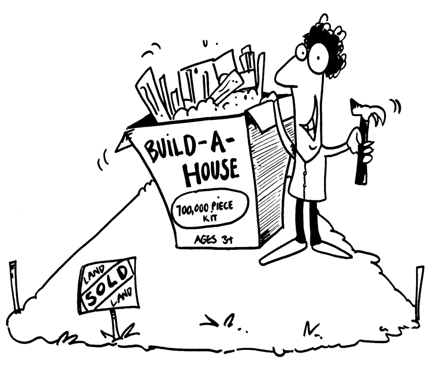

# Hawkesbury Development Control Plan 2002 - Part D Specific Development

> This chapter is split into 48 section file(s), one per numbered heading, in the order they appear in the PDF.

Source PDF: [6DCP_PARTD-Chapters-1-to-7.pdf](https://planfortomorrow.sharepoint.com/sites/Planfortomorrow/Shared%20Documents/00%20NSW-Planning-Resources/dcp/hawkesbury-development-control-plan-2002/part-d-specific-development/6DCP_PARTD-Chapters-1-to-7.pdf)

### PART D SPECIFIC DEVELOPMENT

### CONTENTS

### Part D

| RESIDENTIAL DEVELOPMENT .................................................................................................. 5 |  |
|---|---|
| 1.1 | INTRODUCTION ........................................................................................................................... 1–1 |
| 1.2 | AIMS .............................................................................................................................................. 1–1 |
| 1.3 | HEIGHT ......................................................................................................................................... 1–1 |
| 1.4 | SETBACKS ................................................................................................................................... 1–3 |
| 1.5 | DEVELOPMENT FRONTING REAR LANES ................................................................................ 1–5 |
| 1.6 | LANDSCAPED AREAS ................................................................................................................. 1–6 |
| 1.7 | PRIVATE OPEN SPACE ............................................................................................................... 1–7 |
| 1.8 | COMMON USE OPEN SPACE ..................................................................................................... 1–9 |
| 1.9 | VEHICLE ACCESS AND CAR PARKING ................................................................................... 1–11 |
| 1.10 | BASEMENT PARKING ................................................................................................................ 1–13 |
| 1.11 | VISUAL PRIVACY ....................................................................................................................... 1–14 |
| 1.12 | ACOUSTIC PRIVACY ................................................................................................................. 1–17 |
| 1.13 | EXTERNAL NOISE AND VIBRATION ......................................................................................... 1–19 |
| 1.14 | SAFETY AND SECURITY ........................................................................................................... 1–20 |
| 1.15 | UTILITY AND SITE SERVICES ................................................................................................... 1–21 |
| 1.16 | CABLES ...................................................................................................................................... 1–22 |
| 1.17 | RECYCLING, GARBAGE AND MAIL COLLECTION AREAS ..................................................... 1–22 |
| 1.18 | EFFLUENT DISPOSAL ............................................................................................................... 1–23 |
| 1.19 | FENCING AND RETAINING WALLS .......................................................................................... 1–23 |
| 1.20 | RURAL DUAL OCCUPANCIES ................................................................................................... 1–24 |
| INDUSTRIAL DEVELOPMENT ................................................................................................. 2.1 |  |
| 2.1 | GENERAL PRINCIPLES ............................................................................................................... 2–1 |
| 2.2 | BUILDING SETBACKS .................................................................................................................. 2–1 |
| 2.3 | RELATIONSHIP TO ADJACENT DEVELOPMENT....................................................................... 2–3 |
| 2.4 | BUILDING DESIGN AND CONSTRUCTION ................................................................................. 2–3 |
| 2.5 | FENCING ...................................................................................................................................... 2–5 |
| 2.6 | OPEN STORAGE AREAS ............................................................................................................. 2–5 |
| 2.7 | ENVIRONMENTAL ISSUES .......................................................................................................... 2–6 |
| SUBDIVISION ............................................................................................................................ 3.1 |  |
| 3.1 | GENERAL PRINCIPLES ............................................................................................................... 3–1 |

____________________________________________________________________________________________________________TABLE OF CONTENTS

i

3.2 FLORA AND FAUNA PROTECTION ............................................................................................. 3–1

3.3 VISUAL AMENITY ......................................................................................................................... 3–2

3.4 HERITAGE .................................................................................................................................... 3–3

3.5 UTILITY SERVICES ...................................................................................................................... 3–3

3.6 FLOODING, LANDSLIP & CONTAMINATED LAND ..................................................................... 3–5

3.7 RESIDENTIAL SUBDIVISION ....................................................................................................... 3–5

3.7.1 Residential Local Street Design ......................................................................................... 3–5

3.7.2 Residential Accessway Design ........................................................................................... 3–8

3.7.3 Planning for Pedestrians and Cyclists in Residential Areas ............................................. 3–10

3.7.4 Stormwater Management ................................................................................................. 3–11

3.7.5 Lot Size and Shape .......................................................................................................... 3–12

3.7.6 Solar Access and Lot Orientation ..................................................................................... 3–13

3.7.7 Torrens Title Subdivision of Existing Dwellings ................................................................ 3–14

3.8 RURAL AND RURAL–RESIDENTIAL SUBDIVISION ................................................................. 3–14

3.8.1 Rural Lot Size and Shape ................................................................................................. 3–14

3.8.2 Boundary Adjustment ....................................................................................................... 3–15

3.8.3 Rural Road and Accessway Design ................................................................................. 3–16

3.8.4 Effluent Disposal .............................................................................................................. 3–18

3.9 INDUSTRIAL ............................................................................................................................... 3–18

3.9.1 Industrial Lot Sizes and Shapes ....................................................................................... 3–18

3.9.2 Industrial Access and Road Layout .................................................................................. 3–19

BROTHELS ................................................................................................................................ 4.1

4.1 INTRODUCTION ........................................................................................................................... 4–1

4.2 OBJECTIVES ................................................................................................................................ 4–1

4.3 KEY ASSESSMENT ISSUES ........................................................................................................ 4–2

4.3.1 Locational Characteristics .................................................................................................. 4–2

4.3.2 Access ................................................................................................................................ 4–2

4.3.3 Design and Layout ............................................................................................................. 4–3

4.3.4 Parking ............................................................................................................................... 4–3

4.3.5 Hours of Operation ............................................................................................................. 4–3

4.3.6 Signage .............................................................................................................................. 4–4

4.3.7 Health and Safety Standards .............................................................................................. 4–4

TELECOMMUNICATIONS ........................................................................................................ 5.1

5.1 OBJECTIVES FOR TELECOMMUNICATIONS FACILITIES ........................................................ 5–1

5.2 KEY ASSESSMENT ISSUES ........................................................................................................ 5–2

5.3 MATTERS FOR CONSIDERATION .............................................................................................. 5–2

DAM CONSTRUCTION ............................................................................................................. 6.3

6.1 OBJECTIVES ................................................................................................................................ 6–1

6.2 LOCATIONAL PRINCIPLES .......................................................................................................... 6–1

6.3 DESIGN AND CONSTRUCTION REQUIREMENTS ..................................................................... 6–3

6.3.1 Crest ................................................................................................................................... 6–3

6.3.2 Freeboard ........................................................................................................................... 6–3

6.3.3 Embankments .................................................................................................................... 6–3

6.3.4 Spillway .............................................................................................................................. 6–4

6.3.5 Cut-Off Trench .................................................................................................................... 6–4

6.3.6 Vegetation Filters and Tree Planting .................................................................................. 6–5

6.3.7 Hydrological Aspects .......................................................................................................... 6–7

6.3.8 Dam Construction ............................................................................................................... 6–7

TABLE OF CONTENTS ___________________________________________________________________________________________________________

ii

| LANDFILL .................................................................................................................................. 7.1 |  |
|---|---|
| 7.1 | GENERAL PRINCIPLES ............................................................................................................... 7–1 |
| 7.2 | TYPES OF LANDFILL ................................................................................................................... 7–1 |
| 7.3 | GENERAL LANDFILL REQUIREMENTS ...................................................................................... 7–3 7.3.1 Council Consent ................................................................................................................. 7–3 7.3.2 Riverbank/Foreshore Reshaping, Regrading and Stabilisation .......................................... 7–4 7.3.3 Temporary Stockpiles ......................................................................................................... 7–4 7.3.4 Maintenance ....................................................................................................................... 7–5 7.3.5 Removal/Reinstatement or Removal/Rehabilitation ........................................................... 7–5 7.3.6 Aboriginal/Archaeological Sites .......................................................................................... 7–6 7.3.7 Limited Consent ................................................................................................................. 7–6 |

____________________________________________________________________________________________________________TABLE OF CONTENTS

iii

Chapter 1 RESIDENTIAL DEVELOPMENT

> [Picture on page 7: a picture, saved as a picture (images/part-d-specific-development-page-7-3.gif, 150 dpi).]

<!-- sections -->
## Sections

1. [1.1 INTRODUCTION](01-1-1-introduction.md)
2. [1.2 AIMS](02-1-2-aims.md)
3. [1.3 HEIGHT](03-1-3-height.md)
4. [1.4 SETBACKS](04-1-4-setbacks.md)
5. [1.5 DEVELOPMENT FRONTING REAR LANES](05-1-5-development-fronting-rear-lanes.md)
6. [1.6 LANDSCAPED AREAS](06-1-6-landscaped-areas.md)
7. [1.7 PRIVATE OPEN SPACE](07-1-7-private-open-space.md)
8. [1.8 COMMON USE OPEN SPACE](08-1-8-common-use-open-space.md)
9. [1.9 VEHICLE ACCESS AND CAR PARKING](09-1-9-vehicle-access-and-car-parking.md)
10. [1.10 BASEMENT PARKING](10-1-10-basement-parking.md)
11. [1.11 VISUAL PRIVACY](11-1-11-visual-privacy.md)
12. [1.12 ACOUSTIC PRIVACY](12-1-12-acoustic-privacy.md)
13. [1.13 EXTERNAL NOISE AND VIBRATION](13-1-13-external-noise-and-vibration.md)
14. [1.14 SAFETY AND SECURITY](14-1-14-safety-and-security.md)
15. [1.15 UTILITY AND SITE SERVICES](15-1-15-utility-and-site-services.md)
16. [1.16 CABLES](16-1-16-cables.md)
17. [1.17 RECYCLING, GARBAGE AND MAIL COLLECTION AREAS](17-1-17-recycling-garbage-and-mail-collection.md)
18. [1.18 EFFLUENT DISPOSAL](18-1-18-effluent-disposal.md)
19. [1.19 FENCING AND RETAINING WALLS](19-1-19-fencing-and-retaining-walls.md)
20. [1.20 RURAL DUAL OCCUPANCIES](20-1-20-rural-dual-occupancies.md)
21. [2.1 GENERAL PRINCIPLES](21-2-1-general-principles.md)
22. [2.2 BUILDING SETBACKS](22-2-2-building-setbacks.md)
23. [2.3 RELATIONSHIP TO](23-2-3-relationship-to.md)
24. [2.4 BUILDING DESIGN AND CONSTRUCTION](24-2-4-building-design-and-construction.md)
25. [2.5 FENCING](25-2-5-fencing.md)
26. [2.6 OPEN STORAGE AREAS](26-2-6-open-storage-areas.md)
27. [2.7 ENVIRONMENTAL ISSUES](27-2-7-environmental-issues.md)
28. [3.1 GENERAL PRINCIPLES](28-3-1-general-principles.md)
29. [3.2 FLORA AND FAUNA PROTECTION](29-3-2-flora-and-fauna-protection.md)
30. [3.3 VISUAL AMENITY](30-3-3-visual-amenity.md)
31. [3.4 HERITAGE](31-3-4-heritage.md)
32. [3.5 UTILITY SERVICES](32-3-5-utility-services.md)
33. [3.6 FLOODING, LANDSLIP & CONTAMINATED LAND](33-3-6-flooding-landslip-and-contaminated-land.md)
34. [3.7 RESIDENTIAL SUBDIVISION](34-3-7-residential-subdivision.md)
35. [3.8 RURAL AND RURAL–RESIDENTIAL SUBDIVISION](35-3-8-rural-and-rural-residential-subdivision.md)
36. [3.9 INDUSTRIAL](36-3-9-industrial.md)
37. [4.1 INTRODUCTION](37-4-1-introduction.md)
38. [4.2 OBJECTIVES](38-4-2-objectives.md)
39. [4.3 KEY ASSESSMENT ISSUES](39-4-3-key-assessment-issues.md)
40. [5.1 OBJECTIVES FOR](40-5-1-objectives-for.md)
41. [5.2 KEY ASSESSMENT ISSUES](41-5-2-key-assessment-issues.md)
42. [5.3 MATTERS FOR](42-5-3-matters-for.md)
43. [6.1 OBJECTIVES](43-6-1-objectives.md)
44. [6.2 LOCATIONAL PRINCIPLES](44-6-2-locational-principles.md)
45. [6.3 DESIGN AND CONSTRUCTION REQUIREMENTS](45-6-3-design-and-construction-requirements.md)
46. [7.1 GENERAL PRINCIPLES](46-7-1-general-principles.md)
47. [7.2 TYPES OF LANDFILL](47-7-2-types-of-landfill.md)
48. [7.3 GENERAL LANDFILL REQUIREMENTS](48-7-3-general-landfill-requirements.md)
