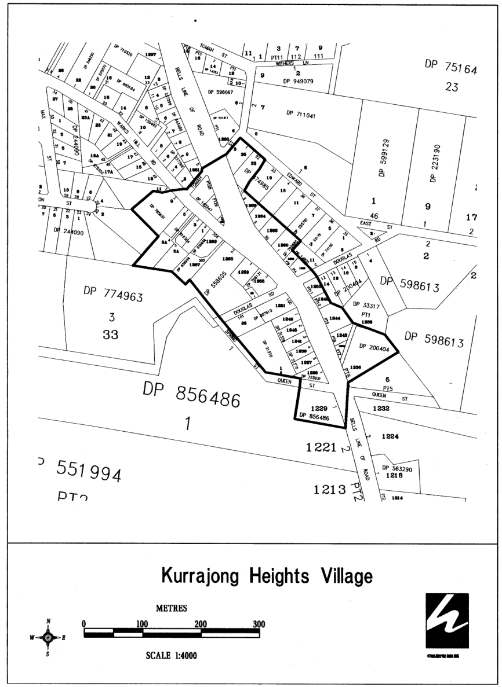

### 1.1 INTRODUCTION

Kurrajong Heights is an important village in the Hawkesbury local government area.  The establishment of the village is linked with the discovery of the second route over the mountains.  In September 1823, Archibald Bell Junior blazed a route which is virtually that followed by the Bells Line of Road today.  Many legacies of the past are still physically evident in the village and tell the story of its evolution.  Such legacies contribute to the inherent character and heritage significance of the village.

> [Picture on page 7: a picture, saved as a picture (images/part-e-specific-areas-page-7-12.gif, 150 dpi).]

This chapter of the Hawkesbury DCP has been prepared to conserve the character and heritage significance of Kurrajong Heights Village and provide an appropriate framework for new development.  With careful management, the character and significance of the village can be retained and reinforced for the benefit of future generations.

Objectives and rules in this chapter will ensure that new development does not comprise or detract from the existing natural or built environment.  Rather that the character and significance of the village will be conserved and protected.

The preparation of this chapter of the DCP reinforces Council's commitment to heritage conservation not only in Kurrajong Heights Village but also within the wider City.  It is hoped that the objectives and guidelines in the plan will foster new development which is compatible in scale form and character with the village and its hinterland.

This chapter of the DCP applies to land defined as Kurrajong Heights Village, including  land bounded to the south by the church, to the east by properties fronting the Bells Line of Road, to the north by Tomah Street and to the west by "Belmore Lodge".  A plan illustrating  land encompassed by this chapter appears on the next page.

___________________________________________________________________________________________________KURRAJONG HEIGHTS VILLAGE

#### Figure E1.1 Plan of the area

> [Picture on page 8: a picture, saved as a picture (images/part-e-specific-areas-page-8-2.gif, 150 dpi).]

KURRAJONG HEIGHTS VILLAGE ___________________________________________________________________________________________________
