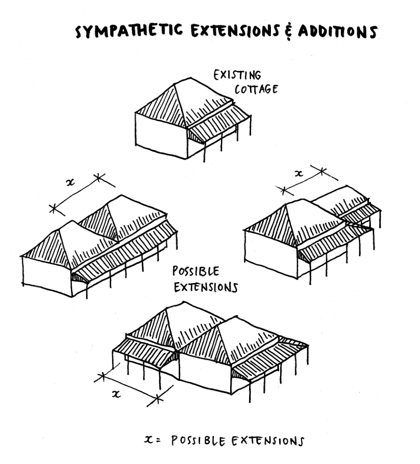
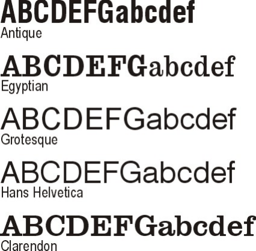

### 1.4 VILLAGE CHARACTER

A number of individual elements contribute to the character of Kurrajong Heights Village.  These are:

ƒ individual vernacular nineteenth century buildings with hipped roofs, verandas with spaced posts and weatherboard walls;

ƒ the juxtaposition of vernacular buildings separated by open space;

ƒ open spaces;

ƒ exotic planting; ƒ bush hinterland;

ƒ views and vistas;

ƒ landmarks; and ƒ rural and picket fencing.

#### Aims

‰ To conserve and enhance the historic, visual and environmental elements and townscape qualities that contribute to the distinctive character of Kurrajong Heights Village.

#### Objectives

¾ Conserve sites, buildings, structures and artefacts that contribute to the character and significance of the village.

¾ Retain the visual amenity of the village. ¾ New development shall not interrupt or destroy the setting of buildings, village, skylines, townscape details and landmarks.

¾ New development shall positively contribute to and reinforce the character of the village. Design principles to be addressed in any new development include: à relationship to neighbouring buildings; à line of vision – skyline and setback; à roof form; à bulk and scale; à windows and doors; à verandas; à wall and roof finishes; à fences;

KURRAJONG HEIGHTS VILLAGE ___________________________________________________________________________________________________

à landscaping; à architectural detail; and à car accommodation.

¾ Fencing should maintain character of existing fencing.

¾ Commercial and other advertising signage shall be well located on buildings and

> [Picture on page 11: a picture, saved as a picture (images/part-e-specific-areas-page-11-6.gif, 150 dpi).]

sympathetic to traditional techniques and styles.

#### Rules

(a) Traditional fencing in the village shall be retained, repaired or reinstated.  New fencing shall be based on traditional designs.

(b) Open timber picket paling fencing with supporting posts shall be provided.  Brick, asbestos cement, corrugated iron or cyclone mesh fencing shall not be

used.  For larger areas, split post and rail should be used.

(c) Signs shall relate to commercial advertising of the 1850 - 1900 period.  Restoration or reconstruction of early signs, where physical evidence exists is encouraged.  For authenticity, the most important aspects to consider are typeface and location on the building.

(d) Signs that are clear, simple and symmetrical. Upper case lettering located on spandrels closing the verandah, horizontal fascia or trimming boards and along the outer edge of the verandah facing the street.  Signs are not to be placed on the structural elements of a building such as pilasters and architraves, or across the country side.

(e) The number of signs limited for each establishment.  Size of the sign will be dependent on its location.  Freestanding signs shall be a maximum of 1.5 metres x 1 metre.

(f) Street furniture including litter bins, seats and bus shelters to be consistent with village character.  Wherever possible existing low grade and inappropriate street furniture shall be replaced with standard street furniture.  New shelters erected in the village shall be sympathetic to its character ie. simple hipped galvanised iron roof with timber support posts and detailing.

___________________________________________________________________________________________________KURRAJONG HEIGHTS VILLAGE

#### Figure E1.2

> [Picture on page 12: a picture, saved as a picture (images/part-e-specific-areas-page-12-2.gif, 150 dpi).]

In terms of signs, the National Trust of Australia (Victoria) Technical Bulletin for Lettering and Signs on buildings circa 1850 - 1900 advises:

“The most common type faces appear to have been:

Egyptian (Antique), Ionic (Fat Clarendon) and Grotesque (Sans Serif).  These faces were normally based on a square section for each letter and the letters were not compressed in bold displays required on the exterior of the building."

The following examples of modern type face are considered appropriate for signage in the village:

KURRAJONG HEIGHTS VILLAGE ___________________________________________________________________________________________________

> [Picture on page 13: a picture, saved as a picture (images/part-e-specific-areas-page-13-1.gif, 150 dpi).]

> [Picture on page 13: a picture, saved as a picture (images/part-e-specific-areas-page-13-2.gif, 150 dpi).]
