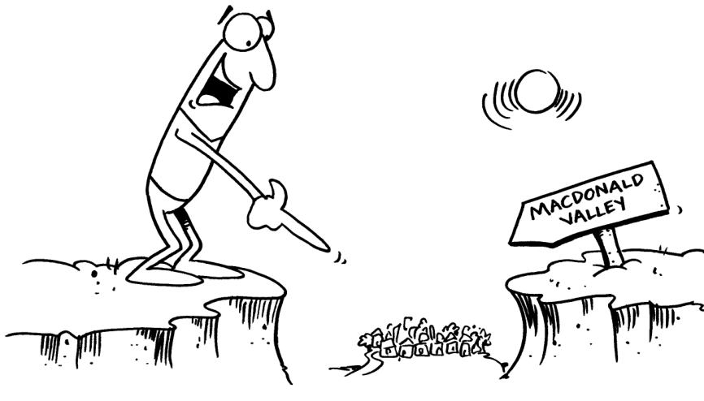

### 1.9 CONCLUSION

The village of Kurrajong Heights retains much of its early vernacular architecture and as a consequence has inherent character and significance.

As the population of the City grows increased development pressure will be placed on Kurrajong Heights Village.  Guidelines and objectives outlined in this plan will ensure that new development can occur in the village without compromise of its special character and significance.

___________________________________________________________________________________________________KURRAJONG HEIGHTS VILLAGE

Chapter 2 MACDONALD VALLEY

> [Picture on page 19: a picture, saved as a picture (images/part-e-specific-areas-page-19-3.gif, 150 dpi).]
