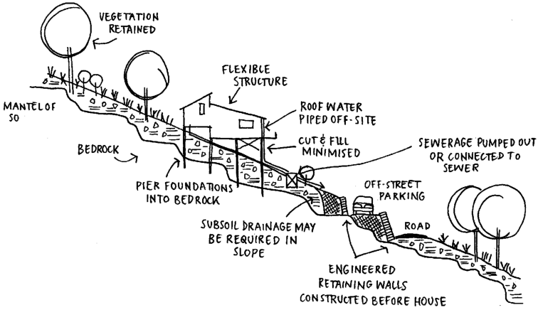
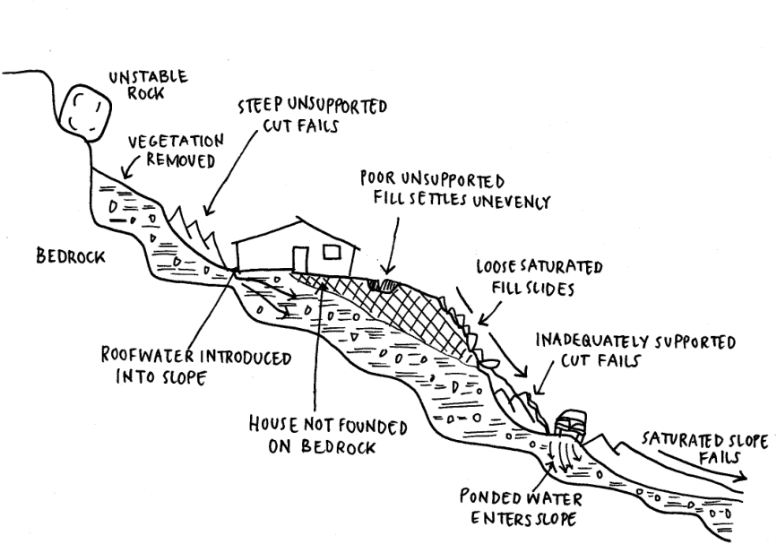

### 2.2 SITING

ƒ Council will not permit development on exposed ridgelines nor the laying of slab foundations on steeply sloping ground (slopes greater than 10°).  On such slopes, Council will approve the construction, (subject to appropriate soil stability tests) of split-level or pole homes only.

ƒ Buildings should be located on natural benches below ridgelines.  On elevated sites requiring levelling, Council must be satisfied, (as a result of soil and slope tests), that cut-and-fill earthworks will adequately support building foundations.  These prohibitions and precautions are aimed at protecting ridgelines, reducing earthworks, and avoiding erosion and land slip.

#### Figure E2.1 Example of Good Hillside Practice on Steep/Unstable Sites

> [Picture on page 21: a picture, saved as a picture (images/part-e-specific-areas-page-21-16.gif, 150 dpi).]

____________________________________________________________________________________________________________MACDONALD VALLEY

#### Figure E2.2 Example of Poor Hillside Practice

> [Picture on page 22: a picture, saved as a picture (images/part-e-specific-areas-page-22-2.gif, 150 dpi).]

ƒ Driveways should follow natural contours to avoid erosion, to minimise visual impact and to minimise maintenance costs.  Diversionary spillways or drains must be provided.

ƒ All buildings should be sited to provide buffer zones and access from all sides in the event of fire.

ƒ In the St Albans village area, buildings should be well clear of boundaries and adjoining structures, so sited that vehicle access can be gained, as appropriate, from front or rear of allotments.
