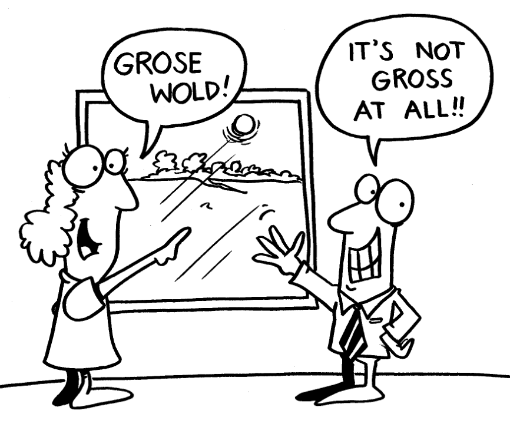

### 2.3 BUILDING DESIGN AND MATERIALS

ƒ New buildings need not follow historic styles and designs.  Council regards innovative design, imaginative use of materials, maintenance of a “village” atmosphere, and protection of natural beauty, as equally essential and challenging aspects of the Macdonald Valley’s special character.

MACDONALD VALLEY ____________________________________________________________________________________________________________

ƒ Within St Albans village, Council will not approve building of more than two storeys, with roof ridges more than 8 metres above natural ground level, or with roofs pitched at less than 221/2°.  Elsewhere in the valley, roofs should be gently pitched (12°-21°) rather than flat, the increase in exposure to radiation being offset, in the event of bushfire, by the creation of an updraft sufficient to carry the fire over the building. Council recommends the installation of fixed roof sprinkler systems – this may reduce house insurance costs.

ƒ Throughout the Valley, the preferred roofing material, on aesthetic, fire mitigation, and practical (water catchment) grounds, is corrugated iron.  Terra-cotta and cement tiles will not be approved on aesthetic grounds, wooden shingles only after review of potential fire risks.  All chimneys and flues must be capped.

ƒ Throughout the Valley, the external walls have traditionally been constructed from ironbark slabs, hardwood boards, weatherboard, sandstone, and corrugated iron. Council will readily approve sympathetic use of these materials.  The use of other materials will be closely scrutinised.  In high fire risk zones, however, the use of timber walling may limit the potential for planting trees and shrubs close to a house.  Under-floor areas must be fully enclosed by screen-backed lattice or an acceptable alternative; exposed timber floor joists must not extend through walls to form external decking ( thereby reducing the fire protection afforded by the external walls).

ƒ Within the village area, windows should be vertical in proportion, total window space less than 30% of wall surface, larger glazed areas permissible only if screened by verandas.  Elsewhere in the Valley, doorways should be positioned in protected elevations, window openings kept to a minimum in exposed elevations.  Council recommends that all windows be protected by hinged shutters, and ventilation openings screened with metal gauze.

____________________________________________________________________________________________________________MACDONALD VALLEY

Chapter 3 GROSE WOLD

> [Picture on page 25: a picture, saved as a picture (images/part-e-specific-areas-page-25-3.gif, 150 dpi).]
