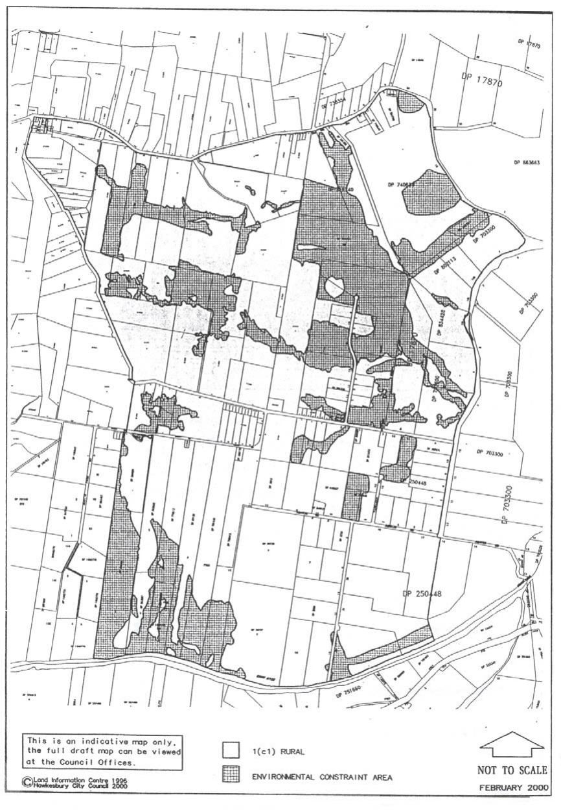
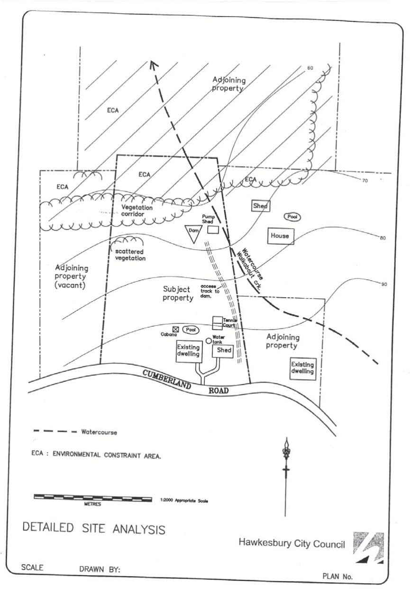

### 3.2 SITE ANALYSIS

The first step towards determining the most appropriate development for the site is to undertake an detailed site analysis.

#### Objectives

¾ To ensure that development occurs in the most suitable location on the subject land.

#### Rules

(a) Preparation of plan drawn to scale showing: à Appropriate scale, north point and site area. à Location of subject land with respect to adjoining allotments and roads. à Location and uses of existing buildings, including sheds, tennis court, horse yards.

à Location of all vegetation, Environmental Constraint Area, watercourses, dams, drainage lines, rock outcrops and escarpments.

à Location of services. à Location of access to the site, including any rights of carriageway.

(b) The site analysis should then identify the following: à Plan of proposed subdivision, including access to the proposed lots. à Dimensions of the proposed subdivision. à Details of any proposed roads, including long section and a cross sectional drawing.

à Building envelope. à Details of any associated works such as drainage, earthmoving or fill.

___________________________________________________________________________________________________________________GROSE WOLD

#### Figure E3.1 Plan of the Area

> [Picture on page 28: a picture, saved as a picture (images/part-e-specific-areas-page-28-2.gif, 150 dpi).]

GROSE WOLD __________________________________________________________________________________________________________________

#### Figure E3.2 Gives an example of a detailed site analysis

> [Picture on page 29: a picture, saved as a picture (images/part-e-specific-areas-page-29-2.gif, 150 dpi).]

___________________________________________________________________________________________________________________GROSE WOLD
